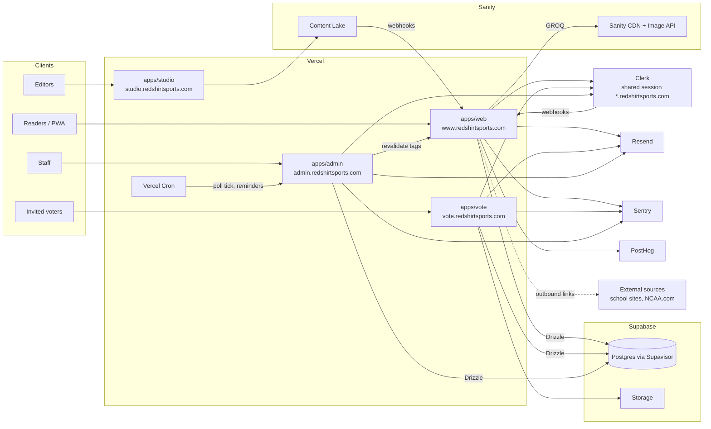

## 4. Architecture overview

**Key principles**

1. **Server-first reads.** Public pages read Sanity and Postgres on the server and cache aggressively with tags. The browser does not query Supabase in the MVP (Storage uploads use signed URLs).
2. **One write path per domain.** Ballots are written only through `submitBallot()`; picks only through `saveBracketEntry()`; results only through `setBracketGameResult()`. All are Drizzle transactions in `packages/db` that take row locks and enforce lock times, called from server actions that validate with zod.
3. **Postgres enforces invariants.** One ballot per voter per poll week, one bracket event per sport/division/season, one entry per user per group, rank uniqueness: constraints, not just app checks.
4. **Derived data is recomputable.** Poll results, bracket scores and leaderboards can be rebuilt from ballots, picks and admin-entered results at any time. Audits and corrections are safe.
5. **Content and data join by canonical IDs.** Sanity `school` documents carry the canonical `schoolId` used in Postgres, so a team hub joins both worlds without fuzzy matching.
6. **Own what's unique, link to what's commodity.** Redshirt owns polls, brackets and journalism; schedules, scores and rosters are links.
