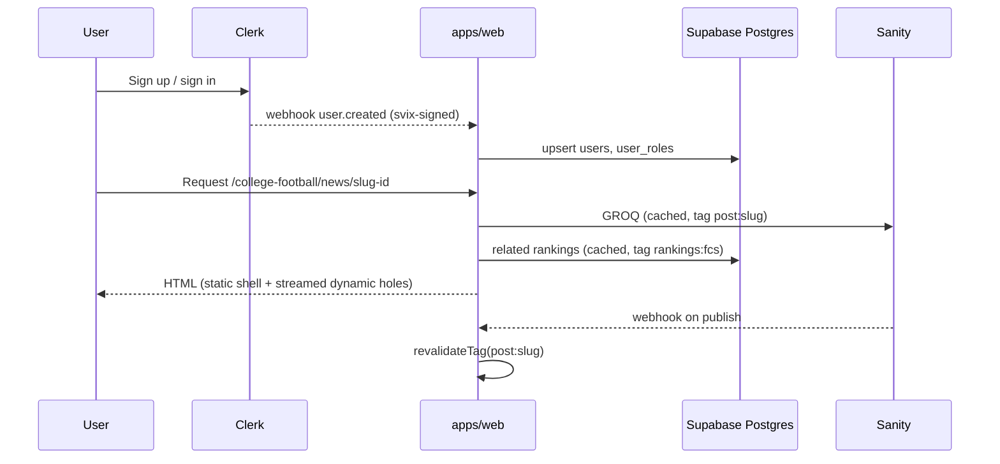

## 5. System responsibility split

### 5.1 The rule of thumb

> **If an editor writes it, it lives in Sanity. If a user or a machine writes it, or it needs a transaction, a constraint, or an aggregate, it lives in Postgres. If it answers "who is this person and what may they do", Clerk is the source of truth and Postgres keeps a mirror.**

### 5.2 Ownership table

| Entity | Source of truth | Mirror / reference | Notes |
|---|---|---|---|
| Article, podcast episode, video, gallery, one-off page (page builder) | Sanity | Optional Postgres `content_index` for search/analytics joins | Sanity webhooks push slug + ids for sitemaps |
| Person (writers, editors, photographers, hosts, staff, optional voter profiles) | Sanity `person` | Postgres `users.sanity_person_id`, `voters.sanity_person_id` | One profile per human; bylines, credits and hosts reference it (§12.7) |
| One-off pages (About, Contact, Privacy, Terms, Ethics, Advertise, Careers) | Sanity `page` (page builder) | Postgres `contact_submissions` for form entries | §12.8 |
| School (editorial: logo, colors, nicknames, bio, social) | Sanity `school` doc | Postgres `schools` (canonical id, slugs, division membership) | Sanity holds `schoolId` field equal to Postgres `schools.id` |
| Conference (editorial) | Sanity `conference` | Postgres `conferences` + `conference_memberships` by season | Membership changes by season live in Postgres |
| Division, sport, season, week | Postgres | Sanity references by string key | E.g. `sport='cfb'`, `division='fcs'` |
| Users | Clerk | Postgres `users` mirror via webhook | Postgres needs FK targets for ballots and entries |
| Roles (admin, editor, voter, moderator) | Clerk `publicMetadata.roles` + org roles | Postgres `user_roles` mirror | RLS reads JWT claims; server code reads Postgres |
| Voter status | Postgres `voters` (created only by accepting an admin invite) and `voter_invites` | Clerk `publicMetadata.roles` gets `voter`, mirrored to `user_roles` by webhook | Postgres is the source of truth per poll and season (§13.4) |
| Ballots, poll results | Postgres | Sanity optional `pollRelease` doc for the written commentary | Commentary article references `pollWeekId` |
| Brackets, picks, groups, leaderboards, admin-entered results | Postgres | Sanity `bracketPromo` for marketing blocks | Results are staff-entered; no feed (§14.11) |
| Subscriptions, entitlements | Clerk Billing or Stripe | Postgres `entitlements` mirror | Paywall checks read session claims first |
| Newsletter subscribers | Postgres `newsletter_subscriptions` | Resend audiences / contacts | Resend for delivery |

### 5.3 Data flow between systems

### 5.4 Why not put everything in one system?

- **Sanity as a database for ballots or picks** would lose transactions, uniqueness constraints and cheap aggregates; mutation rate limits and per-document costs also make high-write traffic a poor fit.
- **Postgres as a CMS** would lose the editorial UX (real-time collaboration, Portable Text, image hotspots, scheduled publishing, previews).
- **Clerk as the user database** is fine for identity but you cannot join Clerk to Postgres in SQL; hence the mirror.
