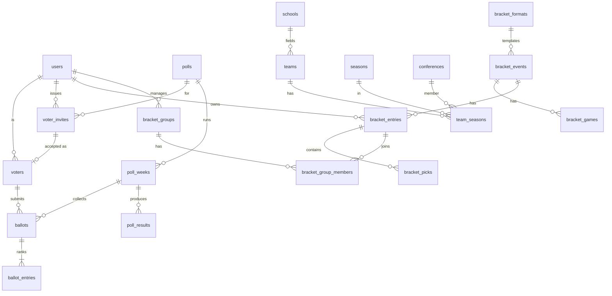

## 10. Postgres schema and the Drizzle data access layer

**Source of truth: the Drizzle schema.** Tables, columns, indexes, constraints, RLS enablement and policies are declared in TypeScript in `packages/db/src/schema/*.ts`, and `drizzle-kit generate` turns them into SQL migrations. The SQL DDL in §10.1–10.9 is the **generated shape**, shown as SQL so reviewers can read it and pgTAP tests can be written against it. Anything Drizzle cannot declare (functions, triggers, materialized views and their refresh, `pg_cron` schedules, extensions, function grants) goes into **custom migrations** (`drizzle-kit generate --custom`) in the same folder, so there is one linear migration history. §10.10–10.16 cover the Drizzle side: package layout, config, schema code, RLS wiring, pooling, typed queries and where supabase-js is still used.

Conventions: snake_case; `uuid` PKs via `gen_random_uuid()` for domain entities; `text` for Clerk user ids; `timestamptz` everywhere; `created_at`/`updated_at` on mutable tables with a shared trigger; check constraints instead of Postgres enums (easier to evolve); all foreign keys indexed.

### 10.1 Extensions and helpers

```sql
create extension if not exists pgcrypto;
create extension if not exists pg_trgm;
create extension if not exists citext;
create extension if not exists pg_cron;      -- enable in dashboard
create extension if not exists pg_net;       -- for cron → edge function calls

create schema if not exists app;             -- private helper functions, not exposed via Data API

create or replace function app.set_updated_at() returns trigger language plpgsql as $$
begin new.updated_at = now(); return new; end $$;

-- Current Clerk user id from the JWT (null for anon)
create or replace function app.uid() returns text language sql stable as $$
  select nullif(auth.jwt() ->> 'sub', '')
$$;

-- Role check from JWT claims (staff roles in Clerk publicMetadata.roles)
create or replace function app.has_role(r text) returns boolean language sql stable as $$
  select coalesce((auth.jwt() -> 'roles') ? r, false)
      or coalesce((auth.jwt() -> 'roles') ? 'admin', false)
$$;
```

### 10.2 Users and roles

```sql
create table users (
  id text primary key,                         -- Clerk user id
  email citext,
  first_name text,
  last_name text,
  display_name text generated always as (
    coalesce(first_name,'') || case when last_name is not null and last_name <> '' then ' ' || left(last_name,1) || '.' else '' end
  ) stored,
  image_url text,
  sanity_person_id text,                       -- Sanity person doc link
  clerk_updated_at timestamptz,
  deleted_at timestamptz,
  created_at timestamptz not null default now(),
  updated_at timestamptz not null default now()
);
create unique index users_email_uq on users (email) where deleted_at is null;
create trigger users_updated before update on users for each row execute function app.set_updated_at();

create table user_roles (
  user_id text not null references users(id) on delete cascade,
  role text not null check (role in ('admin','editor','contributor','poll_admin','bracket_admin','data_admin','moderator','voter')),
  granted_by text references users(id),
  granted_at timestamptz not null default now(),
  primary key (user_id, role)
);

create table user_follows (                    -- teams, conferences, divisions, people (§31.3)
  user_id text not null references users(id) on delete cascade,
  target_type text not null check (target_type in ('school','team','conference','division','person')),  -- 'school' = all sports
  target_id text not null,                     -- team uuid, conference id, 'cfb:fcs', Sanity person _id
  notify_push boolean not null default false,
  notify_email boolean not null default true,
  created_at timestamptz not null default now(),
  primary key (user_id, target_type, target_id)
);
create index on user_follows (target_type, target_id);

create table saved_items (                     -- saved articles (§31.8)
  user_id text not null references users(id) on delete cascade,
  sanity_id text not null,
  saved_at timestamptz not null default now(),
  primary key (user_id, sanity_id)
);

create table webhook_events (
  id text primary key,                         -- svix-id or sanity transaction id
  source text not null,
  type text not null,
  received_at timestamptz not null default now(),
  processed_at timestamptz,
  error text
);
```

### 10.3 Sports reference data

```sql
create table sports (
  code text primary key check (code in ('cfb','mbb','wbb')),
  name text not null
);

create table divisions (
  sport text not null references sports(code),
  code text not null,                          -- fbs, fcs, d2, d3, naia, d1
  name text not null,
  sort_order int not null,
  primary key (sport, code)
);

create table schools (
  id uuid primary key default gen_random_uuid(),
  slug text not null unique                    -- public team-hub slug: "montana-state-bobcats" → /teams/montana-state-bobcats
    check (slug ~ '^[a-z0-9]+(-[a-z0-9]+)*$'),
  short_slug text not null unique,             -- "montana-state" (internal lookups, legacy mapping; never in URLs)
  name text not null,                          -- "Montana State University"
  short_name text not null,                    -- "Montana State"
  abbreviation text,                           -- "MTST"
  mascot text not null,                        -- "Bobcats" (nickname; part of the slug)
  city text, state text, country text default 'US',
  sanity_id text unique,                       -- Sanity school _id
  created_at timestamptz not null default now(),
  updated_at timestamptz not null default now()
);
create index schools_name_trgm on schools using gin (short_name gin_trgm_ops);
create trigger schools_updated before update on schools for each row execute function app.set_updated_at();

-- Team-hub slugs are immutable (no redirects, §17). Block updates; a real rebrand is a one-off migration
-- plus a manual legacy 301 row (§27).
create or replace function app.schools_slug_immutable() returns trigger language plpgsql as $$
begin
  if new.slug <> old.slug then raise exception 'schools.slug is immutable'; end if;
  return new;
end $$;
create trigger schools_slug_lock before update of slug on schools for each row execute function app.schools_slug_immutable();

-- One row per sport a school plays. The public sport section is /teams/{schools.slug}/{SPORTS[sport].teamPath}
-- (football | mens-basketball | womens-basketball); no slug of its own.
create table teams (
  id uuid primary key default gen_random_uuid(),
  school_id uuid not null references schools(id),
  sport text not null references sports(code),
  unique (school_id, sport)
);
-- user_follows.target_id is polymorphic (no FK); a nightly job deletes follows whose target no longer exists.

create table conferences (
  id uuid primary key default gen_random_uuid(),
  slug text not null unique,                   -- "big-sky"
  name text not null,
  short_name text,
  sanity_id text unique
);

create table seasons (
  id text primary key,                         -- 'cfb-2026', 'mbb-2026'
  sport text not null references sports(code),
  year int not null,
  display_label text not null,                 -- '2026' or '2026-27'
  starts_on date, ends_on date,
  unique (sport, year)
);

create table weeks (
  id uuid primary key default gen_random_uuid(),
  season_id text not null references seasons(id),
  season_type text not null default 'regular' check (season_type in ('preseason','regular','postseason')),
  number int not null,                         -- 0..16 regular; postseason uses 1..n
  label text not null,                         -- 'Week 7', 'Preseason', 'Final'
  starts_at timestamptz not null,
  ends_at timestamptz not null,
  unique (season_id, season_type, number)
);

create table team_seasons (
  team_id uuid not null references teams(id),
  season_id text not null references seasons(id),
  division text not null,
  conference_id uuid references conferences(id),
  is_transitional boolean not null default false,  -- reclassifying teams (e.g. postseason-ineligible)
  postseason_eligible boolean not null default true,
  head_coach text,
  primary key (team_id, season_id)
);
create index team_seasons_div on team_seasons (season_id, division);
create index team_seasons_conf on team_seasons (season_id, conference_id);

create table venues (
  id uuid primary key default gen_random_uuid(),
  name text not null, city text, state text, capacity int,
  timezone text                                -- IANA, e.g. 'America/Denver'
);
```

### 10.4 Games and scores — removed

There is no `games`, `game_events`, `team_game_stats`, `standings` or `ingestion_runs` table. Bracket games are `bracket_games` (§10.6). Hub "schedule / scores / standings / roster" tabs are outbound-link cards configured on the Sanity `school` / `conference` documents (§15).

### 10.5 Polls

```sql
create table polls (
  id uuid primary key default gen_random_uuid(),
  slug text not null unique,                   -- 'cfb-fbs', 'cfb-fcs', 'mbb-d1', 'wbb-d1'
  sport text not null references sports(code),
  division text not null,
  name text not null,                          -- 'Redshirt Sports FCS Top 25'
  size int not null default 25 check (size between 5 and 50),
  allow_ineligible boolean not null default false,  -- may voters rank postseason-ineligible teams?
  is_active boolean not null default true,
  foreign key (sport, division) references divisions(sport, code)
);

create table poll_weeks (
  id uuid primary key default gen_random_uuid(),
  poll_id uuid not null references polls(id),
  season_id text not null references seasons(id),
  week_number int not null,                    -- 0 = preseason; final poll uses a high number with label
  label text not null,                         -- 'Preseason', 'Week 7', 'Final'
  opens_at timestamptz not null,
  closes_at timestamptz not null,
  publish_at timestamptz,                      -- scheduled public release
  status text not null default 'draft'
    check (status in ('draft','open','closed','tabulated','published','voided')),
  tabulated_at timestamptz,
  published_at timestamptz,
  published_by text references users(id),
  notes text,
  unique (poll_id, season_id, week_number),
  check (closes_at > opens_at)
);
create index poll_weeks_status on poll_weeks (status, closes_at);

create table voter_invites (                   -- invite-only onboarding (§13.4); no public applications
  id uuid primary key default gen_random_uuid(),
  email citext not null,
  poll_id uuid not null references polls(id),
  season_id text not null references seasons(id),
  public_name text, outlet text, note text,
  token_hash text not null,                    -- sha256 of the nonce in the signed token
  expires_at timestamptz not null,
  status text not null default 'pending' check (status in ('pending','accepted','revoked','expired')),
  allow_any_email boolean not null default false,
  invited_by text not null references users(id),
  sent_count int not null default 1,
  last_sent_at timestamptz not null default now(),
  accepted_by text references users(id), accepted_at timestamptz,
  revoked_by text references users(id), revoked_at timestamptz,
  created_at timestamptz not null default now(),
  updated_at timestamptz not null default now()
);
create unique index voter_invites_one_pending on voter_invites (email, poll_id, season_id) where status = 'pending';
create index on voter_invites (poll_id, season_id, status);

create table voters (
  id uuid primary key default gen_random_uuid(),
  user_id text not null references users(id),
  poll_id uuid not null references polls(id),
  season_id text not null references seasons(id),  -- membership is per season; rosters renew each year
  invite_id uuid references voter_invites(id),
  slug text not null,                          -- public URL segment for ballot pages
  public_name text not null,                   -- shown on transparency pages
  outlet text,
  bio text,
  avatar_path text,                            -- Supabase Storage object path
  conflicts text[] not null default '{}',      -- disclosed school slugs / affiliations (shown publicly)
  sanity_person_id text,                       -- optional person profile (/people/{slug})
  code_of_conduct_version text not null,
  status text not null default 'active' check (status in ('active','suspended','revoked')),
  added_by text references users(id),          -- the admin who issued the invite
  joined_at timestamptz not null default now(),
  revoked_at timestamptz, revoked_by text references users(id), revoked_reason text,
  missed_weeks int not null default 0,
  unique (user_id, poll_id, season_id),
  unique (poll_id, season_id, slug)
);

create table ballots (
  id uuid primary key default gen_random_uuid(),
  poll_week_id uuid not null references poll_weeks(id),
  voter_id uuid not null references voters(id),
  status text not null default 'draft' check (status in ('draft','submitted','locked','voided')),
  submitted_at timestamptz,
  locked_at timestamptz,
  voided_reason text,
  revision int not null default 1,
  client_fingerprint text,                     -- hashed UA + IP prefix, anti-abuse only
  created_at timestamptz not null default now(),
  updated_at timestamptz not null default now(),
  unique (poll_week_id, voter_id)
);
create trigger ballots_updated before update on ballots for each row execute function app.set_updated_at();

create table ballot_entries (
  ballot_id uuid not null references ballots(id) on delete cascade,
  rank int not null,
  team_id uuid not null references teams(id),
  comment text check (char_length(comment) <= 280),
  primary key (ballot_id, rank),
  unique (ballot_id, team_id)
);
create index ballot_entries_team on ballot_entries (team_id);

create table ballot_revisions (                -- immutable history of every save
  id bigint generated always as identity primary key,
  ballot_id uuid not null references ballots(id) on delete cascade,
  revision int not null,
  entries jsonb not null,                      -- [{rank, team_id}]
  saved_at timestamptz not null default now(),
  saved_by text not null
);

create table poll_results (
  poll_week_id uuid not null references poll_weeks(id) on delete cascade,
  team_id uuid not null references teams(id),
  rank int,                                    -- null for 'others receiving votes'
  points int not null,
  first_place_votes int not null default 0,
  ballots_listed int not null,                 -- how many ballots included the team
  highest_rank int not null,
  lowest_rank int not null,
  previous_rank int,                           -- null = unranked last week
  movement int,                                -- previous_rank - rank (positive = up)
  is_new boolean not null default false,
  record_wins int, record_losses int, record_ties int,   -- snapshot at publish
  primary key (poll_week_id, team_id)
);
create index poll_results_rank on poll_results (poll_week_id, rank);

create table poll_week_summaries (
  poll_week_id uuid primary key references poll_weeks(id) on delete cascade,
  ballots_counted int not null,
  ballots_voided int not null default 0,
  dropped_out uuid[] not null default '{}',    -- teams ranked last week, unranked now
  consensus_index numeric(5,4),                -- e.g. mean Spearman correlation vs final
  computed_hash text not null                  -- sha256 of inputs for reproducibility
);

create table poll_audit_log (
  id bigint generated always as identity primary key,
  poll_week_id uuid references poll_weeks(id),
  ballot_id uuid references ballots(id),
  actor_id text,
  voter_id uuid references voters(id),
  invite_id uuid references voter_invites(id),
  action text not null,                        -- 'ballot.submit','ballot.void','week.open','week.publish','invite.create','invite.accept','invite.revoke','voter.revoke',...
  detail jsonb,
  ip_hash text,
  at timestamptz not null default now()
);
create index poll_audit_week on poll_audit_log (poll_week_id, at);
```

### 10.6 Brackets

```sql
create table bracket_formats (
  code text primary key,                       -- 'fcs24','cfp12','d2_28','d3_32','ncaab68'
  name text not null,
  sport text not null references sports(code),
  team_count int not null,
  game_count int not null,
  rounds int not null,
  definition jsonb not null,                   -- slots + feeds, generated from @rs/brackets registry
  version int not null default 1
);

create table bracket_events (
  id uuid primary key default gen_random_uuid(),
  -- Public URL: /{sport-path}/bracket-challenge/{division}/{year}
  -- Exactly one event per sport + division + season (enforced below).
  sport text not null references sports(code), -- 'cfb'
  division text not null,                      -- 'fbs' (CFP format), 'fcs', 'd2', 'd3'
  season_id text not null references seasons(id),
  year int not null,                           -- denormalized for URLs; must match seasons.year
  format_code text not null references bracket_formats(code),
  name text not null,                          -- '2026 FCS Bracket Challenge'
  status text not null default 'draft'
    check (status in ('draft','field_set','open','locked','in_progress','complete','archived')),
  opens_at timestamptz,
  lock_at timestamptz not null,                -- first game kickoff; staff-set
  lock_mode text not null default 'full' check (lock_mode = 'full'),  -- per_round dropped in 1.2
  scoring_system text not null default 'standard',
  scoring_config jsonb not null,
  tiebreaker text not null default 'title_total' check (tiebreaker in ('title_total','title_margin','none')),
  sponsor jsonb,
  max_entries_per_user int not null default 1,
  created_at timestamptz not null default now(),
  updated_at timestamptz not null default now(),
  unique (sport, division, season_id),
  foreign key (sport, division) references divisions(sport, code)
);

create table bracket_slots (                   -- concrete field: who is in which seed/slot for this event
  event_id uuid not null references bracket_events(id) on delete cascade,
  slot_code text not null,                     -- 'R1G1H', 'SEED1', 'FF1A' ... defined by format
  team_id uuid references teams(id),           -- null until set
  seed int,
  region text,
  primary key (event_id, slot_code)
);

create table bracket_games (                   -- one row per format game per event; results are staff-entered
  event_id uuid not null references bracket_events(id) on delete cascade,
  game_code text not null,                     -- 'R1G1'...'F'
  round int not null,
  label text,                                  -- bowl name, "First Round", etc.
  starts_at timestamptz,                       -- informational (for countdown); does not auto-score
  winner_team_id uuid references teams(id),
  loser_team_id uuid references teams(id),
  home_score int, away_score int,              -- optional display; scoring uses winner only
  status text not null default 'pending' check (status in ('pending','final')),
  result_set_by text references users(id),
  result_set_at timestamptz,
  primary key (event_id, game_code)
);

create table bracket_groups (
  id uuid primary key default gen_random_uuid(),
  event_id uuid not null references bracket_events(id) on delete cascade,
  name text not null check (char_length(name) between 3 and 60),
  slug text,                                   -- for public groups
  manager_id text not null references users(id),
  visibility text not null default 'private' check (visibility in ('private','public','system')),
  invite_code text not null unique,            -- 8+ chars, base32 without ambiguous chars
  password_hash text,                          -- optional extra gate for public groups
  max_members int not null default 500,
  allow_multiple_entries boolean not null default false,
  is_sponsored boolean not null default false,
  created_at timestamptz not null default now()
);
create index bracket_groups_event on bracket_groups (event_id);

create table bracket_entries (
  id uuid primary key default gen_random_uuid(),
  event_id uuid not null references bracket_events(id) on delete cascade,
  user_id text not null references users(id),
  name text not null check (char_length(name) between 1 and 40),
  tiebreaker_value int check (tiebreaker_value between 0 and 200),
  status text not null default 'incomplete' check (status in ('incomplete','complete','locked','disqualified')),
  submitted_at timestamptz,
  score int not null default 0,
  max_possible int not null default 0,
  correct_picks int not null default 0,
  round_points int[] not null default '{}',
  scored_at timestamptz,
  created_at timestamptz not null default now(),
  updated_at timestamptz not null default now()
);
create index bracket_entries_event_score on bracket_entries (event_id, score desc);
create index bracket_entries_user on bracket_entries (user_id, event_id);

create table bracket_picks (
  entry_id uuid not null references bracket_entries(id) on delete cascade,
  game_code text not null,
  picked_team_id uuid not null references teams(id),
  primary key (entry_id, game_code)
);

create table bracket_group_members (
  group_id uuid not null references bracket_groups(id) on delete cascade,
  entry_id uuid not null references bracket_entries(id) on delete cascade,
  user_id text not null references users(id),
  joined_at timestamptz not null default now(),
  primary key (group_id, entry_id)
);
create unique index bgm_one_entry_per_user on bracket_group_members (group_id, user_id);  -- drop if allow_multiple_entries
create index bgm_user on bracket_group_members (user_id);

create table bracket_audit_log (
  id bigint generated always as identity primary key,
  event_id uuid references bracket_events(id),
  entry_id uuid,
  actor_id text,
  action text not null,
  detail jsonb,
  at timestamptz not null default now()
);
```

### 10.7 Recruiting and portal — removed

No `players`, `roster_spots`, `recruit_*` or `portal_entries` tables. Cover those topics with articles tagged to schools.

### 10.7a Redirects and admin-entered team records

```sql
-- Legacy redirects ONLY: one-time 301s from old Redshirt URLs (§27). Read by the root catch-all fallback.
-- The app never redirects its own URLs (slugs are immutable after publish).
create table redirects (
  source_path text primary key,                -- old Redshirt path, e.g. '/my-old-article-slug'
  destination_path text not null,              -- '/college-football/news/my-old-article-slug'
  status_code int not null default 308 check (status_code in (301, 308)),  -- Next.js permanentRedirect/permanent:true emit 308; both are permanent
  reason text not null default 'legacy' check (reason in ('legacy','manual_legacy')),
  hits bigint not null default 0,
  last_hit_at timestamptz,
  created_at timestamptz not null default now(),
  check (source_path <> destination_path)
);
create index on redirects (destination_path);   -- collapse chains on insert (A→B, B→C ⇒ A→C)

-- Optional W-L record shown on poll pages. Admin-entered per poll week; no data feed.
create table poll_week_team_records (
  poll_week_id uuid not null references poll_weeks(id) on delete cascade,
  team_id uuid not null references teams(id),
  wins int not null check (wins >= 0),
  losses int not null check (losses >= 0),
  ties int not null default 0 check (ties >= 0),
  entered_by text references users(id),
  entered_at timestamptz not null default now(),
  primary key (poll_week_id, team_id)
);
```

Drizzle: `redirects` and `pollWeekTeamRecords` live in `schema/content.ts` and `schema/polls.ts`. RLS: enabled, no client policies (server reads only).

```ts
// packages/db/src/queries/redirects.ts
import { eq, sql } from "drizzle-orm";
import { cacheTag, cacheLife } from "next/cache";
import { adminDb } from "../client";
import { redirects } from "../schema";

export async function lookupRedirect(path: string): Promise<string | null> {
  "use cache";
  cacheTag("redirects");
  cacheLife("hours");
  const [r] = await adminDb.select({ to: redirects.destinationPath }).from(redirects).where(eq(redirects.sourcePath, path)).limit(1);
  return r?.to ?? null;
}

/** Insert and collapse chains so every source points at the final destination. */
export async function upsertRedirect(source: string, destination: string, reason: "legacy" | "manual_legacy") {
  await adminDb.transaction(async (tx) => {
    await tx.update(redirects).set({ destinationPath: destination }).where(eq(redirects.destinationPath, source));
    await tx.insert(redirects).values({ sourcePath: source, destinationPath: destination, reason })
      .onConflictDoUpdate({ target: redirects.sourcePath, set: { destinationPath: destination, reason } });
    await tx.delete(redirects).where(sql`${redirects.sourcePath} = ${redirects.destinationPath}`);
  });
}
```

(Hit counters are incremented asynchronously with `after()` so cached lookups stay cached.)

### 10.8 Engagement, billing, newsletters

```sql
create table newsletter_lists (
  id text primary key,                          -- 'daily', 'fcs-weekly', 'team:<team_id>'
  name text not null, description text,
  resend_segment_id text
);

create table newsletter_subscriptions (
  email citext not null,
  list_id text not null references newsletter_lists(id),
  user_id text references users(id),
  status text not null default 'pending' check (status in ('pending','active','unsubscribed','bounced','complained')),
  confirm_token_hash text,
  confirmed_at timestamptz,
  source text,                                  -- 'footer','article-inline','bracket-signup'
  created_at timestamptz not null default now(),
  primary key (email, list_id)
);

create table entitlements (
  user_id text not null references users(id),
  product text not null,                        -- 'all_access', 'ad_free'
  source text not null check (source in ('clerk_billing','stripe','comp')),
  status text not null check (status in ('active','trialing','past_due','canceled')),
  current_period_end timestamptz,
  external_id text,
  updated_at timestamptz not null default now(),
  primary key (user_id, product)
);

create table meter_events (                     -- paywall metering for signed-in users (anon is cookie-based)
  user_id text not null references users(id),
  content_id text not null,                     -- sanity _id
  period_start date not null,                   -- month bucket
  first_viewed_at timestamptz not null default now(),
  primary key (user_id, period_start, content_id)
);

create table push_subscriptions (
  id uuid primary key default gen_random_uuid(),
  user_id text not null references users(id) on delete cascade,
  endpoint text not null unique,
  p256dh text not null, auth text not null,
  topics text[] not null default '{}',          -- 'team:<id>','poll:cfb-fcs','bracket:<event>'
  created_at timestamptz not null default now()
);
```

### 10.9 Entity-relationship diagram (core)



### 10.10 `packages/db` layout

```text
packages/db/
├── drizzle.config.ts
├── package.json                  # exports: ".", "./schema", "./queries", "./rls", "./realtime", "./storage", "./types"
├── src/
│   ├── schema/
│   │   ├── _helpers.ts           # timestamps(), citext, app.uid() sql, role imports
│   │   ├── users.ts              # users, user_roles, user_follows, saved_items, webhook_events
│   │   ├── sports.ts             # sports, divisions, schools, teams, conferences, seasons, weeks, team_seasons, venues (optional provider_ids for history import)
│   │   ├── polls.ts              # polls, poll_weeks, voters, voter_invites, ballots, ballot_entries, ballot_revisions, poll_results, summaries, audit
│   │   ├── content.ts            # redirects, optional content_index
│   │   ├── brackets.ts           # formats, events (unique sport+division+season), slots, games (manual results), groups, group_secrets, entries, picks, members, audit, standings MV (existing)
│   │   ├── engagement.ts         # newsletter_* (+ newsletter_events), entitlements, meter_events, push_subscriptions, notification_prefs, contact_submissions
│   │   ├── relations.ts
│   │   └── index.ts
│   ├── client.ts                 # adminDb, withRls(), pool config
│   ├── queries/                  # typed query functions, one file per domain
│   │   ├── users.ts  polls.ts  voters.ts  brackets.ts  newsletter.ts  index.ts
│   ├── realtime.ts               # optional: bracket leaderboard refresh broadcast
│   ├── storage.ts                # Supabase Storage helpers (signed upload/download URLs)
│   ├── cache-tags.ts
│   ├── errors.ts                 # domain errors: PollWeekClosedError, BracketLockedError, InviteInvalidError, ...
│   └── seed.ts                   # local seed (schools, conferences, seasons, poll + invites, FCS bracket event)
└── test/                         # integration tests against the local Supabase Postgres
```

Migrations are written to the root `supabase/migrations/` folder using drizzle-kit's **Supabase-compatible file prefix**, so the Supabase CLI (`supabase db reset`, `supabase test db`, preview branches) sees exactly the same SQL files Drizzle generated.

### 10.11 `drizzle.config.ts`

```ts
// packages/db/drizzle.config.ts
import { defineConfig } from "drizzle-kit";

export default defineConfig({
  dialect: "postgresql",
  schema: "./src/schema/index.ts",
  out: "../../supabase/migrations",
  casing: "snake_case",                       // TS camelCase → SQL snake_case
  dbCredentials: { url: process.env.DATABASE_URL_DIRECT! }, // session pooler (5432) or direct; never the transaction pooler
  schemaFilter: ["public"],
  entities: { roles: { provider: "supabase" } }, // don't try to create/drop Supabase's built-in roles (anon, authenticated, service_role)
  migrations: { prefix: "supabase", table: "__drizzle_migrations", schema: "drizzle" },
  strict: true,
  verbose: true,
});
```

Migration workflow:

| Step | Command | Notes |
|---|---|---|
| Change the schema | edit `packages/db/src/schema/*.ts` | |
| Generate SQL | `pnpm db:generate` (`drizzle-kit generate --name=<change>`) | Review the SQL diff in the PR like code |
| Functions, triggers, MVs, cron | `pnpm db:custom --name=poll_functions` (`drizzle-kit generate --custom`) then write SQL in the empty file | Same journal, same order |
| Apply locally | `supabase start` then `pnpm db:migrate` (`drizzle-kit migrate`) and `pnpm db:seed`; or `supabase db reset` for a clean rebuild | Local stack Postgres on port 54322 |
| Test | `supabase test db` (pgTAP) + `pnpm --filter @rs/db test` | CI runs both |
| Apply to staging/production | GitHub Action runs `drizzle-kit migrate` with `DATABASE_URL_DIRECT` behind a manual approval | **One applier for remote databases: drizzle-kit.** Don't also run `supabase db push` against the same database, the two tools keep separate history tables |
| Never | `drizzle-kit push` against shared or production databases | `push` is fine for throwaway local experiments only |

Expand/contract still applies (§7.3): a column rename is two migrations across two deploys, never a generated drop-and-add.

### 10.12 Drizzle schema (key tables)

```ts
// packages/db/src/schema/_helpers.ts
import { sql } from "drizzle-orm";
import { customType, timestamp } from "drizzle-orm/pg-core";

export const citext = customType<{ data: string }>({ dataType: () => "citext" });
export const uid = sql`(select app.uid())`;                    // Clerk sub from request.jwt.claims
export const hasRole = (r: string) => sql`app.has_role(${r})`;
export const timestamps = {
  createdAt: timestamp({ withTimezone: true }).notNull().defaultNow(),
  updatedAt: timestamp({ withTimezone: true }).notNull().defaultNow().$onUpdate(() => new Date()),
};
```

```ts
// packages/db/src/schema/users.ts
import { sql } from "drizzle-orm";
import { pgTable, text, timestamp, primaryKey, uniqueIndex, pgPolicy, check } from "drizzle-orm/pg-core";
import { authenticatedRole } from "drizzle-orm/supabase";
import { citext, timestamps, uid } from "./_helpers";

export const users = pgTable("users", {
  id: text().primaryKey(),                                   // Clerk user id
  email: citext(),
  firstName: text(),
  lastName: text(),
  displayName: text().generatedAlwaysAs(sql`coalesce(first_name,'') || case when coalesce(last_name,'') <> '' then ' ' || left(last_name,1) || '.' else '' end`),
  imageUrl: text(),
  sanityPersonId: text(),                                    // link to Sanity person doc (§12.8)
  clerkUpdatedAt: timestamp({ withTimezone: true }),
  deletedAt: timestamp({ withTimezone: true }),
  ...timestamps,
}, (t) => [
  uniqueIndex("users_email_uq").on(t.email).where(sql`${t.deletedAt} is null`),
  pgPolicy("own row", { for: "select", to: authenticatedRole, using: sql`${t.id} = ${uid}` }),
]);

export const USER_ROLES = ["admin", "editor", "contributor", "poll_admin", "bracket_admin", "data_admin", "moderator", "voter"] as const;

export const userRoles = pgTable("user_roles", {
  userId: text().notNull().references(() => users.id, { onDelete: "cascade" }),
  role: text({ enum: USER_ROLES }).notNull(),
  grantedBy: text(),
  grantedAt: timestamp({ withTimezone: true }).notNull().defaultNow(),
}, (t) => [
  primaryKey({ columns: [t.userId, t.role] }),
  check("user_roles_role_chk", sql`${t.role} in (${sql.raw(USER_ROLES.map((r) => `'${r}'`).join(","))})`),
]).enableRLS();                                              // no policies: server-only
```

```ts
// packages/db/src/schema/polls.ts (excerpt)
import { sql } from "drizzle-orm";
import { pgTable, uuid, text, integer, timestamp, boolean, jsonb, primaryKey, unique, uniqueIndex, index, check, pgPolicy, bigint } from "drizzle-orm/pg-core";
import { anonRole, authenticatedRole } from "drizzle-orm/supabase";
import { citext, timestamps, uid } from "./_helpers";
import { users } from "./users";
import { seasons, teams } from "./sports";

export const polls = pgTable("polls", {
  id: uuid().primaryKey().defaultRandom(),
  slug: text().notNull().unique(),                           // 'cfb-fcs'
  sport: text().notNull(),
  division: text().notNull(),
  name: text().notNull(),
  size: integer().notNull().default(25),
  allowIneligible: boolean().notNull().default(false),
  isActive: boolean().notNull().default(true),
}, () => [pgPolicy("public read", { for: "select", to: [anonRole, authenticatedRole], using: sql`true` })]);

export const POLL_WEEK_STATUS = ["draft", "open", "closed", "tabulated", "published", "voided"] as const;

export const pollWeeks = pgTable("poll_weeks", {
  id: uuid().primaryKey().defaultRandom(),
  pollId: uuid().notNull().references(() => polls.id),
  seasonId: text().notNull().references(() => seasons.id),
  weekNumber: integer().notNull(),
  label: text().notNull(),
  opensAt: timestamp({ withTimezone: true }).notNull(),
  closesAt: timestamp({ withTimezone: true }).notNull(),
  publishAt: timestamp({ withTimezone: true }),
  status: text({ enum: POLL_WEEK_STATUS }).notNull().default("draft"),
  tabulatedAt: timestamp({ withTimezone: true }),
  publishedAt: timestamp({ withTimezone: true }),
  publishedBy: text().references(() => users.id),
  notes: text(),
}, (t) => [
  unique().on(t.pollId, t.seasonId, t.weekNumber),
  index().on(t.status, t.closesAt),
  check("poll_weeks_window_chk", sql`${t.closesAt} > ${t.opensAt}`),
  pgPolicy("published weeks", { for: "select", to: [anonRole, authenticatedRole], using: sql`${t.status} = 'published'` }),
  pgPolicy("voter sees own polls' weeks", {
    for: "select", to: authenticatedRole,
    using: sql`exists (select 1 from voters v where v.poll_id = ${t.pollId} and v.season_id = ${t.seasonId} and v.user_id = ${uid} and v.status = 'active')`,
  }),
]);

export const voterInvites = pgTable("voter_invites", {
  id: uuid().primaryKey().defaultRandom(),
  email: citext().notNull(),
  pollId: uuid().notNull().references(() => polls.id),
  seasonId: text().notNull().references(() => seasons.id),
  publicName: text(),                                        // prefill for the acceptance form
  outlet: text(),
  note: text(),                                              // internal note from the admin
  tokenHash: text().notNull(),                               // sha256 of the nonce inside the signed token
  expiresAt: timestamp({ withTimezone: true }).notNull(),
  status: text({ enum: ["pending", "accepted", "revoked", "expired"] }).notNull().default("pending"),
  allowAnyEmail: boolean().notNull().default(false),         // admin override when the voter signs in with another address
  invitedBy: text().notNull().references(() => users.id),
  sentCount: integer().notNull().default(1),
  lastSentAt: timestamp({ withTimezone: true }).notNull().defaultNow(),
  acceptedBy: text().references(() => users.id),
  acceptedAt: timestamp({ withTimezone: true }),
  revokedBy: text().references(() => users.id),
  revokedAt: timestamp({ withTimezone: true }),
  ...timestamps,
}, (t) => [
  uniqueIndex("voter_invites_one_pending").on(t.email, t.pollId, t.seasonId).where(sql`${t.status} = 'pending'`),
  index().on(t.pollId, t.seasonId, t.status),
]).enableRLS();                                              // no policies: admin/server only

export const voters = pgTable("voters", {
  id: uuid().primaryKey().defaultRandom(),
  userId: text().notNull().references(() => users.id),
  pollId: uuid().notNull().references(() => polls.id),
  seasonId: text().notNull().references(() => seasons.id),
  inviteId: uuid().references(() => voterInvites.id),
  slug: text().notNull(),                                    // public URL segment for ballots
  publicName: text().notNull(),
  outlet: text(),
  bio: text(),
  avatarPath: text(),                                        // Supabase Storage path
  conflicts: text().array().notNull().default(sql`'{}'::text[]`),
  sanityPersonId: text(),                                    // optional person doc → /people/{slug}
  codeOfConductVersion: text().notNull(),
  status: text({ enum: ["active", "suspended", "revoked"] }).notNull().default("active"),
  addedBy: text().references(() => users.id),
  joinedAt: timestamp({ withTimezone: true }).notNull().defaultNow(),
  revokedAt: timestamp({ withTimezone: true }),
  revokedBy: text().references(() => users.id),
  revokedReason: text(),
  missedWeeks: integer().notNull().default(0),
}, (t) => [
  unique().on(t.userId, t.pollId, t.seasonId),
  unique().on(t.pollId, t.seasonId, t.slug),
  pgPolicy("public voter roster", { for: "select", to: [anonRole, authenticatedRole], using: sql`${t.status} = 'active'` }),
]);

export const ballots = pgTable("ballots", {
  id: uuid().primaryKey().defaultRandom(),
  pollWeekId: uuid().notNull().references(() => pollWeeks.id),
  voterId: uuid().notNull().references(() => voters.id),
  status: text({ enum: ["draft", "submitted", "locked", "voided"] }).notNull().default("draft"),
  submittedAt: timestamp({ withTimezone: true }),
  lockedAt: timestamp({ withTimezone: true }),
  voidedReason: text(),
  revision: integer().notNull().default(1),
  clientFingerprint: text(),
  ...timestamps,
}, (t) => [
  unique().on(t.pollWeekId, t.voterId),
  pgPolicy("own ballots", { for: "select", to: authenticatedRole,
    using: sql`exists (select 1 from voters v where v.id = ${t.voterId} and v.user_id = ${uid})` }),
  pgPolicy("published ballots", { for: "select", to: [anonRole, authenticatedRole],
    using: sql`${t.status} = 'locked' and exists (select 1 from poll_weeks w where w.id = ${t.pollWeekId} and w.status = 'published')` }),
]);

export const ballotEntries = pgTable("ballot_entries", {
  ballotId: uuid().notNull().references(() => ballots.id, { onDelete: "cascade" }),
  rank: integer().notNull(),
  teamId: uuid().notNull().references(() => teams.id),
  comment: text(),
}, (t) => [
  primaryKey({ columns: [t.ballotId, t.rank] }),
  unique().on(t.ballotId, t.teamId),
  index().on(t.teamId),
  check("ballot_entries_comment_len", sql`char_length(${t.comment}) <= 280`),
  pgPolicy("entries follow ballot", { for: "select", to: [anonRole, authenticatedRole],
    using: sql`exists (select 1 from ballots b where b.id = ${t.ballotId})` }),
]);

export const ballotRevisions = pgTable("ballot_revisions", {
  id: bigint({ mode: "number" }).primaryKey().generatedAlwaysAsIdentity(),
  ballotId: uuid().notNull().references(() => ballots.id, { onDelete: "cascade" }),
  revision: integer().notNull(),
  entries: jsonb().$type<{ rank: number; teamId: string }[]>().notNull(),
  savedAt: timestamp({ withTimezone: true }).notNull().defaultNow(),
  savedBy: text().notNull(),
}).enableRLS();

export const pollAuditLog = pgTable("poll_audit_log", {
  id: bigint({ mode: "number" }).primaryKey().generatedAlwaysAsIdentity(),
  pollWeekId: uuid().references(() => pollWeeks.id),
  ballotId: uuid().references(() => ballots.id),
  voterId: uuid().references(() => voters.id),
  inviteId: uuid().references(() => voterInvites.id),
  actorId: text(),
  action: text().notNull(),
  detail: jsonb(),
  ipHash: text(),
  at: timestamp({ withTimezone: true }).notNull().defaultNow(),
}, (t) => [index().on(t.pollWeekId, t.at)]).enableRLS();

// pollResults, pollWeekSummaries follow the same pattern as the DDL in §10.5
```

```ts
// packages/db/src/schema/brackets.ts (excerpt)
import { sql } from "drizzle-orm";
import { pgTable, uuid, text, integer, jsonb, timestamp, primaryKey, unique, index, pgPolicy } from "drizzle-orm/pg-core";
import { anonRole, authenticatedRole } from "drizzle-orm/supabase";
import { users } from "./users";
import { sports, seasons, teams } from "./sports";
import { bracketFormats } from "./bracket-formats";
export const bracketEvents = pgTable("bracket_events", {
  id: uuid("id").primaryKey().defaultRandom(),
  sport: text("sport").notNull().references(() => sports.code),
  division: text("division").notNull(),                    // 'fbs' | 'fcs' | 'd2' | 'd3'
  seasonId: text("season_id").notNull().references(() => seasons.id),
  year: integer("year").notNull(),
  formatCode: text("format_code").notNull().references(() => bracketFormats.code),
  name: text("name").notNull(),
  status: text("status", { enum: ["draft", "field_set", "open", "locked", "in_progress", "complete", "archived"] }).notNull().default("draft"),
  opensAt: timestamp("opens_at", { withTimezone: true }),
  lockAt: timestamp("lock_at", { withTimezone: true }).notNull(),
  scoringSystem: text("scoring_system").notNull().default("standard"),
  scoringConfig: jsonb("scoring_config").notNull(),
  tiebreaker: text("tiebreaker", { enum: ["title_total", "title_margin", "none"] }).notNull().default("title_total"),
  sponsor: jsonb("sponsor"),
  maxEntriesPerUser: integer("max_entries_per_user").notNull().default(1),
  createdAt: timestamp("created_at", { withTimezone: true }).notNull().defaultNow(),
  updatedAt: timestamp("updated_at", { withTimezone: true }).notNull().defaultNow(),
}, (t) => [
  unique("bracket_events_one_per_division_season").on(t.sport, t.division, t.seasonId),
  index().on(t.sport, t.division, t.year),
  pgPolicy("public non-draft events", { for: "select", to: [anonRole, authenticatedRole], using: sql`${t.status} <> 'draft'` }),
]).enableRLS();

export const bracketGames = pgTable("bracket_games", {
  eventId: uuid("event_id").notNull().references(() => bracketEvents.id, { onDelete: "cascade" }),
  gameCode: text("game_code").notNull(),
  round: integer("round").notNull(),
  label: text("label"),
  startsAt: timestamp("starts_at", { withTimezone: true }),
  winnerTeamId: uuid("winner_team_id").references(() => teams.id),
  loserTeamId: uuid("loser_team_id").references(() => teams.id),
  homeScore: integer("home_score"),
  awayScore: integer("away_score"),
  status: text("status", { enum: ["pending", "final"] }).notNull().default("pending"),
  resultSetBy: text("result_set_by").references(() => users.id),
  resultSetAt: timestamp("result_set_at", { withTimezone: true }),
}, (t) => [
  primaryKey({ columns: [t.eventId, t.gameCode] }),
  pgPolicy("public bracket games", { for: "select", to: [anonRole, authenticatedRole],
    using: sql`exists (select 1 from bracket_events e where e.id = ${t.eventId} and e.status <> 'draft')` }),
]).enableRLS();

/** Division → default format (used by the admin "create event" form). */
export const DIVISION_FORMAT = { fbs: "cfp12", fcs: "fcs24", d2: "d2_28", d3: "d3_32" } as const;

/** Resolve THE event for a public URL. */
// db.select().from(bracketEvents).where(and(eq(bracketEvents.sport, "cfb"), eq(bracketEvents.division, division), eq(bracketEvents.year, year))).limit(1)

export const bracketEntries = pgTable("bracket_entries", {
  id: uuid().primaryKey().defaultRandom(),
  eventId: uuid().notNull().references(() => bracketEvents.id, { onDelete: "cascade" }),
  userId: text().notNull().references(() => users.id),
  name: text().notNull(),
  tiebreakerValue: integer(),
  status: text({ enum: ["incomplete", "complete", "locked", "disqualified"] }).notNull().default("incomplete"),
  submittedAt: timestamp({ withTimezone: true }),
  score: integer().notNull().default(0),
  maxPossible: integer().notNull().default(0),
  correctPicks: integer().notNull().default(0),
  roundPoints: integer().array().notNull().default(sql`'{}'::int[]`),
  scoredAt: timestamp({ withTimezone: true }),
  ...timestamps,
}, (t) => [
  index().on(t.eventId, t.score.desc()),
  index().on(t.userId, t.eventId),
  pgPolicy("own entries", { for: "select", to: authenticatedRole, using: sql`${t.userId} = ${uid}` }),
  pgPolicy("entries visible after lock", { for: "select", to: [anonRole, authenticatedRole], using: sql`
    exists (select 1 from bracket_events e where e.id = ${t.eventId} and now() >= e.lock_at)
    and exists (select 1 from bracket_group_members m join bracket_groups g on g.id = m.group_id
                where m.entry_id = ${t.id}
                  and (g.visibility in ('public','system')
                       or exists (select 1 from bracket_group_members me where me.group_id = g.id and me.user_id = ${uid})))` }),
]);

// Materialized view is created in a custom migration (§14.8); declare its columns so reads are typed.
export const bracketGroupStandings = pgMaterializedView("bracket_group_standings", {
  groupId: uuid().notNull(),
  entryId: uuid().notNull(),
  userId: text().notNull(),
  name: text().notNull(),
  score: integer().notNull(),
  maxPossible: integer().notNull(),
  correctPicks: integer().notNull(),
  roundPoints: integer().array().notNull(),
  position: bigint({ mode: "number" }).notNull(),
  scoreRank: bigint({ mode: "number" }).notNull(),
  groupSize: bigint({ mode: "number" }).notNull(),
}).existing();
```

Relations (`relations.ts`) declare `users ↔ voters ↔ ballots ↔ ballotEntries`, `pollWeeks ↔ pollResults`, `bracketEvents ↔ entries ↔ picks`, so `db.query.*.findMany({ with: … })` returns nested typed objects. Inferred types (`typeof ballots.$inferSelect`, `$inferInsert`) replace `supabase gen types` for all server code; `drizzle-zod` (`createInsertSchema`) can derive zod validators for admin forms.

### 10.13 Client, RLS wrapper and connection pooling (Supavisor)

```ts
// packages/db/src/client.ts
import "server-only";
import { sql } from "drizzle-orm";
import { drizzle } from "drizzle-orm/postgres-js";
import postgres from "postgres";
import * as schema from "./schema";

const g = globalThis as unknown as { __pg?: postgres.Sql };

const pg =
  g.__pg ??
  postgres(process.env.DATABASE_URL!, {     // Supavisor TRANSACTION mode, port 6543, user rs_server.<project-ref>
    prepare: false,                          // required: transaction pooling cannot keep prepared statements
    max: Number(process.env.DB_POOL_MAX ?? 5),
    idle_timeout: 20,
    connect_timeout: 10,
  });
if (process.env.NODE_ENV !== "production") g.__pg = pg;   // survive HMR in dev

/** Trusted connection. Bypasses RLS. Authorize the caller in code BEFORE using it. */
export const adminDb = drizzle(pg, { schema, casing: "snake_case" });
export type Db = typeof adminDb;
export type Tx = Parameters<Parameters<Db["transaction"]>[0]>[0];

/**
 * Run `fn` with Supabase RLS enforced for the given verified Clerk claims.
 * Everything is transaction-local (set local / set_config(..., true)), which is what makes it
 * safe on a transaction-mode pooler: nothing leaks to the next client that gets this connection.
 */
export async function withRls<T>(claims: { sub: string; roles?: string[] } | null, fn: (tx: Tx) => Promise<T>): Promise<T> {
  const role = claims ? "authenticated" : "anon";
  const jwt = JSON.stringify(claims ? { ...claims, role } : { role });
  return adminDb.transaction(async (tx) => {
    await tx.execute(sql`select set_config('request.jwt.claims', ${jwt}, true)`);
    await tx.execute(sql.raw(`set local role ${role}`));    // role is one of two literals, never user input
    return fn(tx);
  });
}
```

**Database roles**

| Role | Login? | Privileges | Used by |
|---|---|---|---|
| `postgres` (Supabase owner) | Yes | DDL, owns tables | `drizzle-kit migrate` only (CI with approval) |
| `rs_server` (create in a custom migration) | Yes | `select/insert/update/delete` on app tables, `usage` on sequences, `execute` on `app.*` functions, **`BYPASSRLS`**, member of `anon` and `authenticated` so it can `set local role` | `adminDb` / `withRls` in web, admin, workers |
| `authenticated`, `anon` | No (assumed) | Grants per table + RLS policies | `withRls`, supabase-js |
| `service_role` | Via secret key | Bypasses RLS through the Data API | supabase-js server helpers for Storage/Realtime only |

```sql
-- custom migration: 0003_rs_server_role.sql (password set out-of-band, stored in Vercel env)
create role rs_server login bypassrls;
grant anon, authenticated to rs_server;
grant usage on schema public, app to rs_server;
grant select, insert, update, delete on all tables in schema public to rs_server;
grant usage, select on all sequences in schema public to rs_server;
grant execute on all functions in schema app to rs_server;
alter default privileges in schema public grant select, insert, update, delete on tables to rs_server;
alter default privileges in schema public grant usage, select on sequences to rs_server;
```

Using a dedicated runtime role instead of `postgres` means a leaked app connection string cannot drop tables or change schema.

**Connection strings and pooling**

| Variable | Supavisor mode | Port | Use | Why |
|---|---|---|---|---|
| `DATABASE_URL` | Transaction | 6543 | Vercel functions (web, admin), short jobs | Many short-lived serverless connections share a small number of Postgres connections; requires `prepare: false`; no session state (hence `set local`) |
| `DATABASE_URL_SESSION` | Session | 5432 | drizzle-kit migrate in CI, seeding, local scripts; advisory locks held across statements | Keeps one backend per client; supports session features |
| `DATABASE_URL_DIRECT` | Session pooler or direct | 5432 | `drizzle-kit migrate`, `pg_dump` | DDL and long transactions. The direct host may be IPv6-only unless the IPv4 add-on is enabled; the session pooler works over IPv4 from CI |

Sizing rules: `DB_POOL_MAX` × (max concurrent function instances) must stay well under the pooler's client limit for your compute size; keep `max` at 1–5 per instance. With Vercel Fluid compute, instances are reused across requests, so a module-level pool is correct; if your `@vercel/functions` version provides `attachDatabasePool`, attach the pool so idle connections are released before an instance is suspended. Keep transactions short (no network calls to Clerk or Resend inside a DB transaction; do them after commit).

### 10.14 Typed queries (examples)

```ts
// packages/db/src/queries/polls.ts
import { and, asc, desc, eq, isNotNull, sql } from "drizzle-orm";
import { adminDb } from "../client";
import { polls, pollWeeks, pollResults, pollWeekSummaries, teams, schools } from "../schema";

export async function getPollWeek(input: { pollSlug: string; year: number; weekNumber: number }) {
  const [week] = await adminDb
    .select({ id: pollWeeks.id, label: pollWeeks.label, publishedAt: pollWeeks.publishedAt, size: polls.size, pollName: polls.name })
    .from(pollWeeks)
    .innerJoin(polls, eq(polls.id, pollWeeks.pollId))
    .where(and(eq(polls.slug, input.pollSlug), eq(pollWeeks.seasonId, sql`${polls.sport} || '-' || ${input.year}`),
               eq(pollWeeks.weekNumber, input.weekNumber), eq(pollWeeks.status, "published")))
    .limit(1);
  if (!week) return null;

  const rows = await adminDb
    .select({
      rank: pollResults.rank, points: pollResults.points, fpv: pollResults.firstPlaceVotes,
      previousRank: pollResults.previousRank, movement: pollResults.movement, isNew: pollResults.isNew,
      wins: pollResults.recordWins, losses: pollResults.recordLosses,
      school: { slug: schools.slug, shortName: schools.shortName, sanityId: schools.sanityId },
    })
    .from(pollResults)
    .innerJoin(teams, eq(teams.id, pollResults.teamId))
    .innerJoin(schools, eq(schools.id, teams.schoolId))
    .where(eq(pollResults.pollWeekId, week.id))
    .orderBy(sql`${pollResults.rank} asc nulls last`, desc(pollResults.points), asc(schools.shortName));

  const [summary] = await adminDb.select().from(pollWeekSummaries).where(eq(pollWeekSummaries.pollWeekId, week.id));
  return {
    week, summary,
    ranked: rows.filter((r) => r.rank !== null),
    othersReceivingVotes: rows.filter((r) => r.rank === null),
  };
}
```

```ts
// packages/db/src/queries/brackets.ts – private group page read through RLS
import { asc, eq } from "drizzle-orm";
import { withRls } from "../client";
import { bracketGroupStandings, bracketGroups } from "../schema";

export function getGroupStandings(claims: { sub: string } | null, groupId: string) {
  return withRls(claims, async (tx) => {
    const [group] = await tx.select().from(bracketGroups).where(eq(bracketGroups.id, groupId)); // RLS hides private groups you aren't in
    if (!group) return null;
    // Materialized views have no RLS; membership was proven by the RLS-filtered group read above.
    const standings = await tx.select().from(bracketGroupStandings)
      .where(eq(bracketGroupStandings.groupId, groupId)).orderBy(asc(bracketGroupStandings.position)).limit(500);
    return { group, standings };
  });
}
```

Calling SQL from Drizzle (for the few things that stay in SQL, like the MV refresh):

```ts
await adminDb.execute(sql`refresh materialized view concurrently bracket_group_standings`);
```

### 10.15 Where supabase-js is still used

| Use | Where | How |
|---|---|---|
| **Realtime Broadcast** (optional: "results updated" ping for open bracket group pages, ballot counter in admin) | Browser subscribes; server publishes | Browser: `useSupabase().channel(...)`. Server: either supabase-js with the secret key (`channel.send` falls back to the REST broadcast endpoint when not subscribed) or SQL `realtime.send(payload, event, topic, private)` executed through Drizzle **inside the same transaction** that wrote the result, so the message only goes out if the write commits |
| **Realtime private channels** (voter-only, admin-only) | Browser | Private channels authorize with RLS policies on `realtime.messages`, evaluated against the Clerk JWT |
| **Storage** (voter avatars, contact-form attachments, ballot/results CSV exports, generated share images) | Server issues signed upload/download URLs; browser uploads directly | `supabase.storage.from("voter-avatars").createSignedUploadUrl(path)`; bucket policies use `app.uid()` for own-folder access |
| **Browser own-row reads** (optional) | Client components | Publishable key + Clerk token, RLS applies |
| **Not used for** | | Server queries and writes, migrations, generated types (Drizzle owns all of these) |

```ts
// packages/db/src/realtime.ts
import "server-only";
import { sql } from "drizzle-orm";
import type { Tx } from "./client";

/** Broadcast from inside a Drizzle transaction; delivered only if the transaction commits. */
export async function broadcastInTx(tx: Tx, topic: string, event: string, payload: Record<string, unknown>, isPrivate = false) {
  await tx.execute(sql`select realtime.send(${JSON.stringify(payload)}::jsonb, ${event}, ${topic}, ${isPrivate})`);
}
```

### 10.16 Testing the data layer

- **pgTAP** (`supabase test db`) still tests policies and SQL functions against the generated schema (§11.3).
- **Drizzle integration tests** (Vitest) run against the local Supabase Postgres after `drizzle-kit migrate`: each test opens a transaction and rolls back. They cover `withRls` visibility (user A can't read user B's entries before lock), lock enforcement in `submitBallot`/`saveBracketEntry`, invite acceptance edge cases, and query shapes.
- **Schema drift check** in CI: `drizzle-kit generate` must produce no new migration on `main` (fails the build if someone edited the schema without generating), and `drizzle-kit check` validates the migration journal.
