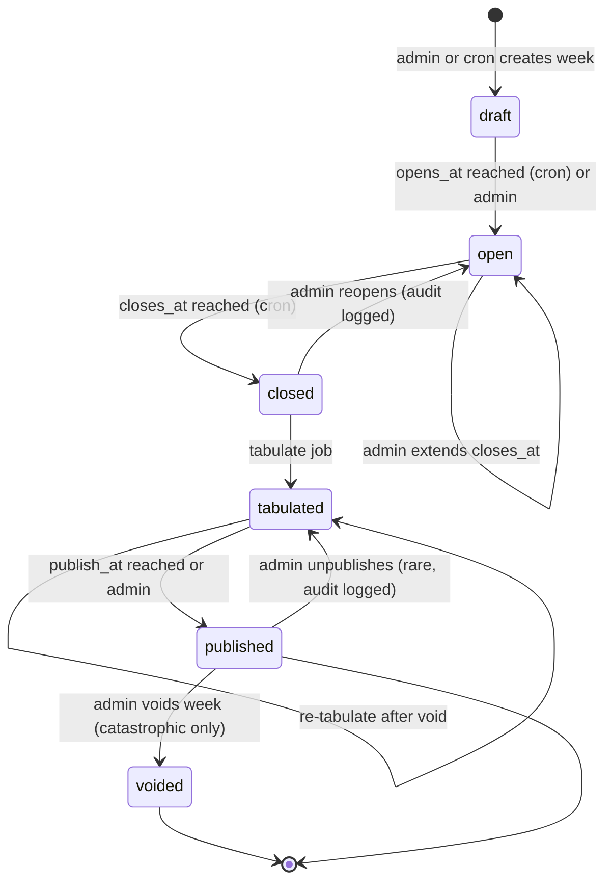
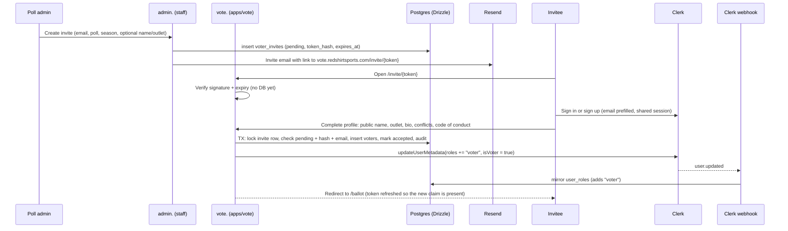

## 13. Top 25 polls: full lifecycle

### 13.1 Goals

1. **Credible**: approved, named voters; published ballots; documented methodology; conflict disclosures.
2. **Reproducible**: results are a pure function of locked ballots; anyone with the ballots can recompute the poll.
3. **Operable**: weekly cadence runs on schedules with minimal manual work; admins can intervene (extend window, void a ballot, republish).
4. **Extensible**: same engine for FBS, FCS, D-II, D-III, men's and women's basketball (Top 25), with different sizes and calendars.

### 13.2 State machine



Ballot states: `draft` (autosaved, editable) → `submitted` (counted if still submitted at close; still editable while open) → `locked` (frozen at close) or `voided` (admin, with reason).

### 13.3 Calendar defaults (configurable per poll)

All times America/New_York in config, stored as UTC, displayed in the viewer's local zone with zone label.

| Poll | Opens | Closes | Publishes | Notes |
|---|---|---|---|---|
| FBS Top 25 | Sunday 08:00 ET | Monday 12:00 ET | Monday or Tuesday at a set hour | Late Saturday games finish after midnight ET; Sunday morning open avoids premature ballots |
| FCS Top 25 | Sunday 08:00 ET | Monday 12:00 ET | Monday or Tuesday | Same cadence |
| D-II / D-III Top 25 | Sunday 10:00 ET | Monday 18:00 ET | Tuesday | Smaller voter pools, give more time |
| Preseason | Admin-set window in summer | | Admin-set | `week_number = 0` |
| Final | After title game | +48 h | Admin | Label "Final" |
| MBB/WBB Top 25 | Sunday 18:00 ET | Monday 10:00 ET | Monday afternoon | Basketball weeks run Monday–Sunday |

A **season generator** (admin action) creates all `poll_weeks` for a season from the `weeks` table and the poll's calendar template, all in `draft`. Weeks the poll admin marks as skipped (holiday, no-poll weeks) are omitted. Weeks are a calendar config, not a feed schedule.

### 13.4 Voter onboarding: invite-only

There is **no public voter application**. Panels are curated: a poll admin invites a specific person by email for a specific poll and season, and only accepting that invite creates a voter. This keeps the panel credible, removes an abuse surface (fake applications, bots, review queues) and makes each season's roster an explicit admin decision.



#### Token design (signed, single-use, expiring)

- The link is `https://vote.redshirtsports.com/invite/{token}`, where `token = base64url(payload) + "." + base64url(HMAC-SHA256(payload, VOTER_INVITE_SECRET))` and `payload = { v: 1, i: inviteId, n: nonce, e: expiresAtUnix }`. The nonce is 32 random bytes.
- The **signature** lets the server reject tampered or expired links without touching the database (cheap rejection of guessing traffic).
- The database stores only `sha256(nonce)` (`token_hash`) and `status`. **Single use** is enforced by an atomic `update … where status = 'pending' and token_hash = $hash and expires_at > now()`; a second click finds nothing to update.
- **Expiry** defaults to 14 days. A nightly job marks old pending invites `expired`.
- **Resend rotates the nonce**: the old link stops working the moment a new one is sent.
- **Revocation** sets `status = 'revoked'`; the link fails immediately even if the signature is valid.
- **Email binding**: the Clerk account accepting the invite must have a *verified* email equal to the invite email (case-insensitive). An admin can set `allow_any_email` for someone who wants to use a different account; that's audited.
- Voters must enroll **MFA** in Clerk before their first ballot (§13.13).

```ts
// packages/polls/src/invite-token.ts  (pure: no DB, runs in tests)
import { createHmac, randomBytes, createHash, timingSafeEqual } from "node:crypto";

type Payload = { v: 1; i: string; n: string; e: number };
const b64 = (b: Buffer | string) => Buffer.from(b).toString("base64url");

export function createInviteToken(inviteId: string, expiresAt: Date, secret: string) {
  const nonce = randomBytes(32).toString("base64url");
  const payload: Payload = { v: 1, i: inviteId, n: nonce, e: Math.floor(expiresAt.getTime() / 1000) };
  const body = b64(JSON.stringify(payload));
  const sig = b64(createHmac("sha256", secret).update(body).digest());
  return { token: `${body}.${sig}`, tokenHash: sha256(nonce) };
}

export function verifyInviteToken(token: string, secret: string, now = new Date()): { inviteId: string; tokenHash: string } | null {
  const [body, sig] = token.split(".");
  if (!body || !sig) return null;
  const expected = createHmac("sha256", secret).update(body).digest();
  const given = Buffer.from(sig, "base64url");
  if (given.length !== expected.length || !timingSafeEqual(given, expected)) return null;
  const p = JSON.parse(Buffer.from(body, "base64url").toString()) as Payload;
  if (p.v !== 1 || p.e * 1000 <= now.getTime()) return null;
  return { inviteId: p.i, tokenHash: sha256(p.n) };
}

export const sha256 = (s: string) => createHash("sha256").update(s).digest("hex");
```

#### Creating invites (admin)

```ts
// apps/admin/app/ops/voters/invites/actions.ts  (staff app)
"use server";
import { z } from "zod";
import { addDays } from "date-fns";
import { eq } from "drizzle-orm";
import { adminDb } from "@rs/db";
import { voterInvites, pollAuditLog } from "@rs/db/schema";
import { createInviteToken } from "@rs/polls/invite-token";
import { requireRole } from "@rs/auth/server";
import { sendVoterInvite } from "@rs/emails/send";

const Input = z.object({
  pollId: z.uuid(), seasonId: z.string(),
  invitees: z.array(z.object({ email: z.email(), publicName: z.string().max(80).optional(), outlet: z.string().max(120).optional() })).min(1).max(200),
  expiresInDays: z.number().int().min(1).max(30).default(14),
  note: z.string().max(500).optional(),
});

export async function createInvites(raw: unknown) {
  const adminId = await requireRole("poll_admin");
  const input = Input.parse(raw);
  const expiresAt = addDays(new Date(), input.expiresInDays);
  const toSend: { email: string; token: string }[] = [];

  await adminDb.transaction(async (tx) => {
    for (const inv of input.invitees) {
      const [row] = await tx.insert(voterInvites).values({
        email: inv.email, pollId: input.pollId, seasonId: input.seasonId, publicName: inv.publicName, outlet: inv.outlet,
        note: input.note, tokenHash: "pending", expiresAt, invitedBy: adminId,
      }).onConflictDoNothing().returning({ id: voterInvites.id });   // skips emails that already have a pending invite
      if (!row) continue;
      const { token, tokenHash } = createInviteToken(row.id, expiresAt, process.env.VOTER_INVITE_SECRET!);
      await tx.update(voterInvites).set({ tokenHash }).where(eq(voterInvites.id, row.id));
      await tx.insert(pollAuditLog).values({ inviteId: row.id, actorId: adminId, action: "invite.create", detail: { email: inv.email } });
      toSend.push({ email: inv.email, token });
    }
  });
  // Send after commit: never hold a DB transaction open across a network call
  await Promise.all(toSend.map((t) => sendVoterInvite(t.email, `${process.env.VOTE_URL}/invite/${t.token}`)));
  return { created: toSend.length, skipped: input.invitees.length - toSend.length };
}
```

#### Accepting an invite

```ts
// apps/vote/app/invite/[token]/actions.ts
"use server";
import { and, eq, gt, sql } from "drizzle-orm";
import { auth, clerkClient } from "@clerk/nextjs/server";
import { adminDb } from "@rs/db";
import { voterInvites, voters, pollAuditLog } from "@rs/db/schema";
import { InviteInvalidError, InviteEmailMismatchError } from "@rs/db/errors";
import { verifyInviteToken } from "@rs/polls/invite-token";
import { ensureUser } from "@rs/db/queries/users";
import { slugify } from "@rs/seo/slug";

export async function acceptInvite(token: string, profile: { publicName: string; outlet?: string; bio?: string; conflicts: string[]; cocVersion: string }) {
  const { userId } = await auth();
  if (!userId) throw new Error("UNAUTHENTICATED");
  const parsed = verifyInviteToken(token, process.env.VOTER_INVITE_SECRET!);
  if (!parsed) throw new InviteInvalidError();

  const clerk = await clerkClient();
  const user = await clerk.users.getUser(userId);
  await ensureUser(user);                                     // users row exists even if the webhook hasn't arrived
  const verifiedEmails = user.emailAddresses.filter((e) => e.verification?.status === "verified").map((e) => e.emailAddress.toLowerCase());

  const voter = await adminDb.transaction(async (tx) => {
    const [invite] = await tx.select().from(voterInvites).where(eq(voterInvites.id, parsed.inviteId)).for("update");
    if (!invite || invite.status !== "pending" || invite.tokenHash !== parsed.tokenHash || invite.expiresAt <= new Date()) throw new InviteInvalidError();
    if (!invite.allowAnyEmail && !verifiedEmails.includes(invite.email.toLowerCase())) throw new InviteEmailMismatchError();

    const [v] = await tx.insert(voters).values({
      userId, pollId: invite.pollId, seasonId: invite.seasonId, inviteId: invite.id,
      slug: slugify(profile.publicName), publicName: profile.publicName, outlet: profile.outlet, bio: profile.bio,
      conflicts: profile.conflicts, codeOfConductVersion: profile.cocVersion, addedBy: invite.invitedBy,
    }).onConflictDoUpdate({                                   // re-invited after a revocation in the same season
      target: [voters.userId, voters.pollId, voters.seasonId],
      set: { status: "active", inviteId: invite.id, revokedAt: null, revokedBy: null, revokedReason: null, joinedAt: new Date() },
    }).returning();

    await tx.update(voterInvites).set({ status: "accepted", acceptedBy: userId, acceptedAt: new Date() })
      .where(and(eq(voterInvites.id, invite.id), eq(voterInvites.status, "pending")));
    await tx.insert(pollAuditLog).values({ inviteId: invite.id, voterId: v.id, actorId: userId, action: "invite.accept" });
    return v;
  });

  // After commit: grant the coarse role in Clerk. The user.updated webhook mirrors it into user_roles.
  const roles = new Set<string>((user.publicMetadata.roles as string[] | undefined) ?? []);
  roles.add("voter");
  await clerk.users.updateUserMetadata(userId, { publicMetadata: { roles: [...roles], isVoter: true } });
  return { voterId: voter.id };
}
```

The client calls `session.reload()` (or `getToken({ skipCache: true })`) after acceptance so the new `roles` claim is in the session token immediately; otherwise it appears on the next token refresh. **Authorization never depends on the claim alone**: every ballot action checks the `voters` row for that poll and season (§13.7). The Clerk role is a coarse gate for navigation and RLS.

> **Clerk Invitations API, optionally.** Clerk can create its own invitations (with `publicMetadata` and a redirect URL) for people who don't have an account yet. It doesn't scope access to a poll and season or handle people who already have accounts, so the signed token above stays the source of truth. If you want Clerk's sign-up email for brand-new users, create a Clerk invitation *and* include the Redshirt invite token in its `redirectUrl`.

#### Revocation, suspension and the role sync

| Action | Database | Clerk | Effect on ballots |
|---|---|---|---|
| Revoke a pending invite | `voter_invites.status = 'revoked'` | none | Link stops working |
| Suspend a voter (temporary) | `voters.status = 'suspended'` | keep role if active elsewhere | Can't submit while suspended; current open-week ballot is excluded at close unless reinstated |
| Revoke a voter (for the season) | `voters.status = 'revoked'`, reason required | If the user has no other `active` voter rows: remove `voter` from `publicMetadata.roles`, `isVoter = false` | Open-week ballot is voided (audited). Already-published ballots stay published with their history (polls must remain reproducible) |
| Reinstate | `status = 'active'` | Re-add role | Can vote in open weeks again |

Clerk `user.updated` webhooks keep `user_roles` in sync (§8.5). A nightly reconcile job compares `voters` (active rows) with Clerk metadata and fixes drift in either direction, logging every correction.

#### Seasonal rosters

Approval is per **poll + season**. Before each season:

1. Admin opens **Roster builder** for the new season: the previous season's active voters are listed with participation (ballots submitted / weeks), missed weeks and outlier stats.
2. Admin selects returning voters → **Renew** creates new invites for the new season (prefilled public name and outlet). Returning voters accept in one click but must re-confirm conflicts and the current code-of-conduct version.
3. Admin adds new invitees (single or bulk paste of `email, name, outlet`).
4. Admin sets the target panel size and the **roster publish** toggle; the public voter panel page shows only active voters for the season, once published.
5. Rosters for past seasons are frozen and stay public alongside their ballots.

#### Admin tools (apps/admin)

| Screen | Route | Capabilities |
|---|---|---|
| Voter roster | `/ops/voters?poll=cfb-fcs&season=2026` | Active/suspended/revoked voters, participation %, missed weeks, MFA status, conflicts, last ballot, quick actions |
| Invites | `/ops/voters/invites` | Create single or bulk invites, filter by status (pending, accepted, expired, revoked), resend (rotates token), revoke, copy link (audited), change expiry |
| Roster builder | `/ops/voters/rosters/{poll}/{season}` | Carry forward from previous season, renew selected, add new, panel-size target, publish toggle |
| Voter detail | `/ops/voters/{voterId}` | Profile and disclosures, ballot history, outlier history, suspend/revoke/reinstate with reason, audit timeline, link to a Sanity `person` profile |
| Reconcile | `/ops/voters/reconcile` | Drift between `voters` and Clerk roles, one-click fix |

#### What the voter provides (at acceptance, not before)

Public display name; outlet/affiliation with URL; short bio; social handles; conflicts disclosure (employer, alma mater, family ties, paid relationships), shown publicly next to their ballots; acceptance of the methodology and code of conduct (version stored); optional avatar uploaded to Supabase Storage via a signed URL.

**Selection criteria (for admins, published on the methodology page):** regularly covers the division; no athletics-department employees; team broadcasters only with disclosure; one ballot per person; season-scoped membership; participation expectations (missing 2 consecutive weeks triggers a warning, 3 triggers a roster review).

**Panel size**: aim for enough voters per poll that one outlier ballot cannot move a team more than a couple of spots; publish the count every week. With small panels (under ~15), show a note.

### 13.5 Ballot entry UX (`apps/vote` at `vote.redshirtsports.com/ballot/[poll]/[season]/[week]`)

- Two columns: **search + filter list of eligible teams** (division teams for that season with admin-entered record if present, last week's rank in the Redshirt poll) and **your ballot 1–25** (drag-and-drop with keyboard support: up/down buttons and "move to rank N" input).
- **Prefill** from the voter's previous week ballot (optional toggle), with teams that lost highlighted.
- **Autosave** drafts every change (debounced 1 s) to `ballots.status='draft'`; explicit **Submit** button validates and marks `submitted`.
- Countdown to close in the voter's local zone, with ET also shown.
- Optional 280-char note per team and a ballot note.
- After close: read-only view; after publish: link to public transparency page.
- Mobile first: many voters fill ballots on phones Sunday morning.

### 13.6 Validation rules

| Rule | Where enforced | Error |
|---|---|---|
| Exactly `poll.size` entries for a submit (drafts may be partial) | zod + SQL function | `BALLOT_INCOMPLETE` |
| Ranks 1..N contiguous and unique | PK `(ballot_id, rank)` + function check | `BALLOT_RANKS_INVALID` |
| Each team at most once | unique `(ballot_id, team_id)` | `BALLOT_DUPLICATE_TEAM` |
| Team belongs to poll division for that season | function joins `team_seasons` | `BALLOT_TEAM_NOT_ELIGIBLE` |
| Transitional/ineligible team allowed only if `polls.allow_ineligible` | function | `BALLOT_TEAM_INELIGIBLE` |
| Voter active for poll+season | function | `NOT_A_VOTER` |
| Window open (`now() between opens_at and closes_at` and status `open`) | function, `for update` lock on poll week | `POLL_WEEK_CLOSED` |
| Rate limit (e.g. 30 saves/min per voter) | Upstash or Postgres token bucket | `RATE_LIMITED` |
| Soft warnings (not errors): ranked a team that lost to an unranked team below that team; ranked an 0-3 team; big jump (> 10 spots) vs previous own ballot | TS heuristics in `@rs/polls` | shown as warnings before submit |

### 13.7 Submit ballot (Drizzle transaction; lock enforced inside it)

```ts
// packages/db/src/queries/ballots.ts
import { and, eq, inArray, sql } from "drizzle-orm";
import { adminDb } from "../client";
import { ballots, ballotEntries, ballotRevisions, pollAuditLog, pollWeeks, polls, teamSeasons, voters } from "../schema";
import { BallotInvalidError, NotAVoterError, PollWeekClosedError } from "../errors";

export type BallotInput = { pollWeekId: string; entries: { rank: number; teamId: string }[]; final: boolean; fingerprint?: string };

export async function submitBallot(userId: string, input: BallotInput) {
  return adminDb.transaction(async (tx) => {
    // 1. Serialize against the close job: both take a row lock on the poll week
    const [week] = await tx.select().from(pollWeeks).where(eq(pollWeeks.id, input.pollWeekId)).for("update");
    const now = new Date();
    if (!week || week.status !== "open" || now < week.opensAt || now >= week.closesAt) throw new PollWeekClosedError();
    const [poll] = await tx.select().from(polls).where(eq(polls.id, week.pollId));

    // 2. Authorization from the database, not from the session claim
    const [voter] = await tx.select().from(voters).where(and(
      eq(voters.userId, userId), eq(voters.pollId, week.pollId), eq(voters.seasonId, week.seasonId), eq(voters.status, "active")));
    if (!voter) throw new NotAVoterError();

    // 3. Shape validation (zod already checked types in the action)
    const n = input.entries.length;
    const ranks = new Set(input.entries.map((e) => e.rank));
    const teamIds = new Set(input.entries.map((e) => e.teamId));
    if (n > poll.size) throw new BallotInvalidError("BALLOT_TOO_LONG");
    if (input.final && n !== poll.size) throw new BallotInvalidError("BALLOT_INCOMPLETE");
    if (ranks.size !== n || teamIds.size !== n || Math.min(...ranks) !== 1 || Math.max(...ranks) !== n) throw new BallotInvalidError("BALLOT_RANKS_INVALID");

    // 4. Eligibility: every team is in the poll's division this season
    if (n > 0) {
      const eligible = await tx.select({ teamId: teamSeasons.teamId }).from(teamSeasons).where(and(
        eq(teamSeasons.seasonId, week.seasonId), eq(teamSeasons.division, poll.division), inArray(teamSeasons.teamId, [...teamIds]),
        poll.allowIneligible ? sql`true` : eq(teamSeasons.postseasonEligible, true)));
      if (eligible.length !== n) throw new BallotInvalidError("BALLOT_TEAM_NOT_ELIGIBLE");
    }

    // 5. Upsert ballot; saving a draft never un-submits
    const [ballot] = await tx.insert(ballots).values({
      pollWeekId: week.id, voterId: voter.id, status: input.final ? "submitted" : "draft",
      submittedAt: input.final ? now : null, clientFingerprint: input.fingerprint,
    }).onConflictDoUpdate({
      target: [ballots.pollWeekId, ballots.voterId],
      set: {
        status: input.final ? sql`'submitted'` : sql`case when ${ballots.status} = 'submitted' then 'submitted' else 'draft' end`,
        submittedAt: input.final ? now : sql`${ballots.submittedAt}`,
        revision: sql`${ballots.revision} + 1`,
        clientFingerprint: sql`coalesce(${input.fingerprint ?? null}, ${ballots.clientFingerprint})`,
      },
    }).returning();

    // 6. Replace entries, keep immutable revision history, audit
    await tx.delete(ballotEntries).where(eq(ballotEntries.ballotId, ballot.id));
    if (n > 0) await tx.insert(ballotEntries).values(input.entries.map((e) => ({ ballotId: ballot.id, rank: e.rank, teamId: e.teamId })));
    await tx.insert(ballotRevisions).values({ ballotId: ballot.id, revision: ballot.revision, entries: input.entries, savedBy: userId });
    await tx.insert(pollAuditLog).values({ pollWeekId: week.id, ballotId: ballot.id, voterId: voter.id, actorId: userId,
      action: input.final ? "ballot.submit" : "ballot.save", detail: { count: n } });
    await tx.update(voters).set({ missedWeeks: 0 }).where(eq(voters.id, voter.id));
    return ballot;
  });
}
```

```ts
// apps/vote/app/ballot/[poll]/[year]/[week]/actions.ts
"use server";
import { z } from "zod";
import { requireUserId } from "@rs/auth/server";
import { submitBallot } from "@rs/db/queries/ballots";
import { ratelimit } from "@/server/ratelimit";

const Input = z.object({
  pollWeekId: z.uuid(),
  entries: z.array(z.object({ rank: z.number().int().min(1).max(50), teamId: z.uuid() })).max(50),
  final: z.boolean(),
});

export async function saveBallot(raw: unknown) {
  const userId = await requireUserId();                // never accept a user id from the client
  const { success } = await ratelimit.limit(`ballot:${userId}`);
  if (!success) return { ok: false as const, error: "RATE_LIMITED" };
  const input = Input.parse(raw);
  const ballot = await submitBallot(userId, input);
  return { ok: true as const, ballotId: ballot.id, status: ballot.status };
}
```

Domain errors (`PollWeekClosedError`, `NotAVoterError`, `BallotInvalidError`) are mapped to user-facing messages in the action.

**Edge case: the "submitted at 11:59:59" race.** The `for update` row lock on `poll_weeks` serializes submits against the close job (which also takes `for update`). Whichever commits first wins; a submit that loses sees `status = 'closed'` and gets `POLL_WEEK_CLOSED`. No grace window; the countdown in the UI is honest.

### 13.8 Close and lock

```ts
// packages/db/src/queries/poll-jobs.ts
export async function closePollWeek(pollWeekId: string) {
  return adminDb.transaction(async (tx) => {
    const [week] = await tx.select().from(pollWeeks).where(and(eq(pollWeeks.id, pollWeekId), eq(pollWeeks.status, "open"))).for("update");
    if (!week) return null;                                            // already closed: idempotent
    const locked = await tx.update(ballots).set({ status: "locked", lockedAt: new Date() })
      .where(and(eq(ballots.pollWeekId, pollWeekId), eq(ballots.status, "submitted"))).returning({ id: ballots.id });
    await tx.update(pollWeeks).set({ status: "closed" }).where(eq(pollWeeks.id, pollWeekId));
    // missed-week counters for active voters without a locked ballot
    await tx.execute(sql`
      update voters v set missed_weeks = missed_weeks + 1
       where v.poll_id = ${week.pollId} and v.season_id = ${week.seasonId} and v.status = 'active'
         and not exists (select 1 from ballots b where b.voter_id = v.id and b.poll_week_id = ${pollWeekId} and b.status = 'locked')`);
    await tx.insert(pollAuditLog).values({ pollWeekId, action: "week.close", detail: { locked: locked.length } });
    return { locked: locked.length };
  });
}
```

Drafts that were never submitted do not count; they are kept for the voter's own history.

### 13.9 Tabulation

**Points**: rank `r` on a ballot earns `size + 1 - r` points (25 for 1st … 1 for 25th). First-place votes = count of ballots ranking the team 1st.

**Order**: points desc. **Ties in points** share the same rank (AP-style "T-12"). Display tie order by first-place votes desc, then alphabetical; rank numbers skip (two teams T-12 → next is 14). This mirrors common poll practice; document it on the methodology page.

**Others receiving votes**: every team with points > 0 not in the top `size`, listed by points desc. Ties at the cutoff: if teams tie for the 25th spot, include all tied teams as T-25 (the published list can exceed 25). Document the choice.

**Movement**: compare to the previous *published* week of the same poll and season (preseason for week 1). `movement = previous_rank - rank`. Unranked last week → `is_new = true`, display "NR" / "New". Dropped out = ranked last week and not ranked now.

**On X of N ballots** (v1.7, replaces the "ballot share" bar): `poll_results.ballots_listed` is the number of counted ballots that ranked the team anywhere from 1 to 25; the page shows it as "On 18 of 22 ballots" (N = `poll_week_summaries.ballots_counted`). It shows how *broad* support is, which points can hide: a team on every ballot around No. 20 and a team on half the ballots around No. 8 can total similar points.

**No longer receiving votes**: teams with points > 0 in the previous published week (ranked or RV) and no points this week. Derived at read time from the two weeks' `poll_results` (no new column). A team can appear both here and under *Dropped out* (ranked last week, zero votes now).

**Record snapshot** (optional): staff may enter W-L per team in `poll_week_team_records` from `admin./ops/polls/{weekId}`; tabulation copies them into `poll_results.record_*`. If absent, the poll page hides the record column for that team. There is no `standings` or `games` table.

SQL variant (single statement, idempotent; kept in a custom migration for the optional pg_cron path and as an independent cross-check. The primary path is the TypeScript + Drizzle version further below):

```sql
create or replace function app.tabulate_poll_week(p_poll_week_id uuid) returns void
language plpgsql security definer set search_path = public, app as $$
declare v_size int; v_prev uuid; v_week poll_weeks%rowtype; v_hash text;
begin
  select * into v_week from poll_weeks where id = p_poll_week_id for update;
  if v_week.status not in ('closed','tabulated') then raise exception 'POLL_WEEK_NOT_CLOSED'; end if;
  select size into v_size from polls where id = v_week.poll_id;

  select id into v_prev from poll_weeks
   where poll_id = v_week.poll_id and season_id = v_week.season_id and status = 'published'
     and week_number < v_week.week_number
   order by week_number desc limit 1;

  delete from poll_results where poll_week_id = p_poll_week_id;

  with counted as (
    select be.team_id,
           sum(v_size + 1 - be.rank)::int as points,
           count(*) filter (where be.rank = 1)::int as fpv,
           count(*)::int as listed,
           min(be.rank) as hi, max(be.rank) as lo
      from ballots b join ballot_entries be on be.ballot_id = b.id
     where b.poll_week_id = p_poll_week_id and b.status = 'locked'
     group by be.team_id
  ), ranked as (
    select c.*, rank() over (order by points desc) as pts_rank from counted c
  ), cutoff as (
    select min(points) as min_pts from ranked where pts_rank <= v_size
  )
  insert into poll_results (poll_week_id, team_id, rank, points, first_place_votes, ballots_listed,
                            highest_rank, lowest_rank, previous_rank, movement, is_new)
  select p_poll_week_id, r.team_id,
         case when r.points >= (select min_pts from cutoff) then r.pts_rank end,
         r.points, r.fpv, r.listed, r.hi, r.lo,
         pr.rank,
         case when r.points >= (select min_pts from cutoff) and pr.rank is not null then pr.rank - r.pts_rank end,
         (r.points >= (select min_pts from cutoff) and pr.rank is null)
    from ranked r
    left join poll_results pr on pr.poll_week_id = v_prev and pr.team_id = r.team_id;

  -- record snapshot
  update poll_results res set record_wins = r.wins, record_losses = r.losses, record_ties = r.ties
    from poll_week_team_records r where r.team_id = res.team_id and r.poll_week_id = res.poll_week_id
     and res.poll_week_id = p_poll_week_id;

  select encode(digest(string_agg(b.id::text || ':' || be.rank || ':' || be.team_id::text, ',' order by b.id, be.rank), 'sha256'), 'hex')
    into v_hash
    from ballots b join ballot_entries be on be.ballot_id = b.id
   where b.poll_week_id = p_poll_week_id and b.status = 'locked';

  insert into poll_week_summaries (poll_week_id, ballots_counted, ballots_voided, dropped_out, computed_hash)
  values (p_poll_week_id,
          (select count(*) from ballots where poll_week_id = p_poll_week_id and status = 'locked'),
          (select count(*) from ballots where poll_week_id = p_poll_week_id and status = 'voided'),
          coalesce((select array_agg(pr.team_id) from poll_results pr
                     where pr.poll_week_id = v_prev and pr.rank is not null
                       and not exists (select 1 from poll_results cur where cur.poll_week_id = p_poll_week_id
                                        and cur.team_id = pr.team_id and cur.rank is not null)), '{}'),
          v_hash)
  on conflict (poll_week_id) do update set ballots_counted = excluded.ballots_counted,
     ballots_voided = excluded.ballots_voided, dropped_out = excluded.dropped_out, computed_hash = excluded.computed_hash;

  update poll_weeks set status = 'tabulated', tabulated_at = now() where id = p_poll_week_id;
  insert into poll_audit_log (poll_week_id, action, detail) values (p_poll_week_id, 'week.tabulate', jsonb_build_object('hash', v_hash));
end $$;
```

The same algorithm lives in TypeScript in `@rs/polls` (`tabulate(ballots, size)`). The TS version powers "what if" previews in the admin app and lets anyone verify a published poll from the CSV export.

```ts
// packages/polls/src/tabulate.ts
export type Ballot = { voterId: string; teamIds: string[] }; // index 0 = rank 1
export type Result = { teamId: string; rank: number | null; points: number; fpv: number; listed: number; hi: number; lo: number };

export function tabulate(ballots: Ballot[], size = 25): Result[] {
  const agg = new Map<string, { points: number; fpv: number; listed: number; hi: number; lo: number }>();
  for (const b of ballots) {
    if (b.teamIds.length !== size || new Set(b.teamIds).size !== size) throw new Error(`invalid ballot ${b.voterId}`);
    b.teamIds.forEach((teamId, i) => {
      const r = i + 1;
      const a = agg.get(teamId) ?? { points: 0, fpv: 0, listed: 0, hi: Infinity, lo: 0 };
      a.points += size + 1 - r;
      if (r === 1) a.fpv += 1;
      a.listed += 1;
      a.hi = Math.min(a.hi, r);
      a.lo = Math.max(a.lo, r);
      agg.set(teamId, a);
    });
  }
  const sorted = [...agg.entries()].sort((x, y) => y[1].points - x[1].points);
  // competition ranking (1,2,2,4)
  let lastPts = -1, lastRank = 0;
  const withRank = sorted.map(([teamId, a], i) => {
    const rank = a.points === lastPts ? lastRank : i + 1;
    lastPts = a.points; lastRank = rank;
    return { teamId, ...a, ptsRank: rank };
  });
  const cutoffPts = withRank.filter((r) => r.ptsRank <= size).at(-1)?.points ?? Infinity;
  return withRank.map(({ ptsRank, ...r }) => ({ ...r, rank: r.points >= cutoffPts ? ptsRank : null }));
}
```

**Primary path: TypeScript tabulation stored with Drizzle.** The poll tick runs the pure `tabulate()` from `@rs/polls` on the locked ballots and writes the results in one transaction. The same code powers admin "what if" previews and public verification from the CSV export, so there is exactly one implementation of the rules.

```ts
// packages/db/src/queries/poll-jobs.ts (continued)
import { createHash } from "node:crypto";
import { tabulate } from "@rs/polls";

export async function tabulateAndStore(pollWeekId: string) {
  return adminDb.transaction(async (tx) => {
    const [week] = await tx.select().from(pollWeeks).where(eq(pollWeeks.id, pollWeekId)).for("update");
    if (!week || !["closed", "tabulated"].includes(week.status)) throw new Error("POLL_WEEK_NOT_CLOSED");
    const [poll] = await tx.select().from(polls).where(eq(polls.id, week.pollId));

    const rows = await tx.select({ ballotId: ballots.id, voterId: ballots.voterId, rank: ballotEntries.rank, teamId: ballotEntries.teamId })
      .from(ballots).innerJoin(ballotEntries, eq(ballotEntries.ballotId, ballots.id))
      .where(and(eq(ballots.pollWeekId, pollWeekId), eq(ballots.status, "locked")))
      .orderBy(asc(ballots.id), asc(ballotEntries.rank));
    const byBallot = Map.groupBy(rows, (r) => r.ballotId);
    const input = [...byBallot.values()].map((es) => ({ voterId: es[0].voterId, teamIds: es.map((e) => e.teamId) }));
    const results = tabulate(input, poll.size);

    const [prevWeek] = await tx.select({ id: pollWeeks.id }).from(pollWeeks).where(and(
      eq(pollWeeks.pollId, week.pollId), eq(pollWeeks.seasonId, week.seasonId), eq(pollWeeks.status, "published"), lt(pollWeeks.weekNumber, week.weekNumber)))
      .orderBy(desc(pollWeeks.weekNumber)).limit(1);
    const prev = prevWeek ? await tx.select({ teamId: pollResults.teamId, rank: pollResults.rank }).from(pollResults).where(eq(pollResults.pollWeekId, prevWeek.id)) : [];
    const prevRank = new Map(prev.filter((p) => p.rank !== null).map((p) => [p.teamId, p.rank!]));

    await tx.delete(pollResults).where(eq(pollResults.pollWeekId, pollWeekId));
    if (results.length) await tx.insert(pollResults).values(results.map((r) => ({
      pollWeekId, teamId: r.teamId, rank: r.rank, points: r.points, firstPlaceVotes: r.fpv, ballotsListed: r.listed,
      highestRank: r.hi, lowestRank: r.lo, previousRank: prevRank.get(r.teamId) ?? null,
      movement: r.rank !== null && prevRank.has(r.teamId) ? prevRank.get(r.teamId)! - r.rank : null,
      isNew: r.rank !== null && !prevRank.has(r.teamId),
    })));
    // optional record snapshot from poll_week_team_records (same as SQL variant), then summary + reproducibility hash
    await tx.execute(sql`update poll_results res set record_wins = r.wins, record_losses = r.losses, record_ties = r.ties
      from poll_week_team_records r where r.team_id = res.team_id and r.poll_week_id = res.poll_week_id and res.poll_week_id = ${pollWeekId}`);
    const hash = createHash("sha256").update(rows.map((r) => `${r.ballotId}:${r.rank}:${r.teamId}`).join(",")).digest("hex");
    const ranked = new Set(results.filter((r) => r.rank !== null).map((r) => r.teamId));
    await tx.insert(pollWeekSummaries).values({
      pollWeekId, ballotsCounted: byBallot.size, computedHash: hash,
      droppedOut: [...prevRank.keys()].filter((t) => !ranked.has(t)),
    }).onConflictDoUpdate({ target: pollWeekSummaries.pollWeekId, set: { ballotsCounted: byBallot.size, computedHash: hash,
      droppedOut: [...prevRank.keys()].filter((t) => !ranked.has(t)) } });
    await tx.update(pollWeeks).set({ status: "tabulated", tabulatedAt: new Date() }).where(eq(pollWeeks.id, pollWeekId));
    await tx.insert(pollAuditLog).values({ pollWeekId, action: "week.tabulate", detail: { hash, ballots: byBallot.size } });
  });
}
```

A **property test** asserts that `tabulateAndStore` and the SQL variant produce identical `poll_results` on random ballots.

### 13.10 Publish

- `publish_at` scheduled; the poll tick (§13.14) runs `publishDueWeeks()` (Drizzle: `status='published'`, `published_at=now()`, audit row) and then:
  1. Calls `revalidateTag('poll:cfb-fcs')`, `revalidateTag('poll:cfb-fcs:2026')`, `revalidateTag('poll:cfb-fcs:2026:7')`, and team tags for every ranked team (`team:<id>:rankings`).
  2. Generates OG images for the poll page and for each team's "Ranked No. X" share card.
  3. Sends the newsletter (Resend broadcast to `poll:<slug>` segment) and push to topic subscribers.
  4. Optionally creates a Sanity `pollRelease` draft prefilled with movement facts for the writer to add commentary.
- **Embargo**: until published, results are visible only in the admin app (RLS + server checks). Voters can't see aggregate results early.

### 13.11 Transparency pages

| Page | Route | Content |
|---|---|---|
| Poll week | `/college/football/rankings/fcs/2026/week-7` (current: `/college/football/rankings/fcs`) | Rank, team, record, points, first-place votes, previous rank, movement arrow, **On X of N ballots**, **Others receiving votes**, **Dropped out of the Top 25** (last week's rank), **No longer receiving votes**, ballots counted, published time, prominent "See all N ballots" CTA |
| Voter panel (roster published by admins each season) | `/college/football/rankings/fcs/voters` (archive `/voters/2026`) | Voter names, outlet/affiliation (linked), role, coverage area, on panel since, ballots submitted this season, disclosed conflicts; each row links to the voter's current ballot and their `/people/{slug}` profile |
| Voter ballot | `/college/football/rankings/fcs/2026/week-7/ballots/{voter}` | That voter's 1–25 with comments, deviation from consensus per team |
| Ballot breakdown, all ballots (default, unfiltered) | `/college/football/rankings/fcs/2026/week-7/ballots` | Teams × all voters grid (sticky header + team column, two-way scroll), outliers ringed, per-team distribution, biggest outliers; `?voters=` highlights only |
| Ballot breakdown, by voter | `/college/football/rankings/fcs/2026/week-7/ballots/by-voter` (`?q=`, `?sort=`, `?page=n`) | Voter list + one card per voter: full 25-team ballot, +/− vs consensus per pick, outliers, omitted top-15 teams, note |
| Poll history | `/college/football/rankings/fcs/history` (`/history/2025` for past seasons) | Rank-by-week chart (pick teams), week-by-week table for every team ranked that season, No. 1 by week, past seasons' final No. 1 |
| Team poll history | `/teams/montana-state-bobcats/football/rankings` | Line chart of rank by week across seasons |
| Methodology | `/college/football/rankings/methodology` | 25-to-1 points and ties, first-place votes, "On X of N ballots", others/dropped/no-longer definitions, voter and team eligibility, ballot window + automation timeline, transparency (public ballots, CSV + hash, corrections log), outlier policy, FAQ (`FAQPage`) |
| Data export | `/api/rankings/cfb/fcs/2026/week-7.csv` | Ballots CSV (voter, rank, team) + results CSV + hash, for independent verification |

**Outlier highlighting**: per-voter deviation = mean absolute difference between voter rank and consensus rank for teams on both lists; flag a pick when a voter ranked the team **≥ 8 spots** from its published rank, or **left off a team ranked in the top 15** (thresholds are config: `OUTLIER_GAP = 8`, `OUTLIER_OMIT_TOP = 15`). Flags are shown, never acted on automatically. This is a transparency feature, not a punitive one.

### 13.12 Audit

Every state change and every ballot save goes to `poll_audit_log` (who, what, when, hashed IP). Admin actions require a reason string (void, reopen, extend, unpublish). The admin app shows a per-week timeline. Audit rows are append-only (no update/delete grants; a trigger raises on update/delete).

### 13.13 Anti-abuse

| Threat | Mitigation |
|---|---|
| Account takeover of a voter | Require MFA for voters (Clerk), notify voter by email on every submit |
| Unauthorized voters | No public application path; invites are admin-issued, bound to a verified email, signed, single-use, expiring (14 days) and revocable; season-scoped membership |
| Forwarded or leaked invite link | Email binding (verified Clerk email must match), single-use atomic acceptance, resend rotates the token, admin sees who accepted and when |
| Sock puppets / coordinated ballots | Flag ballots with identical top 25s or same fingerprint across voters; review queue |
| Troll ballots | Soft-validation warnings, outlier report before publish, admin void with reason (published) |
| Conflict of interest | Required disclosures shown publicly next to ballot; optional rule to forbid ranking own employer |
| Script abuse on endpoints | Rate limits on ballot saves and invite acceptance, CSRF-safe server actions, signature check before any DB work on invite links |
| Insider early leak | Results embargoed by RLS; admin view access logged |
| Post-close edits | Database lock in function + `ballots.status='locked'`; any reopen is audited and displayed on the poll page ("window extended 30 min due to late game") |

### 13.14 Jobs and schedules

A single **poll tick** job runs every minute and is idempotent: it opens due weeks, closes due weeks, tabulates closed weeks and publishes due weeks, all through the Drizzle functions above. Running it twice does nothing extra because each step is guarded by status and row locks.

| Job | Schedule | Runs where | Action |
|---|---|---|---|
| `poll-tick` | every minute | Vercel Cron → `/api/jobs/poll-tick` (bearer `CRON_SECRET`) | `openDueWeeks()`, `closePollWeek()` for due weeks, `tabulateAndStore()` for closed weeks, `publishDueWeeks()` then revalidate tags, OG images, notifications |
| `poll-remind` | hourly | Vercel Cron | Email/push voters without a submitted ballot at T-12 h and T-2 h |
| `invite-expire` | nightly | Vercel Cron | Mark pending invites past `expires_at` as `expired` |
| `voter-reconcile` | nightly | Vercel Cron | Sync `voters` ↔ Clerk roles drift |
| `voter-missed` | inside close | | Increments missed counters; queues warnings at 2 and roster review at 3 |

```ts
// apps/admin/app/api/cron/poll-tick/route.ts   (admin app owns poll operations)
import { safeCompare } from "@/lib/safe-compare";
import { openDueWeeks, closeDueWeeks, tabulateClosedWeeks, publishDueWeeks } from "@rs/db/queries/poll-jobs";
import { afterPublish } from "@/server/poll-publish";   // revalidate web tags via a signed call, OG, Resend, push
import * as Sentry from "@sentry/nextjs";

export async function GET(req: Request) {
  if (!safeCompare(req.headers.get("authorization") ?? "", `Bearer ${process.env.CRON_SECRET}`)) return new Response("unauthorized", { status: 401 });
  return Sentry.withMonitor("poll-tick", async () => {
    const opened = await openDueWeeks();
    const closed = await closeDueWeeks();
    const tabulated = await tabulateClosedWeeks();
    const published = await publishDueWeeks();
    for (const w of published) await afterPublish(w);
    return Response.json({ opened, closed, tabulated, published: published.length });
  });
}
```

Because `apps/admin` and `apps/web` are separate deployments, `afterPublish` calls a bearer-protected `POST /api/revalidate/tags` on `apps/web` with the list of tags to expire.

**Alternative:** if you prefer in-database scheduling, `pg_cron` can call the same endpoint through `pg_net` (with the bearer token read from Supabase Vault), or call SQL versions of open/close (the SQL tabulation function above is kept for this path and for cross-checking).

### 13.15 Poll page component sketch

```tsx
// apps/web/src/routes/rankings.tsx (pollWeek factory; stub at app/(site)/college/football/rankings/[division]/[year]/[week]/page.tsx)
import { cacheLife, cacheTag } from "next/cache";
import { getPollWeek } from "@rs/db/queries/polls";
import { pollSlugFor, parseWeekSegment } from "@rs/seo/urls";
import { PollTable } from "@rs/ui/components/poll-table";
import { pollTags } from "@rs/db/cache-tags";

export default async function Page({ params }: { params: Promise<{ sport: string; division: string; year: string; week: string }> }) {
  const p = await params;
  const data = await loadPoll(p.sport, p.division, Number(p.year), p.week);
  return <PollTable data={data} />;
}

async function loadPoll(sport: string, division: string, year: number, week: string) {
  "use cache";
  cacheLife("days");
  const tags = pollTags({ sport, division, year, week });
  tags.forEach((t) => cacheTag(t));
  return getPollWeek({ pollSlug: pollSlugFor(sport, division), year, weekNumber: parseWeekSegment(week) }); // 'week-7' → 7, 'preseason' → 0
}
```

URLs follow §17: the current poll lives at `/{sport}/rankings/{division}` and each archived week at `/{sport}/rankings/{division}/{year}/week-N` (`preseason`, `final`). New divisions and sports need no new routes, only new `polls` rows, e.g. `/college/football/rankings/d2`, `/college/mens-basketball/rankings/d1`, `/college/womens-basketball/rankings/d1`.
