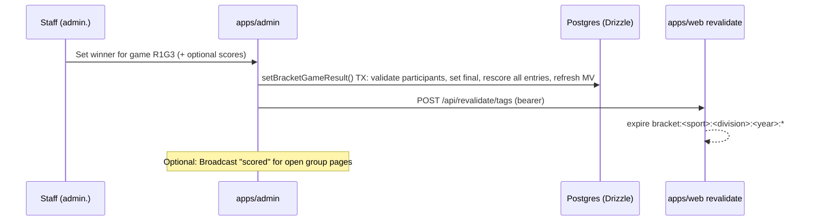

## 14. Bracket Challenge: full design

### 14.1 Product scope

| Event | Format code | Teams | Games | Rounds | Byes | First available |
|---|---|---|---|---|---|---|
| FCS Championship (division **`fcs`**) | `fcs24` | 24 | 23 | 5 | Seeds 1–8 skip round 1 | P0 |
| College Football Playoff (division **`fbs`**) | `cfp12` | 12 | 11 | 4 | Seeds 1–4 skip round 1 | P1 |
| NCAA Division II Football (division **`d2`**) | `d2_28` | 28 | 27 | 5 | No. 1 seed in each of 4 super regions | P1 |
| NCAA Division III Football (division **`d3`**) | `d3_32` | 32 | 31 | 5 | None | P1 |
| NCAA Men's / Women's Basketball | `ncaab68` | 68 | 67 | 7 (incl. First Four) | None (First Four play-ins) | P2 |
| Conference tournaments (optional) | `custom_N` | Varies | | | Configurable | P3 |

> Field sizes and seeding rules are set by the NCAA and the CFP and change from time to time. Verify every format against the official selection announcement each season before opening an event; formats are versioned so an old season's brackets remain correct after a rule change.

Feature list:

- Pick every game in the bracket before the lock; byes auto-advance.
- Multiple named entries per user per event (configurable cap, default 1 for the national leaderboard; groups can allow more).
- Groups (private leagues) with invite links/codes; public groups; one "Redshirt Sports National" system group per event.
- Leaderboards: national, per group, friends (users you share any group with), per school fan base (optional: "Montana State fans" based on favorite team).
- Possible points remaining and elimination status, updated when staff enter results.
- Shareable bracket images (OG) and a printable view.
- **One event per division per season** (`unique (sport, division, season_id)`), URL `/college-football/bracket-challenge/{division}/{year}`.
- Sponsored brackets: sponsor branding on landing page, group, and share images; disclosure.
- No entry fees and no prizes in the free game unless legal review approves a sweepstakes structure (see §20.5).

### 14.2 Format registry (pure TypeScript)

Each format is defined as a list of **slots** (team positions known before the event) and **games** (each side is fed by a slot or by the winner of an earlier game). Everything else (rendering, validation, scoring) is derived.

```ts
// packages/brackets/src/types.ts
export type Side = { slot: string } | { winnerOf: string };
export type GameDef = { code: string; round: number; region?: string; top: Side; bottom: Side; label?: string };
export type FormatDef = {
  code: string;
  version: number;
  name: string;
  rounds: { round: number; name: string; short: string }[];
  slots: { code: string; seed?: number; region?: string; label: string }[];
  games: GameDef[];
  finalGame: string;
};
```

#### FCS 24 (`fcs24`)

Structure: 16 unseeded teams play 8 first-round games; the 8 seeds host second-round games against those winners; then quarterfinals, semifinals, final. The committee pairs unseeded first-round games partly on geography, so the format uses **slot codes for unseeded teams by bracket position**, not by seed.

```ts
// packages/brackets/src/formats/fcs24.ts
import type { FormatDef, GameDef } from "../types";

// Bracket order of seeds top to bottom (1 v 8 side, 4 v 5, 3 v 6, 2 v 7)
const SEED_ORDER = [1, 8, 4, 5, 3, 6, 2, 7] as const;

const slots = [
  ...SEED_ORDER.map((s) => ({ code: `S${s}`, seed: s, label: `No. ${s} seed` })),
  ...Array.from({ length: 16 }, (_, i) => ({ code: `U${i + 1}`, label: `First round team ${i + 1}` })),
];

const r1: GameDef[] = Array.from({ length: 8 }, (_, i) => ({
  code: `R1G${i + 1}`, round: 1, top: { slot: `U${2 * i + 1}` }, bottom: { slot: `U${2 * i + 2}` },
}));
const r2: GameDef[] = SEED_ORDER.map((seed, i) => ({
  code: `R2G${i + 1}`, round: 2, top: { slot: `S${seed}` }, bottom: { winnerOf: `R1G${i + 1}` },
}));
const qf: GameDef[] = Array.from({ length: 4 }, (_, i) => ({
  code: `QF${i + 1}`, round: 3, top: { winnerOf: `R2G${2 * i + 1}` }, bottom: { winnerOf: `R2G${2 * i + 2}` },
}));
const sf: GameDef[] = [
  { code: "SF1", round: 4, top: { winnerOf: "QF1" }, bottom: { winnerOf: "QF2" } },
  { code: "SF2", round: 4, top: { winnerOf: "QF3" }, bottom: { winnerOf: "QF4" } },
];
const final: GameDef = { code: "F", round: 5, top: { winnerOf: "SF1" }, bottom: { winnerOf: "SF2" }, label: "FCS Championship" };

export const fcs24: FormatDef = {
  code: "fcs24", version: 1, name: "FCS Championship (24 teams)",
  rounds: [
    { round: 1, name: "First Round", short: "R1" },
    { round: 2, name: "Second Round", short: "R2" },
    { round: 3, name: "Quarterfinals", short: "QF" },
    { round: 4, name: "Semifinals", short: "SF" },
    { round: 5, name: "Championship", short: "F" },
  ],
  slots, games: [...r1, ...r2, ...qf, ...sf, final], finalGame: "F",
};
```

> The exact mapping of which first-round game feeds which seed is announced on selection day. The admin "Set field" screen therefore assigns teams to `U1..U16` in the order that makes `R1G(i)` feed `R2G(i)` as announced, rather than assuming a fixed pairing.

#### CFP 12 (`cfp12`)

Seeds 1–4 get byes; first round is 5v12, 6v11, 7v10, 8v9 (higher seed hosts); quarterfinals pair 1 with the 8/9 winner, 2 with 7/10, 3 with 6/11, 4 with 5/12.

```ts
// packages/brackets/src/formats/cfp12.ts
const slots = Array.from({ length: 12 }, (_, i) => ({ code: `S${i + 1}`, seed: i + 1, label: `No. ${i + 1} seed` }));
const R1 = [[8, 9], [5, 12], [6, 11], [7, 10]] as const;    // bracket order: feeds QF vs 1, 4, 3, 2
const QF_TOP = [1, 4, 3, 2] as const;
export const cfp12: FormatDef = {
  code: "cfp12", version: 1, name: "College Football Playoff (12 teams)",
  rounds: [
    { round: 1, name: "First Round", short: "R1" },
    { round: 2, name: "Quarterfinals", short: "QF" },
    { round: 3, name: "Semifinals", short: "SF" },
    { round: 4, name: "National Championship", short: "F" },
  ],
  slots,
  games: [
    ...R1.map(([a, b], i) => ({ code: `R1G${i + 1}`, round: 1, top: { slot: `S${a}` }, bottom: { slot: `S${b}` } })),
    ...QF_TOP.map((s, i) => ({ code: `QF${i + 1}`, round: 2, top: { slot: `S${s}` }, bottom: { winnerOf: `R1G${i + 1}` } })),
    { code: "SF1", round: 3, top: { winnerOf: "QF1" }, bottom: { winnerOf: "QF2" } },
    { code: "SF2", round: 3, top: { winnerOf: "QF3" }, bottom: { winnerOf: "QF4" } },
    { code: "F", round: 4, top: { winnerOf: "SF1" }, bottom: { winnerOf: "SF2" } },
  ],
  finalGame: "F",
};
```

Quarterfinal and semifinal games are assigned to named bowls; store the bowl name in `bracket_games.label` per event (it rotates each year) instead of in the format.

#### D-II 28 (`d2_28`)

Four super regions of seven teams. Seed 1 in each region has a bye; first round is 2v7, 3v6, 4v5; second round is 1 vs 4/5 winner and 2/7 winner vs 3/6 winner; third round is the regional final (national quarterfinal); then national semifinals and final. The pairing of regions in the semifinals is announced; store it per event.

```ts
// packages/brackets/src/formats/d2_28.ts
const REGIONS = ["1", "2", "3", "4"] as const;
export const d2_28: FormatDef = {
  code: "d2_28", version: 1, name: "NCAA Division II Football (28 teams)",
  rounds: [
    { round: 1, name: "First Round", short: "R1" },
    { round: 2, name: "Second Round", short: "R2" },
    { round: 3, name: "Quarterfinals", short: "QF" },
    { round: 4, name: "Semifinals", short: "SF" },
    { round: 5, name: "Championship", short: "F" },
  ],
  slots: REGIONS.flatMap((r) => [1, 2, 3, 4, 5, 6, 7].map((s) => ({ code: `R${r}S${s}`, seed: s, region: r, label: `Super Region ${r} No. ${s}` }))),
  games: [
    ...REGIONS.flatMap((r) => [
      { code: `R${r}-R1A`, round: 1, region: r, top: { slot: `R${r}S4` }, bottom: { slot: `R${r}S5` } },
      { code: `R${r}-R1B`, round: 1, region: r, top: { slot: `R${r}S3` }, bottom: { slot: `R${r}S6` } },
      { code: `R${r}-R1C`, round: 1, region: r, top: { slot: `R${r}S2` }, bottom: { slot: `R${r}S7` } },
      { code: `R${r}-R2A`, round: 2, region: r, top: { slot: `R${r}S1` }, bottom: { winnerOf: `R${r}-R1A` } },
      { code: `R${r}-R2B`, round: 2, region: r, top: { winnerOf: `R${r}-R1C` }, bottom: { winnerOf: `R${r}-R1B` } },
      { code: `R${r}-QF`, round: 3, region: r, top: { winnerOf: `R${r}-R2A` }, bottom: { winnerOf: `R${r}-R2B` } },
    ]),
    { code: "SF1", round: 4, top: { winnerOf: "R1-QF" }, bottom: { winnerOf: "R2-QF" } },
    { code: "SF2", round: 4, top: { winnerOf: "R3-QF" }, bottom: { winnerOf: "R4-QF" } },
    { code: "F", round: 5, top: { winnerOf: "SF1" }, bottom: { winnerOf: "SF2" } },
  ],
  finalGame: "F",
};
```

#### D-III 32 (`d3_32`)

A plain 32-team single-elimination bracket in four 8-team quadrants, no byes; the NCAA builds pairings largely by geography, so slots are positional (`P1..P32`) like the FCS unseeded slots. Generated by a helper `singleElimination({ code, size: 32, regions: 4 })` that also powers conference tournaments and the basketball 64-team core.

#### NCAA basketball 68 (`ncaab68`)

Four regions of 16 seeds plus a First Four (four play-in games: two among 16-seeds, two among last at-large teams, whose seeds vary by year). Implement as `singleElimination(64)` plus four `FF` games whose winners feed specific `slot`s; the First Four slot targets are set per event on selection day. Standard 1v16, 8v9, 5v12, 4v13, 6v11, 3v14, 7v10, 2v15 order inside each region. Many bracket games let users skip picking First Four games (the slot is "winner of FF1" and either team's advancement counts); offer that as the default.

### 14.3 Resolution and validation

```ts
// packages/brackets/src/resolve.ts
import type { FormatDef, Side } from "./types";

export type Field = Record<string, string | null>;          // slot code -> teamId
export type Picks = Record<string, string>;                  // game code -> picked teamId

/** Teams that could appear on a side given the field and the user's picks (for UI and validation). */
export function sideTeam(fmt: FormatDef, side: Side, field: Field, picks: Picks): string | null {
  if ("slot" in side) return field[side.slot] ?? null;
  return picks[side.winnerOf] ?? null;
}

export function validatePicks(fmt: FormatDef, field: Field, picks: Picks): { ok: boolean; errors: string[]; complete: boolean } {
  const errors: string[] = [];
  for (const g of fmt.games) {
    const pick = picks[g.code];
    if (!pick) continue;
    const top = sideTeam(fmt, g.top, field, picks);
    const bottom = sideTeam(fmt, g.bottom, field, picks);
    if (pick !== top && pick !== bottom) errors.push(`${g.code}: pick is not a participant`);
  }
  const unknown = Object.keys(picks).filter((c) => !fmt.games.some((g) => g.code === c));
  if (unknown.length) errors.push(`unknown games: ${unknown.join(",")}`);
  const complete = errors.length === 0 && fmt.games.every((g) => picks[g.code]);
  return { ok: errors.length === 0, errors, complete };
}

/** When a user changes an earlier pick, clear every downstream pick that depended on the old team. */
export function cascadeClear(fmt: FormatDef, picks: Picks, changedGame: string, oldTeam: string): Picks {
  const next = { ...picks };
  let frontier = [changedGame];
  while (frontier.length) {
    const g = frontier.pop()!;
    for (const d of fmt.games.filter((x) => ("winnerOf" in x.top && x.top.winnerOf === g) || ("winnerOf" in x.bottom && x.bottom.winnerOf === g))) {
      if (next[d.code] === oldTeam) { delete next[d.code]; frontier.push(d.code); }
    }
  }
  return next;
}
```

Server-side, the same `validatePicks` runs in the server action before calling the SQL save function; SQL additionally enforces lock time and ownership. Byes need no special code: a seed in a bye is a `slot` side of a round-2 game.

### 14.4 Lock rules

| Mode | Lock behavior | Use |
|---|---|---|
| `full` (only mode in v1.2) | All picks lock at `lock_at` = first kickoff of round 1. After lock: no new entries, no edits, no joining groups with new entries. | Standard bracket challenge |

Per-round locks and Second Chance brackets are **dropped**: with one event per division per season, a Second Chance would need a second event and break the URL key. Revisit only with a `/second-chance` sub-route on the same event.

`lock_at` is **entered by staff** from the official kickoff time when the field is set (there is no feed). The admin UI shows it in ET and the user's zone, and warns if any `bracket_games.starts_at` the admin typed is earlier than `lock_at`.

Saving an entry is a Drizzle transaction. Pick validity (participants, cascade) is checked with the pure engine **before** the transaction; the lock and ownership are checked **inside** it.

```ts
// packages/db/src/queries/brackets.ts (continued)
import { and, count, eq, sql } from "drizzle-orm";
import { adminDb } from "../client";
import { bracketAuditLog, bracketEntries, bracketEvents, bracketFormats, bracketGroupMembers, bracketGroups, bracketPicks, bracketSlots } from "../schema";
import { BracketLockedError, EntryLimitError, EntryNotFoundError } from "../errors";
import { getFormat, validatePicks } from "@rs/brackets";

export async function saveBracketEntry(userId: string, input: {
  eventId: string; entryId?: string; name: string; picks: Record<string, string>; tiebreaker: number | null;
}) {
  return adminDb.transaction(async (tx) => {
    const [event] = await tx.select().from(bracketEvents).where(eq(bracketEvents.id, input.eventId)).for("share");
    if (!event || event.status !== "open" || new Date() >= event.lockAt) throw new BracketLockedError();

    const fmt = getFormat(event.formatCode);
    const slots = await tx.select().from(bracketSlots).where(eq(bracketSlots.eventId, event.id));
    const field = Object.fromEntries(slots.map((s) => [s.slotCode, s.teamId]));
    const v = validatePicks(fmt, field, input.picks);
    if (!v.ok) throw new Error(`INVALID_PICKS: ${v.errors.join("; ")}`);

    let entryId = input.entryId;
    if (!entryId) {
      const [{ n }] = await tx.select({ n: count() }).from(bracketEntries)
        .where(and(eq(bracketEntries.eventId, event.id), eq(bracketEntries.userId, userId)));
      if (n >= event.maxEntriesPerUser) throw new EntryLimitError();
      const [created] = await tx.insert(bracketEntries).values({ eventId: event.id, userId, name: input.name, tiebreakerValue: input.tiebreaker })
        .returning({ id: bracketEntries.id });
      entryId = created.id;
      // auto-join the national system group
      const [national] = await tx.select({ id: bracketGroups.id }).from(bracketGroups)
        .where(and(eq(bracketGroups.eventId, event.id), eq(bracketGroups.visibility, "system")));
      if (national) await tx.insert(bracketGroupMembers).values({ groupId: national.id, entryId, userId }).onConflictDoNothing();
    } else {
      const updated = await tx.update(bracketEntries).set({ name: input.name, tiebreakerValue: input.tiebreaker })
        .where(and(eq(bracketEntries.id, entryId), eq(bracketEntries.userId, userId), eq(bracketEntries.eventId, event.id)))
        .returning({ id: bracketEntries.id });
      if (!updated.length) throw new EntryNotFoundError();
    }

    await tx.delete(bracketPicks).where(eq(bracketPicks.entryId, entryId));
    const pickRows = Object.entries(input.picks).map(([gameCode, pickedTeamId]) => ({ entryId: entryId!, gameCode, pickedTeamId }));
    if (pickRows.length) await tx.insert(bracketPicks).values(pickRows);

    const complete = v.complete && input.tiebreaker !== null;
    await tx.update(bracketEntries).set({ status: complete ? "complete" : "incomplete", submittedAt: new Date() })
      .where(eq(bracketEntries.id, entryId));
    await tx.insert(bracketAuditLog).values({ eventId: event.id, entryId, actorId: userId, action: "entry.save", detail: { picks: pickRows.length } });
    return { entryId, complete };
  });
}
```

`for("share")` on the event row lets many saves run concurrently while the lock job (which takes `for update` to flip the status to `locked`) waits for in-flight saves and blocks new ones. Server time is authoritative.

At lock, a job sets `bracket_events.status='locked'` and `bracket_entries.status='locked'` for complete entries. **Incomplete entries at lock** are kept and scored on the picks they have (an unpicked game earns 0); show "Incomplete" on leaderboards. (Alternative: exclude them from the national board. Pick one and state it in the rules.)

### 14.5 Scoring systems

All scoring is a pure function `score(format, results, picks, config)`; configs are stored per event.

| System | Rule | FCS 24 max | CFP 12 max | D-II 28 max | D-III 32 max |
|---|---|---|---|---|---|
| `standard` (doubling) | Round points 10 / 20 / 40 / 80 / 160 | 8×10 + 8×20 + 4×40 + 2×80 + 160 = **720** | (4 rounds) 4×10 + 4×20 + 2×40 + 80 = 280 → use `balanced` below | 12×10 + 8×20 + 4×40 + 2×80 + 160 = **760** | 16×10 + 8×20 + 4×40 + 2×80 + 160 = **800** |
| `balanced` (each round worth the same total) | Points per game = round_total / games_in_round | e.g. 160 per round: 20 / 20 / 40 / 80 / 160 = **800** | 160 per round: 40 / 40 / 80 / 160 = **640** | 240 per round: 20 / 30 / 60 / 120 / 240 = **1,200** | 160 per round: 10 / 20 / 40 / 80 / 160 = **800** |
| `seed_bonus` | Standard + (winner seed − loser seed) when an underdog you picked wins, capped | Varies | Varies | Varies | n/a (unseeded) |
| `upset_multiplier` | Round points × winner seed (ESPN-style "seed multiplier" variant) | Seeded games only | Varies | Varies | n/a |

Recommendation: **`standard` for FCS 24, D-II 28 and D-III 32; `balanced` 40/40/80/160 for CFP 12** so the first round isn't nearly worthless.

```ts
// packages/brackets/src/scoring.ts
import type { FormatDef } from "./types";
export type ScoringConfig = { roundPoints: number[]; seedBonus?: { cap: number } };
export type Results = Record<string, { winner: string; loser: string } | undefined>;

export function scoreEntry(fmt: FormatDef, cfg: ScoringConfig, results: Results, picks: Record<string, string>, seeds: Record<string, number>) {
  let score = 0, correct = 0, maxPossible = 0;
  const roundPoints = new Array(fmt.rounds.length).fill(0);
  const eliminated = new Set(Object.values(results).filter(Boolean).map((r) => r!.loser));
  for (const g of fmt.games) {
    const pts = cfg.roundPoints[g.round - 1];
    const res = results[g.code];
    const pick = picks[g.code];
    if (!pick) continue;
    if (res) {
      if (res.winner === pick) {
        let p = pts;
        if (cfg.seedBonus && seeds[res.winner] && seeds[res.loser] && seeds[res.winner] > seeds[res.loser]) {
          p += Math.min(cfg.seedBonus.cap, seeds[res.winner] - seeds[res.loser]);
        }
        score += p; correct += 1; roundPoints[g.round - 1] += p;
      }
    } else if (!eliminated.has(pick)) {
      maxPossible += pts;
    }
  }
  return { score, correct, roundPoints, maxPossible: score + maxPossible };
}
```

### 14.6 Tiebreakers (strict, deterministic order)

1. Total score (desc).
2. Points in the latest round, then each earlier round, compared backwards (desc). Rewards getting late rounds right.
3. Championship-game tiebreaker: absolute difference between predicted **combined total points** in the final and the actual total (asc). Collected at entry time (0–200).
4. Correct champion pick (true first).
5. Earliest `submitted_at` of the final version (asc).
6. Entry `id` (asc) as a last resort so ordering is always total.

Ties on rank display: entries tied on (1) share a displayed rank only until the final is complete; after that, the full tiebreak order produces unique ranks. Show the tiebreak reason in a tooltip ("Tied on points; ahead on title-game total").

### 14.7 Groups and invites

- Create group: name, visibility (private by default), optional password for public groups, max members, allow multiple entries per user.
- **Invite code**: 8 characters from a Crockford base32 alphabet (no I, L, O, U), generated server-side with `crypto.getRandomValues`, unique index, rotatable by the manager. Invite link: `/college-football/bracket-challenge/fcs/2026/join/{code}` (on `www`).
- Join flow: open link → sign in if needed → choose which of your entries to add (or create one) → joined. Rate limit join attempts per user and per IP to make code guessing infeasible.
- Manager tools (before lock): rename, rotate code, remove member, set message; after lock: view only. Transfer manager on manager account deletion.
- **Entries hidden until lock** to prevent copying (other members see names and "picks hidden until kickoff").
- System groups: "Redshirt Sports National" per event; optional fan-base groups auto-created per school (`Montana State Fans`) that users can join from the team hub.

### 14.8 Leaderboards with materialized views

Scores are written to `bracket_entries` by the scoring job (one UPDATE per event recompute). Group ranks are computed by a materialized view refreshed after each scoring run:

```sql
create materialized view bracket_group_standings as
select m.group_id,
       e.id as entry_id,
       e.user_id,
       e.name,
       e.score, e.max_possible, e.correct_picks, e.round_points,
       e.tiebreaker_value,
       row_number() over (
         partition by m.group_id
         order by e.score desc,
                  e.round_points[5] desc nulls last, e.round_points[4] desc nulls last,
                  e.round_points[3] desc nulls last, e.round_points[2] desc nulls last,
                  abs(coalesce(e.tiebreaker_value, 999) - coalesce(ev.title_total, 0)) asc,
                  e.submitted_at asc, e.id asc
       ) as position,
       rank() over (partition by m.group_id order by e.score desc) as score_rank,
       count(*) over (partition by m.group_id) as group_size
  from bracket_group_members m
  join bracket_entries e on e.id = m.entry_id
  join (select be.id as event_id,
               (select home_score + away_score from bracket_games bg
                 where bg.event_id = be.id and bg.game_code = 'F' and bg.status = 'final') as title_total
          from bracket_events be) ev on ev.event_id = e.event_id
 where e.status <> 'disqualified';

create unique index on bracket_group_standings (group_id, entry_id);
create index on bracket_group_standings (group_id, position);

-- after each scoring run:
refresh materialized view concurrently bracket_group_standings;
```

The view lives in a custom drizzle-kit migration; Drizzle reads it through the typed `bracketGroupStandings` declaration (`pgMaterializedView(...).existing()`, §10.12), and the scoring job refreshes it with ``adminDb.execute(sql`refresh materialized view concurrently bracket_group_standings`)``.

Notes:
- The `round_points[n]` indices should be generated per format (CFP has 4 rounds); the scoring job writes `round_points` padded to 7 elements so the view works for every format.
- The national group can have a very large number of rows; `refresh concurrently` rewrites the whole view. When one event's entry count grows large, switch the national board to a **dedicated table** updated by the scoring job with a single `insert … on conflict update` computed by window functions per event, and keep the MV for small groups. Also cache leaderboard pages (`cacheTag('bracket:<event>:leaderboard')`) for 30–60 s.
- Percentile ("You're in the 92nd percentile") = `1 - position / group_size` from the national board.
- Pages read standings with RLS: a materialized view does not support RLS, so expose it through a `security_invoker` function or read it server-side only (recommended).

### 14.9 Manual results and rescoring (no live feed)

Bracket results are **entered by staff** in `apps/admin`. There is no sports-data poller, no linking of `bracket_games` to an external game id, and no automatic score updates.



```ts
// packages/db/src/queries/brackets.ts
import { and, eq, sql } from "drizzle-orm";
import { adminDb } from "../client";
import { bracketAuditLog, bracketEntries, bracketEvents, bracketGames, bracketPicks, bracketSlots } from "../schema";
import { getFormat, scoreEntry, sideTeam, type Results } from "@rs/brackets";
import type { Tx } from "../client";
import { BracketInvalidResultError } from "../errors";

export async function setBracketGameResult(staffId: string, input: {
  eventId: string; gameCode: string; winnerTeamId: string; loserTeamId?: string;
  homeScore?: number | null; awayScore?: number | null; clear?: boolean;
}) {
  return adminDb.transaction(async (tx) => {
    const [event] = await tx.select().from(bracketEvents).where(eq(bracketEvents.id, input.eventId)).for("update");
    // Results can only be entered after the pick lock; picks and results never overlap.
    if (!event || new Date() < event.lockAt || event.status === "archived") throw new Error("BRACKET_NOT_LOCKED");

    const fmt = getFormat(event.formatCode);
    const game = fmt.games.find((g) => g.code === input.gameCode);
    if (!game) throw new BracketInvalidResultError("unknown game");

    const slots = await tx.select().from(bracketSlots).where(eq(bracketSlots.eventId, event.id));
    const field = Object.fromEntries(slots.map((s) => [s.slotCode, s.teamId]));
    // Build "results so far" + treat earlier winners as resolved picks for side resolution
    const prior = await tx.select().from(bracketGames).where(eq(bracketGames.eventId, event.id));
    const picksProxy: Record<string, string> = {};
    for (const g of prior) if (g.winnerTeamId && g.gameCode !== input.gameCode) picksProxy[g.gameCode] = g.winnerTeamId;

    if (input.clear) {
      await tx.update(bracketGames).set({
        winnerTeamId: null, loserTeamId: null, homeScore: null, awayScore: null, status: "pending",
        resultSetBy: staffId, resultSetAt: new Date(),
      }).where(and(eq(bracketGames.eventId, event.id), eq(bracketGames.gameCode, input.gameCode)));
    } else {
      const top = sideTeam(fmt, game.top, field, picksProxy);
      const bottom = sideTeam(fmt, game.bottom, field, picksProxy);
      if (input.winnerTeamId !== top && input.winnerTeamId !== bottom) throw new BracketInvalidResultError("winner not a participant");
      const loser = input.loserTeamId ?? (input.winnerTeamId === top ? bottom : top);
      await tx.insert(bracketGames).values({
        eventId: event.id, gameCode: input.gameCode, round: game.round, winnerTeamId: input.winnerTeamId, loserTeamId: loser ?? null,
        homeScore: input.homeScore ?? null, awayScore: input.awayScore ?? null, status: "final",
        resultSetBy: staffId, resultSetAt: new Date(),
      }).onConflictDoUpdate({
        target: [bracketGames.eventId, bracketGames.gameCode],
        set: {
          winnerTeamId: input.winnerTeamId, loserTeamId: loser ?? null, homeScore: input.homeScore ?? null, awayScore: input.awayScore ?? null,
          status: "final", resultSetBy: staffId, resultSetAt: new Date(),
        },
      });
    }

    await rescoreEventTx(tx, event);
    await tx.insert(bracketAuditLog).values({
      eventId: event.id, actorId: staffId, action: input.clear ? "result.clear" : "result.set",
      detail: { gameCode: input.gameCode, winnerTeamId: input.winnerTeamId ?? null },
    });
    if (event.status === "locked") await tx.update(bracketEvents).set({ status: "in_progress" }).where(eq(bracketEvents.id, event.id));
  });
}

async function rescoreEventTx(tx: Tx, event: typeof bracketEvents.$inferSelect) {
  const fmt = getFormat(event.formatCode);
  const cfg = event.scoringConfig as { roundPoints: number[] };
  const games = await tx.select().from(bracketGames).where(eq(bracketGames.eventId, event.id));
  const results: Results = {};
  for (const g of games) if (g.status === "final" && g.winnerTeamId && g.loserTeamId) {
    results[g.gameCode] = { winner: g.winnerTeamId, loser: g.loserTeamId };
  }
  const slots = await tx.select().from(bracketSlots).where(eq(bracketSlots.eventId, event.id));
  const seeds = Object.fromEntries(slots.filter((s) => s.teamId && s.seed != null).map((s) => [s.teamId!, s.seed!]));

  const entries = await tx.select().from(bracketEntries).where(eq(bracketEntries.eventId, event.id));
  for (const entry of entries) {
    const picksRows = await tx.select().from(bracketPicks).where(eq(bracketPicks.entryId, entry.id));
    const picks = Object.fromEntries(picksRows.map((p) => [p.gameCode, p.pickedTeamId]));
    const scored = scoreEntry(fmt, cfg, results, picks, seeds);
    await tx.update(bracketEntries).set({
      score: scored.score, maxPossible: scored.maxPossible, correctPicks: scored.correct,
      roundPoints: scored.roundPoints, scoredAt: new Date(),
    }).where(eq(bracketEntries.id, entry.id));
  }
  await tx.execute(sql`refresh materialized view concurrently bracket_group_standings`);
}
```

**Admin UI (`apps/admin/ops/brackets/[sport]/[division]/[year]/results`)**

- List of games in round order; each row shows the two participants (resolved from slots + prior winners), radio buttons for the winner, optional score inputs, Save.
- "Clear result" for a game (re-scores).
- Bulk: paste a simple CSV (`game_code,winner_slug`) for selection Sunday speed after the first round.
- Audit log of every change.
- The championship (`F`) requires both scores when the tiebreaker is `title_total`/`title_margin`; other games' scores are optional.
- After the championship is set, a "Mark complete" action freezes the event.

**Client refresh:** the public site does not need Realtime for MVP. Tag revalidation (30–60 s ISR on leaderboards) is enough; optional Broadcast for group pages that are open during a results session.

**Removed from v1.1:** ingestion worker, linking `bracket_games.game_id` → `games`, live score broadcast, "if it holds" provisional scoring from a feed.


### 14.10 Bracket UX details

- **Mobile**: round-by-round tabs with swipe; desktop: full bracket canvas with horizontal scroll and a mini-map. FCS 24 on desktop shows byes as seed cards entering at round 2.
- **Pick interaction**: tap a team to advance it; changing a pick cascades clears downstream picks with an undo toast.
- **Autofill helpers**: "Pick all higher seeds", "Randomize", "Clear".
- **Countdown**: lock time in local zone plus ET, persistent banner in the last 24 h.
- **Save state**: autosave drafts to `localStorage` for signed-out users; on sign-in, offer to save to account.
- **After lock**: show correct (green), wrong (red, struck through), eliminated future picks (gray), possible points, rank movement.
- **Share**: OG image route `/college-football/bracket-challenge/fcs/2026/entries/{id}/opengraph-image` renders the champion and final four picks.
- **Accessibility**: the bracket is an ordered list of games per round with buttons; the visual tree is decoration. Screen readers announce "Second round, game 3: No. 3 seed Montana State versus winner of first-round game 5. Your pick: Montana State."

### 14.11 Admin flows

1. **Create event** (status `draft`): choose `sport`, `division` (`fbs|fcs|d2|d3`), season/year, format (default mapped: fbs→cfp12, fcs→fcs24, d2→d2_28, d3→d3_32); scoring config; sponsor. DB rejects a second event for the same sport/division/season.
2. **Selection day**: "Set field" assigns teams to slots (search by school; validates division membership and no duplicates); set informational `starts_at` / `lock_at`; status → `field_set` → `open` at the public URL `/college-football/bracket-challenge/{division}/{year}`.
3. **During the event**: **Results** screen (§14.9) — staff enter winners; each save rescores; optional Broadcast.
4. **After the final**: status `complete`; standings frozen; Sanity announcement optional.
5. **Archive**: leaderboards stay public indefinitely.

### 14.12 Abuse and fairness

- One national entry per user (default); Clerk bot protection on sign-up; disposable-email blocking optional.
- Entries hidden pre-lock; the API never returns other users' picks before `lock_at` (RLS + server checks).
- Server time is authoritative; client clocks are ignored.
- Rate limits on save (e.g. 60/min) and join (10/min per user, 30/min per IP).
- Disqualify tool (admin) with reason, audited.
