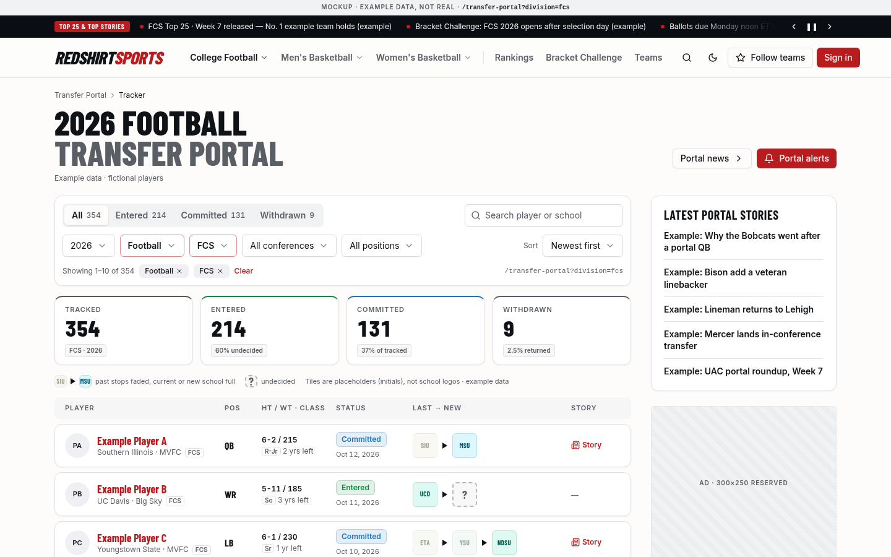

## 16. Transfer portal and recruiting hubs (article-driven)

Hub pages for the two highest-intent off-field topics, with no player databases. Each hub is editorial: Sanity articles tagged with a `topic` (`transfer-portal`, `recruiting`) plus schools. v1.5 adds a real **Transfer Portal Tracker** whose rows are Sanity `portalEntry` documents maintained by editors. There are still **no Postgres player, recruit or portal tables** and no external data feed.

| Page | URL | Content |
|---|---|---|
| Portal hub | `/college/football/transfer-portal` (`?page=n`), same for basketball | Lead story, storylines (Sanity `storyline`), river of portal-tagged articles, a 4-row **tracker preview** (same `PortalRow`), link to the full tracker |
| **Portal tracker** | `/transfer-portal` with `?sport=&division=&status=&position=&conference=&school=&sort=&page=` | Filterable list of `portalEntry` rows (§16.1) |
| Recruiting hub | `/college/football/recruiting` (`?page=n`) | Commits coverage cards, signing-day package, storylines, river, optional curated commits list (`curatedTracker`, kind `recruiting`) |
| Team view | `/teams/{slug}/football/news` | Team's portal/recruiting stories via tags; the team's portal entries in a small `PortalRow` list |

Do not build: player profile pages, player photos, star ratings or grades, NIL valuations, prediction percentages, class rankings, or any ingestion of portal data.

### 16.1 Portal tracker

> **Status: in scope, UI redesign required before build (handoff).** The URL design, `searchParams` rules, Sanity schema, GROQ, caching and the named-`grid-template-areas` technique below are approved for planning. The *visual* design (the `PortalRow` card, filter bar and summary cards shown in the screenshots) will be redone before implementation. Do not build tracker UI from these mockups until James signs off on the redesign; the schema, query and route plumbing can be built first.

> **Story link optional (v1.7).** v1.5 required every entry to link a Redshirt story. Not every player has one, so `story` is **optional** until Open Decision #16 is settled: Studio shows a warning (not an error) when it is empty, the GROQ no longer filters out story-less entries, and `PortalRow` shows "No story yet" instead of the Story link.

**Why one root URL with query filters.** The tracker is a *view over one dataset* with many filter combinations, so filters are `searchParams` (as asked), including sport. It lives in its own static root folder, `app/(site)/transfer-portal/page.tsx` (folder = URL, no rewrites; `transfer-portal` is added to `RESERVED_ROOT_SEGMENTS`). Sport hubs link in with the sport preselected (`/transfer-portal?sport=mens-basketball`). Football is the default, so it carries no `sport` param.

| Param | Values | Default | Indexable? |
|---|---|---|---|
| `sport` | `football`, `mens-basketball`, `womens-basketball` | `football` | Yes |
| `division` | football `fbs fcs d2 d3 naia`; basketball `d1 d2 d3` | all | Yes |
| `status` | `entered`, `committed`, `withdrawn` | all | No |
| `position` | per sport (`qb rb wr te ol dl edge lb cb s k p ls` / `g f c`) | all | No |
| `conference` | conference slug (matches previous **or** new school) | all | No |
| `school` | free text, 2–40 chars (matches previous or new school name) | none | No |
| `sort` | `newest`, `oldest`, `name`, `school` | `newest` | No |
| `page` | 1–500 (§17.6) | 1 | Yes |

- **Canonical** = the indexable subset in a fixed order (`sport`, `division`, `page`, defaults dropped). Example: `/transfer-portal?division=fcs&status=committed&sort=name` → canonical `/transfer-portal?division=fcs`, `robots: noindex, follow`. Views with only indexable params are `index, follow` with a self canonical.
- **Invalid values**: an invalid `page` → 404 (as everywhere). An invalid filter value is dropped (treated as "all") and the view is `noindex`. No redirects either way.
- **Filter UI** is a plain `<form method="get">` of shadcn `Select`s + an `Input`, so it works without JS; with JS, changes call `router.replace(`?${params}`, { scroll: false })` (client navigation, not an HTTP redirect) and reset `page`. Active filters render as removable `Badge` chips plus "Clear all". Mobile collapses the filters into a `Sheet` ("Filters · 2") with the sort `Select` beside it.
- **Summary cards**: Entered / Committed / Withdrawn counts for the current filters (ignoring `status`), labelled as Redshirt-tracked entries, not totals.
- **Caching** (Cache Components): the page shell is static; the list and counts sit in `<Suspense>` and call `getPortalEntries(filters)`, a `"use cache"` function whose arguments are the normalized filter object, so every combination is cached and shared. Tags `portal` and `portal:<sport>`; the Sanity webhook (§18.4) expires them when a `portalEntry` is published. `cacheLife("minutes")` as a backstop.

#### Sanity schema: `portalEntry`

```ts
// packages/sanity/src/schemas/portal-entry.ts
import { defineType, defineField } from "sanity";
import { UsersIcon } from "@sanity/icons";

const POSITIONS = {
  cfb: ["QB", "RB", "WR", "TE", "OL", "DL", "EDGE", "LB", "CB", "S", "K", "P", "LS"],
  mbb: ["G", "F", "C"],
  wbb: ["G", "F", "C"],
} as const;
const DIVISIONS = { cfb: ["fbs", "fcs", "d2", "d3", "naia"], mbb: ["d1", "d2", "d3"], wbb: ["d1", "d2", "d3"] } as const;

export const portalEntry = defineType({
  name: "portalEntry",
  title: "Portal entry",
  type: "document",
  icon: UsersIcon,
  fields: [
    defineField({ name: "playerName", type: "string", validation: (r) => r.required().max(80) }),
    defineField({ name: "sport", type: "string", initialValue: "cfb", options: { list: ["cfb", "mbb", "wbb"], layout: "radio" }, validation: (r) => r.required() }),
    defineField({ name: "season", type: "number", description: "Portal cycle year, e.g. 2026", validation: (r) => r.required().integer().min(2024) }),
    defineField({
      name: "position", type: "string",
      options: { list: [...new Set(Object.values(POSITIONS).flat())] },
      validation: (r) => r.required().custom((v, { document }) =>
        !v || (POSITIONS as any)[document?.sport as string]?.includes(v) || "Position doesn't match the sport"),
    }),
    defineField({ name: "classYear", title: "Class", type: "string", options: { list: ["FR", "SO", "JR", "SR", "GR"] }, validation: (r) => r.required() }),
    defineField({ name: "redshirt", type: "boolean", initialValue: false }),
    defineField({ name: "eligibilityRemaining", title: "Years of eligibility left", type: "number", validation: (r) => r.integer().min(0).max(5) }),
    defineField({ name: "heightInches", title: "Height (inches)", type: "number", description: "Optional. 74 = 6-2", validation: (r) => r.integer().min(60).max(90) }),
    defineField({ name: "weightLbs", title: "Weight (lb)", type: "number", description: "Optional", validation: (r) => r.integer().min(120).max(400) }),
    defineField({ name: "previousSchool", type: "reference", to: [{ type: "school" }], validation: (r) => r.required() }),
    defineField({
      name: "division", type: "string", description: "Division of the previous program",
      options: { list: [...new Set(Object.values(DIVISIONS).flat())] },
      validation: (r) => r.required().custom((v, { document }) =>
        !v || (DIVISIONS as any)[document?.sport as string]?.includes(v) || "Division doesn't match the sport"),
    }),
    defineField({ name: "status", type: "string", initialValue: "entered", options: { list: ["entered", "committed", "withdrawn"], layout: "radio" }, validation: (r) => r.required() }),
    defineField({
      name: "newSchool", type: "reference", to: [{ type: "school" }],
      hidden: ({ document }) => document?.status !== "committed",
      validation: (r) => r.custom((v, { document }) => document?.status !== "committed" || !!v || "Committed entries need a new school"),
    }),
    defineField({ name: "enteredOn", type: "date", validation: (r) => r.required() }),
    defineField({ name: "committedOn", type: "date", hidden: ({ document }) => document?.status !== "committed",
      validation: (r) => r.custom((v, { document }) => document?.status !== "committed" || !!v || "Required when committed") }),
    defineField({ name: "withdrawnOn", type: "date", hidden: ({ document }) => document?.status !== "withdrawn",
      validation: (r) => r.custom((v, { document }) => document?.status !== "withdrawn" || !!v || "Required when withdrawn") }),
    defineField({
      name: "story", title: "Redshirt story", type: "reference", to: [{ type: "post" }],
      description: "The Redshirt article this entry comes from, if there is one. Optional pending Open Decision #16 (§30).",
      // Optional pending Open Decision #16. Do NOT switch this to r.required() until James decides.
      validation: (r) => r.custom((v) => (v ? true : "No Redshirt story linked yet")).warning(),
    }),
    defineField({ name: "moreStories", type: "array", of: [{ type: "reference", to: [{ type: "post" }] }], validation: (r) => r.max(5) }),
    defineField({ name: "note", type: "string", description: "Optional one-line context", validation: (r) => r.max(160) }),
  ],
  orderings: [{ title: "Latest status", name: "latest", by: [{ field: "_updatedAt", direction: "desc" }] }],
  preview: {
    select: { name: "playerName", pos: "position", status: "status", from: "previousSchool.shortName", to: "newSchool.shortName" },
    prepare: ({ name, pos, status, from, to }) => ({ title: `${name} · ${pos}`, subtitle: `${from ?? "?"} → ${to ?? status}` }),
  },
});
```

Notes: no `slug` (there are no player pages) and no image field (initials avatar only, which avoids photo-rights questions). Studio gets a "Portal tracker" desk list filtered by sport/season/status, and the post editor shows "Portal entries citing this story" so editors update both together.

#### GROQ

```ts
// packages/sanity/src/queries/portal.ts
import { defineQuery } from "next-sanity";

// Shared filter. Params left null mean "all". $school is pre-formatted server-side as "montana*".
// Reading $sort inside order() keeps this one static query (typegen-friendly); the server only ever passes a whitelisted value.
export const portalEntriesQuery = defineQuery(`{
  "items": *[_type == "portalEntry" && sport == $sport && season == $season
    && ($division == null || division == $division)
    && ($status == null || status == $status)
    && ($position == null || position == $position)
    && ($conference == null || previousSchool->conference->slug.current == $conference || newSchool->conference->slug.current == $conference)
    && ($school == null || previousSchool->name match $school || previousSchool->shortName match $school
                        || newSchool->name match $school || newSchool->shortName match $school)
  ]{
    _id, playerName, position, classYear, redshirt, eligibilityRemaining, heightInches, weightLbs, division, status, note,
    "statusDate": coalesce(committedOn, withdrawnOn, enteredOn),
    "from": previousSchool->{ "slug": slug.current, name, shortName, "conference": conference->shortName, logo },
    "to": newSchool->{ "slug": slug.current, name, shortName, "conference": conference->shortName, logo },
    // null when no story is linked (story is optional (Decision #16))
    "story": story->{ title, "slug": slug.current, primarySport, publishedAt }
  } | order(
      select($sort == "oldest" => statusDate, $sort == "name" => playerName, $sort == "school" => from.shortName, null) asc,
      select($sort == "newest" => statusDate, null) desc,
      _id asc
    )[$start...$end],
  "counts": {
    "entered":   count(*[_type == "portalEntry" && sport == $sport && season == $season && status == "entered"   && ($division == null || division == $division)]),
    "committed": count(*[_type == "portalEntry" && sport == $sport && season == $season && status == "committed" && ($division == null || division == $division)]),
    "withdrawn": count(*[_type == "portalEntry" && sport == $sport && season == $season && status == "withdrawn" && ($division == null || division == $division)])
  },
  "total": count(*[_type == "portalEntry" && sport == $sport && season == $season
    && ($division == null || division == $division) && ($status == null || status == $status)
    && ($position == null || position == $position)
    && ($conference == null || previousSchool->conference->slug.current == $conference || newSchool->conference->slug.current == $conference)
    && ($school == null || previousSchool->name match $school || previousSchool->shortName match $school
                        || newSchool->name match $school || newSchool->shortName match $school)])
}`);
```

(If the `select()`-in-`order()` pattern gives you trouble on your API version, use four literal queries, one per sort, chosen from a whitelist map. Never interpolate user input into GROQ.) Counts here ignore position/conference/school for speed; extend them with the same filter if editors want exact counts. At editor-maintained volumes (hundreds to low thousands per season) these queries are fast; they're cached anyway.

#### Params, data function and page

```ts
// packages/seo/src/portal-params.ts
import { z } from "zod";
const SPORT = { football: "cfb", "mens-basketball": "mbb", "womens-basketball": "wbb" } as const;
const opt = <T extends z.ZodTypeAny>(s: T) => s.optional().catch(undefined);   // invalid → dropped

export const PortalParams = z.object({
  sport: z.enum(["football", "mens-basketball", "womens-basketball"]).catch("football"),
  division: opt(z.enum(["fbs", "fcs", "d2", "d3", "naia", "d1"])),
  status: opt(z.enum(["entered", "committed", "withdrawn"])),
  position: opt(z.string().regex(/^[a-z]{1,4}$/)),
  conference: opt(z.string().regex(/^[a-z0-9-]{2,40}$/)),
  school: opt(z.string().trim().min(2).max(40)),
  sort: z.enum(["newest", "oldest", "name", "school"]).catch("newest"),
});
export type PortalFilters = z.infer<typeof PortalParams> & { page: number };

export function parsePortal(sp: Record<string, string | string[] | undefined>) {
  const raw = Object.fromEntries(Object.entries(sp).map(([k, v]) => [k, Array.isArray(v) ? v[0] : v]));
  const f = PortalParams.parse(raw);
  const dropped = ["division", "status", "position", "conference", "school", "sort"].some((k) => raw[k] !== undefined && (f as any)[k] !== raw[k]);
  return { filters: f, sportCode: SPORT[f.sport], dropped };
}

export function portalCanonical(f: PortalFilters) {
  const q = new URLSearchParams();
  if (f.sport !== "football") q.set("sport", f.sport);
  if (f.division) q.set("division", f.division);
  if (f.page > 1) q.set("page", String(f.page));
  const s = q.toString();
  return `/transfer-portal${s ? `?${s}` : ""}`;
}
export const portalIndexable = (f: PortalFilters, dropped: boolean) =>
  !dropped && !f.status && !f.position && !f.conference && !f.school && f.sort === "newest";
```

```ts
// packages/sanity/src/data/portal.ts
import { cacheTag, cacheLife } from "next/cache";
import { client } from "../client";
import { portalEntriesQuery } from "../queries/portal";

export async function getPortalEntries(f: PortalFilters & { sportCode: "cfb" | "mbb" | "wbb"; season: number }) {
  "use cache";
  cacheTag("portal", `portal:${f.sportCode}`);
  cacheLife("minutes");
  const size = 25, start = (f.page - 1) * size;
  return client.fetch(portalEntriesQuery, {
    sport: f.sportCode, season: f.season, division: f.division ?? null, status: f.status ?? null,
    position: f.position?.toUpperCase() ?? null, conference: f.conference ?? null,
    school: f.school ? `${f.school.replace(/[*"\\]/g, "")}*` : null,
    sort: f.sort, start, end: start + size,
  });
}
```

```tsx
// apps/web/app/(site)/transfer-portal/page.tsx
import { Suspense } from "react";
import { notFound } from "next/navigation";
import type { Metadata } from "next";
import { parsePage } from "@rs/seo/pagination";
import { parsePortal, portalCanonical, portalIndexable } from "@rs/seo/portal-params";
type SP = Promise<Record<string, string | string[] | undefined>>;

export async function generateMetadata({ searchParams }: { searchParams: SP }): Promise<Metadata> {
  const sp = await searchParams;
  const page = parsePage(typeof sp.page === "string" ? sp.page : undefined) ?? 1;
  const { filters, dropped } = parsePortal(sp);
  const f = { ...filters, page };
  return {
    title: `Transfer Portal Tracker${filters.division ? ` · ${filters.division.toUpperCase()}` : ""}${page > 1 ? ` – Page ${page}` : ""}`,
    alternates: { canonical: portalCanonical(f) },
    robots: portalIndexable(f, dropped) ? { index: true, follow: true } : { index: false, follow: true },
  };
}

export default function Page({ searchParams }: { searchParams: SP }) {
  return (
    <TrackerShell>                                        {/* static: title, intro, rail, ad slots */}
      <Suspense fallback={<TrackerSkeleton />}><Tracker searchParams={searchParams} /></Suspense>
    </TrackerShell>
  );
}

async function Tracker({ searchParams }: { searchParams: SP }) {
  const sp = await searchParams;
  const page = parsePage(typeof sp.page === "string" ? sp.page : undefined);
  if (page === null) notFound();
  const { filters, sportCode } = parsePortal(sp);
  const data = await getPortalEntries({ ...filters, page, sportCode, season: currentPortalSeason(sportCode) });
  const totalPages = Math.max(1, Math.ceil(data.total / 25));
  if (page > totalPages) notFound();
  return (
    <>
      <PortalFilters value={filters} />                   {/* GET form + router.replace; chips; mobile Sheet */}
      <PortalSummary counts={data.counts} />
      <PortalRowHead />
      <ol className="grid gap-2">{data.items.map((e) => <PortalRow key={e._id} entry={e} />)}</ol>
      <Pagination page={page} totalPages={totalPages} hrefFor={(n) => withParam(sp, "page", n > 1 ? String(n) : null)} />
    </>
  );
}
```

#### `PortalRow`: named grid areas

The row is one CSS grid with named areas. Mobile stacks a card; at `lg` the same element becomes a single wide row whose columns line up with a header row. Children only declare *which area* they occupy, so the layout lives in one place. Defined once as a Tailwind v4 `@utility` in `packages/ui/src/styles/globals.css`:

```css
/* packages/ui/src/styles/globals.css (excerpt) */
@utility portal-row {
  display: grid;
  grid-template-areas:
    "avatar  name    status"
    "avatar  meta    meta"
    "schools schools schools"
    "date    date    story";
  grid-template-columns: 2.5rem minmax(0, 1fr) auto;
  column-gap: 0.75rem;
  row-gap: 0.375rem;
  align-items: center;
  @variant lg {
    grid-template-areas:
      "avatar name pos schools status story"
      "avatar meta pos schools date   story";
    grid-template-columns: 2.75rem minmax(0, 1.35fr) 3.25rem minmax(0, 2fr) 6.5rem 7rem;
    column-gap: 1rem;
    row-gap: 0.125rem;
  }
}
@utility portal-row-head {            /* column labels, desktop only, same columns */
  display: none;
  @variant lg {
    display: grid;
    grid-template-areas: "avatar name pos schools status story";
    grid-template-columns: 2.75rem minmax(0, 1.35fr) 3.25rem minmax(0, 2fr) 6.5rem 7rem;
    column-gap: 1rem;
  }
}
```

```tsx
// packages/ui/src/components/portal-row.tsx
import { Badge } from "@rs/ui/components/ui/badge";
import { Avatar, AvatarFallback } from "@rs/ui/components/ui/avatar";
import { ChevronRight, Newspaper } from "lucide-react";
import { SchoolChip } from "./school-chip";
import { urls } from "@rs/seo/urls";

const STATUS = {
  entered:   { label: "Entered",   variant: "outline" as const, className: "border-new/50 text-new" },
  committed: { label: "Committed", variant: "default" as const, className: "" },
  withdrawn: { label: "Withdrawn", variant: "secondary" as const, className: "text-muted-foreground" },
};
const ht = (i?: number) => (i ? `${Math.floor(i / 12)}-${i % 12}` : null);

export function PortalRow({ entry: e }: { entry: PortalEntryRow }) {
  const s = STATUS[e.status];
  const initials = e.playerName.split(" ").slice(-2).map((w) => w[0]).join("");
  const size = [ht(e.heightInches), e.weightLbs].filter(Boolean).join(" / ");
  return (
    <li className="portal-row rounded-xl border bg-card px-4 py-3 shadow-xs transition-colors hover:bg-accent/30">
      <Avatar className="[grid-area:avatar] size-10 self-start lg:size-11 lg:self-center">
        <AvatarFallback className="bg-secondary text-secondary-foreground">{initials}</AvatarFallback>
      </Avatar>
      <div className="[grid-area:name] min-w-0 truncate font-display text-lg font-bold leading-none">{e.playerName}</div>
      <div className="[grid-area:meta] flex min-w-0 flex-wrap items-center gap-x-1.5 gap-y-1 text-xs text-muted-foreground">
        <span className="font-semibold text-foreground lg:hidden">{e.position}</span>
        <span>{e.redshirt ? "R-" : ""}{e.classYear}{e.eligibilityRemaining != null && ` · ${e.eligibilityRemaining} yr left`}{size && ` · ${size}`}</span>
        <Badge variant="secondary" className="h-5 px-1.5 text-[10px] uppercase">{e.division}</Badge>
      </div>
      {/* hidden below lg: the mobile template has no "pos" area, so this must not render there */}
      <div className="[grid-area:pos] hidden font-display text-base font-bold lg:block">{e.position}</div>
      <div className="[grid-area:schools] grid min-w-0 grid-cols-[minmax(0,1fr)_auto_minmax(0,1fr)] items-center gap-2 rounded-lg bg-muted/40 px-2 py-1.5 lg:bg-transparent lg:p-0">
        <SchoolChip school={e.from} muted />
        <ChevronRight className="size-4 text-muted-foreground" aria-hidden />
        {e.status === "committed" && e.to ? <SchoolChip school={e.to} /> :
         e.status === "entered" ? <span className="text-sm text-muted-foreground">Undecided</span> :
         <span className="text-sm text-muted-foreground">Returning</span>}
      </div>
      <Badge variant={s.variant} className={`[grid-area:status] justify-self-end lg:justify-self-start ${s.className}`}>{s.label}</Badge>
      <time dateTime={e.statusDate} className="[grid-area:date] text-xs tabular text-muted-foreground">
        <span className="lg:hidden">{s.label} </span>{formatDate(e.statusDate)}
      </time>
      {e.story?.slug ? (
      <a href={urls.article({ primarySport: e.story.primarySport, slug: e.story.slug })} title={e.story.title}
         className="[grid-area:story] inline-flex items-center gap-1 justify-self-end rounded-md px-2 py-1 text-xs font-semibold text-primary hover:bg-accent">
        <Newspaper className="size-3.5" aria-hidden /> Story <ChevronRight className="size-3" aria-hidden />
        <span className="sr-only">: {e.story.title}</span>
      </a>
      ) : <span className="[grid-area:story] justify-self-end text-xs text-muted-foreground">No story yet</span> /* story optional (Decision #16) */}
    </li>
  );
}
```

**Alternative without `@utility`** (fine for a one-off, harder to read): Tailwind arbitrary properties, with `_` for spaces inside the value:

```tsx
<li className="grid grid-cols-[2.5rem_minmax(0,1fr)_auto]
  [grid-template-areas:'avatar_name_status'_'avatar_meta_meta'_'schools_schools_schools'_'date_date_story']
  lg:grid-cols-[2.75rem_minmax(0,1.35fr)_3.25rem_minmax(0,2fr)_6.5rem_7rem]
  lg:[grid-template-areas:'avatar_name_pos_schools_status_story'_'avatar_meta_pos_schools_date_story']">
```

Prefer the `@utility`: one named class, readable area maps, and the header row shares the column definition. Accessibility: the list is an `<ol>` of `<li>`s (not a table, because the mobile layout reflows cells); the header row is `aria-hidden` and each row's text reads in a sensible order (name, details, position, previous → new, status, date, story).

#### What we borrowed from On3's Transfer Portal Wire

I fetched `on3.com/transfer-portal/wire/football/` and took Playwright screenshots (desktop 1440×900 and mobile 390×844, kept outside this handoff for study only; they contain On3's real players, photos and data, so they are **not** embedded here). With a normal browser window I inspected the row's computed styles: on desktop, each row is a 5-column grid (player · pos · grades/NIL · status · last → new) under a matching header row; on mobile the same row redefines `grid-template-areas` to `"player" "rating" "status" "flow"`, stacking cells into a card and hiding the position cell (it moves into the player meta line).

| On3 element | Redshirt version |
|---|---|
| Row card that is one CSS grid; mobile redefines `grid-template-areas` to stack | `portal-row` `@utility` with named areas; mobile 3-column card, `lg` single row; children only set `[grid-area:…]` |
| Header row aligned to the row columns | `portal-row-head` sharing the same column template |
| Player cell: name, then a meta line with position, height/weight, class chip | Name in Barlow Condensed, meta line with class, eligibility, optional height/weight and a division `Badge`; position gets its own column on desktop and joins the meta line on mobile, as On3 does |
| Status pill with date stacked under it | `Badge` (Entered = outline "new" blue, Committed = primary, Withdrawn = muted) over the date |
| "Last → new" school flow with arrows; "?" when undecided | Previous → new school chips (neutral marks + conference); dashed "?" + "Undecided" when entered; "Returning" when withdrawn. Only previous → new; no multi-school chains |
| Filter selects above the list (year, sport, team, status, position) | Sport, Division, Status, Position, Conference, School search, Sort, all in `searchParams`, plus removable chips and "Clear all"; mobile `Sheet` |
| Summary stat cards (in portal, committed, withdrawn) | Same three counts, from Redshirt's own entries and labelled "tracked, not exhaustive" |
| Not borrowed | Player photos, star ratings, transfer/HS grades, NIL valuations, prediction percentages, ads between rows. (v1.5 also required every row to link a Redshirt story; since v1.7 the link is optional (Decision #16)) |



<p class="shots"></p>

*Above: the tracker on mobile (named areas restacked into a card) and the portal hub with its tracker preview. All players are fictional placeholders.*
