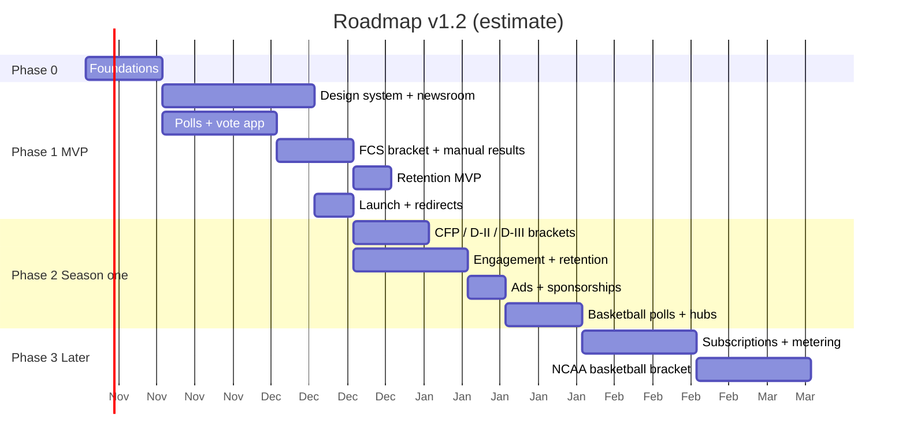

## 28. Phased roadmap and effort

Effort is in **engineer-weeks for one senior full-stack engineer with AI coding assistance**. All numbers are **estimates**; adjust after Phase 0. Appendix D is the Cursor-ready task list with acceptance criteria.

### 28.1 Phases

Illustrative dates; slide them to the season calendar (FCS bracket ready before the selection show; basketball polls before Tipoff).

### 28.2 Milestones

| Phase | Milestone | Scope | Exit criteria | Effort (est.) |
|---|---|---|---|---|
| 0 | Foundations | Turborepo, apps web/vote/admin/studio, `packages/db` (Drizzle + RLS + `rs_server` + `withRls`), CI, Clerk shared sessions + authorizedParties, users webhook, Sanity project + schemas v1, `SanityImage`, `@rs/seo/urls`, design tokens | Signed-in user in Postgres; Sanity post renders on a preview via `/{sport}/news/{slug}` | 2 wk |
| 1a | Newsroom | Design system (§32: tokens, fonts, shadcn inventory, custom components), route manifest + factory + `routes:gen` (no rewrites, §17.3), articles, people, page builder + catch-all + Presentation, sport/division hubs and news indexes with `?page=n`, sport-agnostic team hubs `/teams/{school-nickname}`, **Transfer Portal and Recruiting hubs** (storylines, tracker preview), **Portal Tracker** at `/transfer-portal` (`portalEntry`, filters, named-grid `PortalRow`), homepage, sitemaps, JSON-LD, OG, draft mode, revalidation, legacy-redirect table | Lighthouse budgets; Rich Results; editors publish without dev help; screens match §32 mockups; zero rewrites | 5.5 wk |
| 1e | Retention MVP | Follows + onboarding picker + For you, related/next modules, Poll Release newsletter, OG share cards, PostHog event schema + Activation funnel (§31) | Activation funnel live; follow → For you works end to end | 1 wk |
| 1b | Polls + vote app | Invites, accept on `vote.`, ballot editor, tick cron, tabulation, transparency incl. **Voter Ballot Breakdown** (matrix, outliers, filter, distribution), history import, MFA | One weekly cycle in staging with real voters; recomputed history matches | 3.5 wk |
| 1c | FCS bracket | `fcs24`, pick editor, **bracket view with matchup panel** (§32.12), groups, lock, **manual results + rescore**, leaderboards (MV), share images | Simulated tournament scores correctly; unique (sport,division,season) enforced | 2.5 wk |
| 1d | Launch | Content import, optional legacy 301 import, Search Console, monitoring | Top legacy URLs 301 once; no other redirects or rewrites exist | 1 wk |
| 2b | More brackets | `cfp12` (division `fbs`), `d2_28`, `d3_32` | Each format passes engine tests + dry run with staff results | 2 wk |
| 2c | Engagement + retention | Daily/My Teams newsletters, web push, saved articles, infinite next article, bracket reminders, PWA install card, retention dashboard (§31.13) | Digest on schedule; push on Android/desktop and installed iOS; D1/D7/D30 dashboard populated | 2.5 wk |
| 2d | Revenue v1 | Ad slots + CMP, sponsor models | CLS within budget with ads | 1 wk |
| 2e | Basketball | MBB/WBB seasons, polls, hubs | First basketball poll published | 2 wk |
| 3b | Subscriptions | Clerk Billing or Stripe, entitlements, metering | Paid test; paywall markup valid | 3 wk |
| 3c | `ncaab68` | First Four, regions, mass leaderboards | Load test with large entry count | 3 wk |

**Rough total**: MVP (0–1) about **12.5–15.5 engineer-weeks**; season-one (through 2) about **20–24** (v1.5: +0.5 wk portal tracker, −0.5 wk fan vote and build-your-own removed from 2c); later (3) about **6+**. **Estimate.** v1.4 adds route codegen + sport-agnostic team hubs (+0.5 wk), portal and recruiting hubs (+0.5–1 wk), ballot breakdown (+0.5 wk) and the bracket view (+0.5 wk). v1.3 added the design system (+1 wk), retention MVP (+1 wk) and expanded engagement (+1 wk). Removed vs 1.1: sports-data ingestion (~4 wk), portal (~4), recruiting (~6+).

### 28.3 Sequencing advice

- Ship the newsroom and polls first; they carry the existing audience and weekly cadence.
- Build the bracket engine in parallel once foundations exist; results entry is a small admin UI, not a data pipeline.
- Do **not** invent a scores product, live blogs, rosters or recruiting DBs — they are out of scope (§3, §15, §16).
- Treat basketball as "configuration plus calendars"; if 2e exceeds ~2 weeks, the abstractions are leaking.
- Follow Appendix D milestone by milestone when handing this to Cursor.
