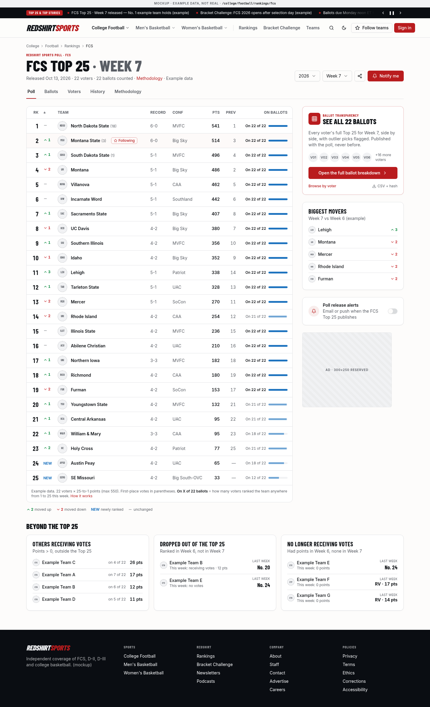
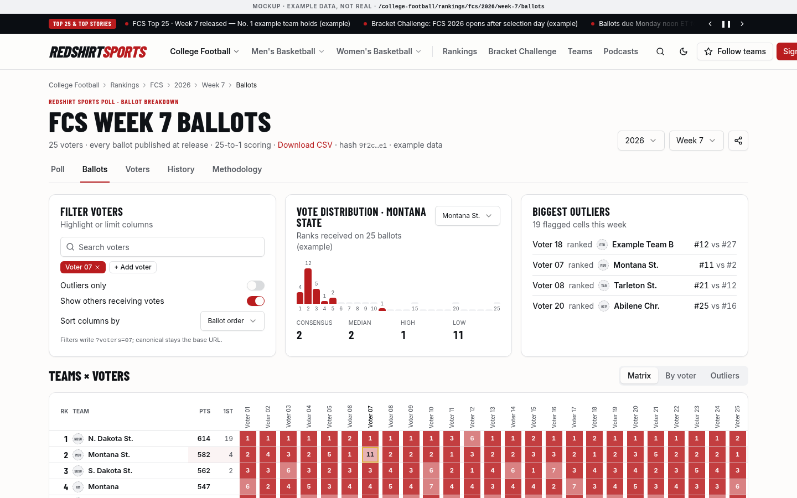
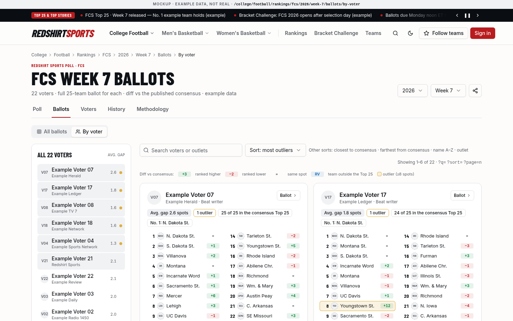
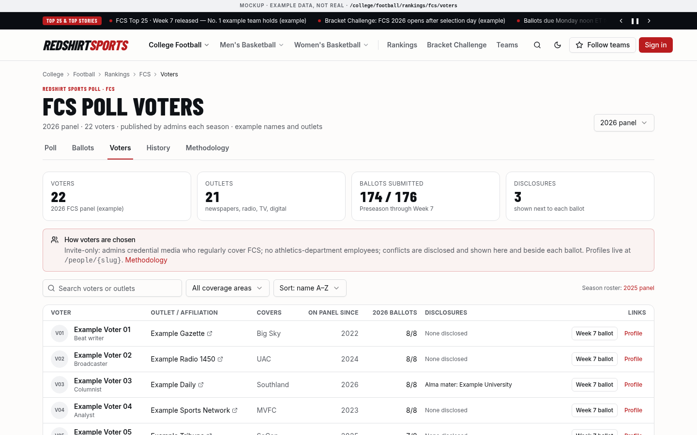
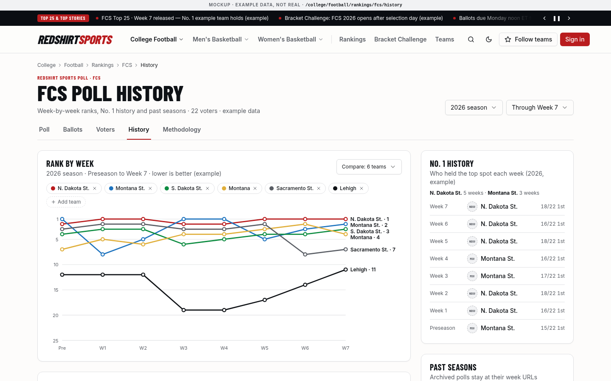
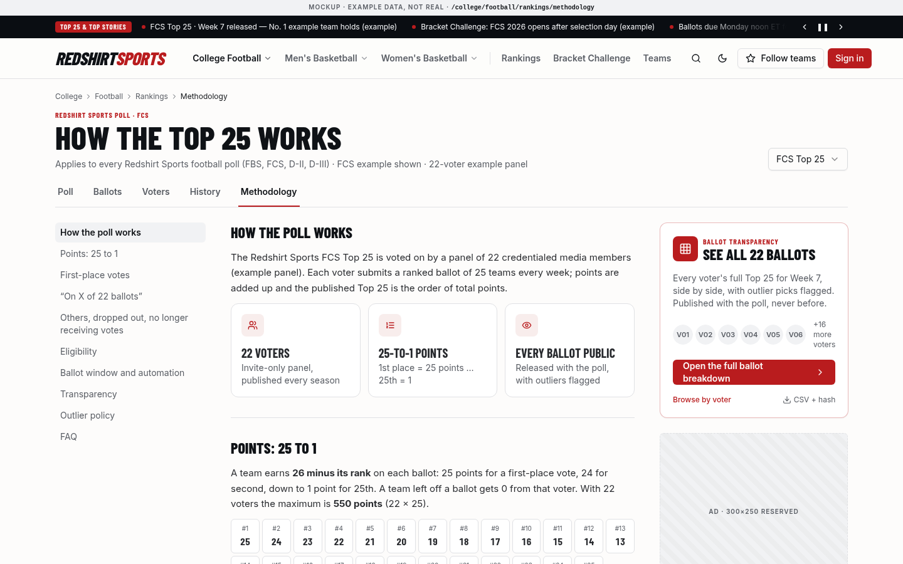

## 32. UI/UX direction and design system

**Direction in one line:** the *density and confidence* of traditional college sports news sites (ESPN's sport/division nav, On3/247 team-first hubs, SI and The Athletic's typography, Bleacher Report's share-first cards) with a *modern, calm* product layer: Tailwind v4 + shadcn/ui, generous whitespace, one accent color, fast pages, no clutter. Scores are deliberately absent; the poll and top stories take the ticker's place.

All mockups below are static HTML built with the same tokens and shadcn component markup the apps will use. They live in `docs/mockups/` (open any `.html` file in a browser; append `?dark` for dark mode, `?mega-open` for the mega nav, `?menu-open` for the mobile sheet). Content is placeholder: school names are examples only, logos are neutral placeholders, and all numbers are example data, not real rankings, records or stats.

### 32.1 Design principles

1. **Headlines first.** Condensed, uppercase display type for headlines and section labels gives the "sports page" feel; everything else is quiet.
2. **One accent.** Redshirt red marks the brand, primary actions, kickers and the active state. Movement colors (up/down/new) are the only other hues.
3. **Information density where it earns it** (rankings tables, brackets, ballots), whitespace everywhere else (articles, hubs).
4. **Everything is a shadcn component or composed from them**, using the same tokens, radius and spacing, so custom sports components (bracket, ballot, rankings table, ticker) look native.
5. **No layout shift.** Every image, ad slot, embed and lazy module has reserved dimensions (§32.15).
6. **Mobile is the primary canvas**: bottom navigation, thumb-reachable actions, sticky progress bars in the bracket and ballot.
7. **Accessible by default**: WCAG 2.2 AA contrast in both themes, keyboard-complete bracket and ballot, visible focus rings (§25).
8. **Personal, not pushy**: follow prompts are inline and dismissible (§31.2).

### 32.2 Typography (open fonts, self-hosted)

| Role | Font | License | Use |
|---|---|---|---|
| Display | **Barlow Condensed** 500–800 | SIL OFL | Headlines, kickers, section titles, rank numbers, card titles, wordmark. Uppercase for H1/section labels, sentence case allowed for river headlines |
| UI / body sans | **Inter** (variable) | SIL OFL | Navigation, buttons, tables, metadata, mobile body, forms |
| Article body / deks | **Source Serif 4** (variable) | SIL OFL | Long-form article body and deks (The Athletic/SI feel), 1.15 rem / 1.7 line height, ~68 ch measure |

- Load with `next/font/local` (or `next/font/google`) in `packages/ui/fonts`, exposing CSS variables consumed by the `@theme` block. Subset to Latin; `display: swap`; preload only Barlow Condensed 700/800 and Inter.
- Scale tokens: `text-kicker` (0.75 rem, 0.08 em tracking), `text-headline-sm` (1.375 rem / 1.1), `text-headline` (2 rem / 1.05), `text-headline-lg` (3.25 rem / 1.0).
- Tabular numerals (`tabular` utility) for ranks, points and records.

### 32.3 Color, light/dark and tokens

- **Brand red** `--primary: oklch(0.505 0.19 27)` (light) / `oklch(0.64 0.2 25)` (dark), tuned for ≥ 4.5:1 against the respective foregrounds on buttons and ≥ 3:1 for large kickers.
- **Ink** (`--ink`) is a near-black for the ticker, footer and hero promo cards (sports-page masthead feel).
- **Paper** background (warm off-white) in light mode; deep blue-gray in dark mode (not pure black, to reduce halation).
- **Semantic sports tokens**: `--up` (green), `--down` (red-orange), `--new` (blue), `--gold` (first-place votes, champion), `--live` (an *open voting window*, never live scores).
- Dark mode via `.dark` class (`next-themes`, `attribute="class"`), default `system`. All components read semantic tokens only; no raw hex values in components.

### 32.4 The theme token file (Tailwind v4, CSS-first, no `tailwind.config.js`)

`packages/ui/src/styles/globals.css` is the single source of truth, imported by `apps/web`, `apps/vote`, `apps/admin` (and used by `components.json` for shadcn). The mockups compile the identical file (`docs/mockups/src/app.css`); in production the `@font-face` blocks are replaced by `next/font` variables, and `@source` points at the monorepo packages.

```css
/* packages/ui/src/styles/globals.css — Redshirt theme (Tailwind v4, CSS-first, shadcn/ui tokens)
   Mockup copy: identical tokens to the production file described in §32.4. */
@import "tailwindcss";
@source "../*.html";

@custom-variant dark (&:where(.dark, .dark *));

/* ---------- Fonts (self-hosted, OFL) ---------- */
@font-face { font-family: "Barlow Condensed"; font-weight: 500; font-display: swap; src: url("../fonts/barlow-condensed-latin-500-normal.woff2") format("woff2"); }
@font-face { font-family: "Barlow Condensed"; font-weight: 600; font-display: swap; src: url("../fonts/barlow-condensed-latin-600-normal.woff2") format("woff2"); }
@font-face { font-family: "Barlow Condensed"; font-weight: 700; font-display: swap; src: url("../fonts/barlow-condensed-latin-700-normal.woff2") format("woff2"); }
@font-face { font-family: "Barlow Condensed"; font-weight: 800; font-display: swap; src: url("../fonts/barlow-condensed-latin-800-normal.woff2") format("woff2"); }
@font-face { font-family: "Inter Variable"; font-weight: 100 900; font-display: swap; src: url("../fonts/inter-latin-wght-normal.woff2") format("woff2"); }
@font-face { font-family: "Source Serif 4 Variable"; font-weight: 200 900; font-display: swap; src: url("../fonts/source-serif-4-latin-wght-normal.woff2") format("woff2"); }
@font-face { font-family: "Source Serif 4 Variable"; font-style: italic; font-weight: 200 900; font-display: swap; src: url("../fonts/source-serif-4-latin-wght-italic.woff2") format("woff2"); }

/* ---------- Semantic tokens (shadcn naming) ---------- */
:root {
  --radius: 0.5rem;

  --background: oklch(0.992 0.002 75);          /* warm paper white */
  --foreground: oklch(0.18 0.01 260);           /* ink */
  --card: oklch(1 0 0);
  --card-foreground: var(--foreground);
  --popover: oklch(1 0 0);
  --popover-foreground: var(--foreground);

  --primary: oklch(0.505 0.19 27);              /* Redshirt red */
  --primary-foreground: oklch(0.985 0.005 27);
  --secondary: oklch(0.955 0.004 260);
  --secondary-foreground: oklch(0.22 0.01 260);
  --muted: oklch(0.962 0.003 260);
  --muted-foreground: oklch(0.48 0.012 260);
  --accent: oklch(0.955 0.012 27);              /* faint red wash for hovers/selected */
  --accent-foreground: oklch(0.38 0.15 27);
  --destructive: oklch(0.577 0.245 27.3);
  --border: oklch(0.91 0.004 260);
  --input: oklch(0.89 0.004 260);
  --ring: oklch(0.505 0.19 27);

  /* Brand extensions */
  --ink: oklch(0.16 0.012 260);                 /* masthead / ticker bar */
  --ink-foreground: oklch(0.97 0.003 260);
  --up: oklch(0.56 0.15 150);                   /* rank moved up */
  --down: oklch(0.55 0.19 25);                  /* rank moved down */
  --new: oklch(0.55 0.14 250);                  /* newly ranked */
  --gold: oklch(0.78 0.14 85);                  /* first-place votes, champion */
  --live: oklch(0.63 0.2 145);                  /* "open" voting windows, not live scores */

  --chart-1: oklch(0.505 0.19 27);
  --chart-2: oklch(0.55 0.14 250);
  --chart-3: oklch(0.56 0.15 150);
  --chart-4: oklch(0.78 0.14 85);
  --chart-5: oklch(0.48 0.012 260);

  --sidebar: oklch(0.985 0.002 260);
  --sidebar-foreground: var(--foreground);
  --sidebar-primary: var(--primary);
  --sidebar-primary-foreground: var(--primary-foreground);
  --sidebar-accent: var(--accent);
  --sidebar-accent-foreground: var(--accent-foreground);
  --sidebar-border: var(--border);
  --sidebar-ring: var(--ring);
}

.dark {
  --background: oklch(0.16 0.008 260);
  --foreground: oklch(0.96 0.004 260);
  --card: oklch(0.2 0.009 260);
  --card-foreground: var(--foreground);
  --popover: oklch(0.2 0.009 260);
  --popover-foreground: var(--foreground);
  --primary: oklch(0.64 0.2 25);
  --primary-foreground: oklch(0.16 0.02 25);
  --secondary: oklch(0.26 0.01 260);
  --secondary-foreground: var(--foreground);
  --muted: oklch(0.25 0.01 260);
  --muted-foreground: oklch(0.7 0.012 260);
  --accent: oklch(0.28 0.05 25);
  --accent-foreground: oklch(0.9 0.05 25);
  --destructive: oklch(0.704 0.191 22.2);
  --border: oklch(1 0 0 / 11%);
  --input: oklch(1 0 0 / 15%);
  --ring: oklch(0.64 0.2 25);
  --ink: oklch(0.12 0.008 260);
  --ink-foreground: oklch(0.96 0.004 260);
  --up: oklch(0.72 0.16 150);
  --down: oklch(0.7 0.17 25);
  --new: oklch(0.72 0.12 250);
  --gold: oklch(0.82 0.14 85);
}

/* ---------- Map tokens to Tailwind utilities ---------- */
@theme inline {
  --font-display: "Barlow Condensed", "Arial Narrow", ui-sans-serif, sans-serif;
  --font-sans: "Inter Variable", ui-sans-serif, system-ui, sans-serif;
  --font-serif: "Source Serif 4 Variable", Georgia, ui-serif, serif;

  --color-background: var(--background);
  --color-foreground: var(--foreground);
  --color-card: var(--card);
  --color-card-foreground: var(--card-foreground);
  --color-popover: var(--popover);
  --color-popover-foreground: var(--popover-foreground);
  --color-primary: var(--primary);
  --color-primary-foreground: var(--primary-foreground);
  --color-secondary: var(--secondary);
  --color-secondary-foreground: var(--secondary-foreground);
  --color-muted: var(--muted);
  --color-muted-foreground: var(--muted-foreground);
  --color-accent: var(--accent);
  --color-accent-foreground: var(--accent-foreground);
  --color-destructive: var(--destructive);
  --color-border: var(--border);
  --color-input: var(--input);
  --color-ring: var(--ring);
  --color-ink: var(--ink);
  --color-ink-foreground: var(--ink-foreground);
  --color-up: var(--up);
  --color-down: var(--down);
  --color-new: var(--new);
  --color-gold: var(--gold);
  --color-live: var(--live);
  --color-chart-1: var(--chart-1);
  --color-chart-2: var(--chart-2);
  --color-chart-3: var(--chart-3);
  --color-chart-4: var(--chart-4);
  --color-chart-5: var(--chart-5);
  --color-sidebar: var(--sidebar);
  --color-sidebar-foreground: var(--sidebar-foreground);
  --color-sidebar-primary: var(--sidebar-primary);
  --color-sidebar-primary-foreground: var(--sidebar-primary-foreground);
  --color-sidebar-accent: var(--sidebar-accent);
  --color-sidebar-accent-foreground: var(--sidebar-accent-foreground);
  --color-sidebar-border: var(--sidebar-border);
  --color-sidebar-ring: var(--sidebar-ring);

  --radius-sm: calc(var(--radius) - 4px);
  --radius-md: calc(var(--radius) - 2px);
  --radius-lg: var(--radius);
  --radius-xl: calc(var(--radius) + 4px);

  /* Editorial type scale (display uses Barlow Condensed, tight leading) */
  --text-kicker: 0.75rem;
  --text-kicker--letter-spacing: 0.08em;
  --text-headline-sm: 1.375rem;
  --text-headline-sm--line-height: 1.1;
  --text-headline: 2rem;
  --text-headline--line-height: 1.05;
  --text-headline-lg: 3.25rem;
  --text-headline-lg--line-height: 1;
  --container-prose: 42rem;
  --container-site: 82rem;
}

@layer base {
  * { @apply border-border outline-ring/50; }
  body { @apply bg-background text-foreground font-sans antialiased; font-feature-settings: "cv11", "ss01"; }
  h1, h2, h3, .font-display { font-family: var(--font-display); }
  :focus-visible { @apply outline-2 outline-offset-2 outline-ring; }
}

/* ---------- Small utilities used by custom components ---------- */
@utility kicker { @apply font-display text-kicker uppercase font-bold tracking-[0.08em]; }
@utility tabular { font-variant-numeric: tabular-nums; }
@utility ph-photo {
  background:
    repeating-linear-gradient(135deg, oklch(0.5 0 0 / 0.06) 0 12px, transparent 12px 24px),
    linear-gradient(135deg, var(--muted), var(--secondary));
}
@utility ad-slot {
  background: repeating-linear-gradient(45deg, oklch(0.5 0 0 / 0.04) 0 8px, transparent 8px 16px), var(--muted);
}
```

`packages/ui/components.json` (shadcn CLI config; with Tailwind v4 the `config` field stays empty):

```json
{
  "$schema": "https://ui.shadcn.com/schema.json",
  "style": "new-york",
  "rsc": true,
  "tsx": true,
  "tailwind": { "config": "", "css": "src/styles/globals.css", "baseColor": "neutral", "cssVariables": true },
  "iconLibrary": "lucide",
  "aliases": { "components": "@rs/ui/components", "ui": "@rs/ui/components/ui", "utils": "@rs/ui/lib/utils", "hooks": "@rs/ui/hooks", "lib": "@rs/ui/lib" }
}
```

```css
/* apps/web/app/globals.css — each app imports the shared theme and tells Tailwind where classes live */
@import "@rs/ui/styles/globals.css";
@source "../../../packages/ui/src";
@source "../app";
@source "../components";
```

Notes:

- Tailwind v4 reads design tokens from `@theme` (here `@theme inline` so utilities reference the runtime CSS variables and dark mode just swaps variables). `bg-primary`, `text-muted-foreground`, `border-border`, `rounded-lg`, `font-display`, `text-up` etc. all come from this file.
- Add shadcn components with `pnpm dlx shadcn@latest add button card ...` from `packages/ui`; they land in `packages/ui/src/components/ui` and already use these token names.
- Radius: `--radius: 0.5rem` (slightly tighter than shadcn's default for a newsier look); `rounded-md` for buttons/inputs, `rounded-xl` for cards.

### 32.5 Component inventory

**shadcn/ui components used as-is** (installed into `packages/ui/src/components/ui`):

| shadcn component | Where it's used |
|---|---|
| `button` | Everywhere (variants: default, secondary, outline, ghost, link; custom `ink` variant added via `cva`) |
| `badge` | Kickers on cards (outline), status ("Window open"), "Following", record chips |
| `card` | Rail widgets, newsletter, groups, poll history, entry summary |
| `navigation-menu` | Desktop sport/division mega nav |
| `sheet` | Mobile menu (left), filters (bottom) |
| `drawer` (vaul) | Mobile onboarding, sign-in prompt, share sheet |
| `dialog` | Desktop onboarding, sign-in prompt (wrapping Clerk `<SignIn>`), confirm submit ballot |
| `command` | Team search in onboarding, ballot eligible teams, global search (`⌘K`) |
| `tabs` | Rankings division switcher, river filters, bracket rounds (mobile), ballot/teams (mobile) |
| `table` | Rankings table, ballots grid, leaderboards, admin lists |
| `select` | Season/week pickers |
| `input`, `label`, `textarea`, `form` (react-hook-form + zod) | Newsletter, tiebreaker, voter profile, admin |
| `checkbox`, `switch`, `radio-group`, `toggle-group` | Newsletter lists, reminders, bracket pick (radio semantics), theme |
| `alert` | Ballot validation, bracket missing picks, poll window notices |
| `progress` | Bracket picks progress, ballot completeness |
| `avatar` | Bylines, voters, groups |
| `separator`, `scroll-area`, `skeleton` | Layout, horizontal rails, loading states with reserved size |
| `tooltip`, `hover-card` | Movement explanation, voter hover cards on ballots |
| `popover`, `dropdown-menu` | Share menu, account menu, entry switcher |
| `breadcrumb` | Article and hub breadcrumbs |
| `pagination` | `?page=n` archives (real `<a>` links; page 1 has no param; §17.6) |
| `sonner` (toast) | "Saved", "Followed", "Ballot submitted" |
| `chart` (Recharts) | Poll history line chart (rank by week), vote distribution bars |
| `carousel` (Embla) | Mobile top stories rail, podcast rail |
| `accordion`, `collapsible` | Methodology, FAQ page-builder section, others receiving votes on mobile |
| `sidebar` | `apps/admin` shell |

**Custom components (built only from the primitives above + tokens):**

| Component | Built on | Notes |
|---|---|---|
| `Masthead` / `SiteHeader` | `navigation-menu`, `button`, `sheet` | Sticky, 64 px desktop / 56 px mobile; wordmark, sport mega nav, search, theme, Follow, Clerk `<UserButton>` |
| `TopTicker` | `button`, `badge`, tokens `bg-ink` | Poll + top stories ticker (§32.7) |
| `StoryCard` (lead, secondary, river, compact) | `card` patterns, `badge`, `avatar`, `SanityImage` | One component, four size variants via `cva` |
| `RankingsTable`, `RankRow`, `MovementIndicator` | `table`, `badge`, `tooltip` | Tabular numerals, up/down/new tokens with text labels |
| `PortalRow`, `PortalRowHead` | `avatar`, `badge` + `portal-row` / `portal-row-head` `@utility` (named grid areas) | Tracker row: mobile card ↔ desktop row via `grid-template-areas` (§16.1) |
| `PortalFilters`, `PortalSummary` | `select`, `input`, `badge`, `sheet`, `card` | GET form + `router.replace`, removable chips, mobile sheet; status counts |
| `RankingsWidget` | `card`, `tabs`, `RankRow` | Rail/top-10 |
| `BallotGrid` | `table`, `hover-card`, `avatar` | Ballot transparency matrix |
| `BracketBoard` (desktop) | `card`, `toggle-group` per game, CSS grid | Horizontal tree, connectors via CSS borders |
| `BracketRounds` (mobile) | `tabs`, `BracketGame`, `progress` | Round-by-round with sticky progress + Save |
| `BracketGame` | `toggle-group` (single) + `badge` | Two team rows; picked state uses `bg-accent` |
| `BallotEditor` | `@dnd-kit/sortable` + `button`, `alert`, `progress`, `command` | Drag to rank, keyboard move up/down, validation |
| `TeamMark` | `avatar` | Logo with neutral fallback (placeholder pattern in mockups) |
| `FollowButton` | `button`, `dialog`/`drawer` (sign-in) | Optimistic toggle; remembers intent through sign-in |
| `OnboardingPicker` | `dialog`/`drawer`, `command`, `toggle-group`, `switch` | §31.3 |
| `OutboundLinkCard` | `card`, `button` | "Opens on {host}" (§15) |
| `AdSlot` | `skeleton`-like reserved box | Fixed min-height per breakpoint (§32.15) |
| `ShareMenu` | `dropdown-menu`, Web Share API | Fires `share_clicked` |
| `PageBuilder` sections | `card`, `accordion`, `button`, `SanityImage` | Hero, rich text, staff grid, FAQ, CTA, job listings (§12.8) |
| `SanityImage` | `sanity-image` | §26 |

### 32.6 Grid and spacing

- Container `max-w-site` (82 rem ≈ 1312 px) with 16 px (mobile) / 24 px (≥ lg) gutters.
- **Desktop home/hub/article**: 12-column mental model implemented as `grid-cols-[minmax(0,2fr)_minmax(0,1fr)]` (main + rail) with `gap-8`; article uses `minmax(0,1fr)_300px` so the rail fits a 300×250 ad exactly.
- Article text column `max-w-prose` (42 rem). Rankings/bracket use full container width.
- Spacing scale is Tailwind's default (4 px base). Section rhythm: 24 px between related blocks, 32–48 px between sections.
- Breakpoints: Tailwind defaults (`sm 40rem`, `md 48rem`, `lg 64rem`, `xl 80rem`). Bottom nav below `lg`.

### 32.7 Header, mega nav and the score-less ticker

- **Ticker** (ink bar, 36 px): "Top 25 & Top Stories" label, rotating links (poll releases, bracket status, ballot deadline for voters, top headlines), prev/pause/next controls. Respects `prefers-reduced-motion` (no auto-scroll; manual arrows only). Content comes from a Sanity `siteSettings.ticker[]` plus automatic poll-release items. This replaces the scores strip of ESPN-style sites.
- **Header**: wordmark, sport triggers (College Football, Men's Basketball, Women's Basketball) with `navigation-menu` mega panels listing divisions and section shortcuts plus a featured promo, then Rankings, Bracket Challenge, Podcasts (hidden below `xl`), search, theme toggle, Follow teams, Sign in/UserButton.
- **Mobile**: hamburger opens a left `sheet` with search, "Your teams" chips, sports → divisions grid, secondary links. A fixed bottom nav (Home, Rankings, Brackets, Following, Me) mirrors the app pattern of ESPN/B/R.


<p class="shots"></p>

*Above: home (mobile), mobile menu sheet, article (mobile), all at 390×844.*

### 32.8 Home layout

1. Ticker → header → optional dismissible "Follow your teams" bar (returning anonymous visitors, §31.2).
2. **Lead story** (2/3): 2:1 photo, kicker, uppercase display headline, dek, byline. **Top stories** (1/3): five compact cards with thumbnails.
3. Leaderboard ad (970×90 / 320×100 mobile, reserved).
4. **River** (2/3) with tabs: For you (signed-in), All, FCS, D-II, D-III, Hoops; "Load more" (progressive enhancement over `?page=2` links for crawlers).
5. **Rail** (1/3): Rankings widget (Top 10 with movement; division tabs), Bracket Challenge CTA (ink card), 300×250 ad, newsletter signup with list checkboxes.

Dark mode uses the same layout with token swaps:


### 32.9 Sport hub, news indexes, team hub, portal and recruiting hubs

- **Sport/division hub** = home layout scoped to the sport/division, with the division's poll widget, bracket CTA, conference chips and an "Official sources" link card (NCAA.com scoreboard/bracket).
- **News index** (`/college/football/news`): breadcrumb, display H1, Follow, **division chips that are links** to `/college/football/{division}/news` (not filters), lead + three secondaries, reserved leaderboard ad, river with "Load more" (progressive enhancement) over shadcn `Pagination` links (`?page=n`, page 1 without a parameter), rail with Most read, rankings widget, ad, newsletter.
- **Division news** (`/college/football/fcs/news?page=2`): division band with path tabs (Home, News, Rankings, Bracket Challenge, Transfer Portal, Conferences: each a real URL), conference chips linking to conference hubs, a paginated river showing the page number and range, and the canonical note (`…/news?page=2`).
- **Team hub (sport-agnostic, `/teams/montana-state-bobcats`)**: header band with neutral placeholder mark, conference + city kicker, **school + nickname** in display type, per-sport rank/record chips, Follow + alert bell. **Sport tabs are paths**: Overview, Football (`/football`), Men's Basketball (`/mens-basketball`), Women's Basketball (`/womens-basketball`), All news (`/news`); only sports the school plays render. Inside a sport, a secondary chip row (Overview, News, Rankings) maps to `/teams/{slug}/{sport}`, `/news`, `/rankings`. Body: lead story + poll history chart, river with pagination; rail with **official outbound links** for that sport, "Other Bobcats sports" card, ad, bracket history.
- **Transfer Portal hub** (`/college/football/transfer-portal`, §16): dark `ink` band with Follow-style "Portal alerts", filter tabs (All, FCS, D-II, D-III are client filters on the same list; Storylines and Tracker are in-page anchors), lead story, **storyline cards** (Sanity `storyline`), **tracker preview** (latest four `PortalRow`s and a "Full tracker" link to `/transfer-portal`, §16.1), river + pagination; rail: "Your teams in the portal" (from follows), editor-entered key dates, ad, newsletter.
- **Recruiting hub** (`/college/football/recruiting`): commitments coverage cards (photo, school mark, "Example Recruit commits to …", position, high school; each card is an article), signing-day package banner, storylines, optional curated commits list, river; rail with Most read and a Follow nudge.


<p class="shots"></p>

<p class="shots"></p>

*Above: team hub, news index, division news, Transfer Portal and Recruiting on mobile (390×844).*

### 32.10 Article page

- Breadcrumb, kicker, display headline (uppercase, up to ~3 lines), serif dek, byline row with avatar, Follow (writer), timestamp/read time, Save and Share icon buttons.
- 16:9 hero via `SanityImage` (priority, LQIP), caption + credit.
- Serif body at ~68 ch; subheads in display type; inline poll embed card; in-article ad between paragraphs with reserved 250 px height; topic chips; "Follow {team}" card; **Up next** block (infinite next article, §31.8).
- Sticky rail (desktop): 300×250, rankings top 5, "More from {writer}".


### 32.11 Rankings page (movement + ballot transparency)

- Header: "FCS Top 25 · Week 7", season/week `select`s, Share, **Notify me**; release metadata and methodology link.
- Underline tabs: Poll, Ballots, Voters, History, Methodology. Each tab is a real URL (§17): `…/rankings/fcs`, `…/fcs/2026/week-7/ballots`, `…/fcs/voters`, `…/fcs/history`, `…/rankings/methodology`.
- `RankingsTable`: rank (display numerals), movement indicator (▲ green / ▼ red-orange / NEW blue / — unchanged, each with an `aria-label` and legend), team mark + name + first-place votes in parentheses, record (admin-entered), conference, points, previous rank, and **On ballots**: "On 18 of 22" with a thin bar (v1.7, replaces "Ballot share"; the count of ballots that ranked the team 1–25, from `poll_results.ballots_listed`; the caption explains it). Followed teams get a subtle highlight and "Following" badge.
- **Beyond the Top 25** (full width under the table, three cards side by side on desktop, stacked on mobile): **Others receiving votes** (team, "on N of 22", points), **Dropped out of the Top 25** (team, last week's rank, and whether it still gets votes), **No longer receiving votes** (team, last week's rank or RV points). Definitions in §13.9.
- Rail: a prominent **"See all 22 ballots"** CTA card (voter count, avatar stack, primary button to the full breakdown, "Browse by voter", CSV + hash) replaces the old small Ballot grid card; on mobile the same CTA is a compact banner above the table. Then **Biggest movers**, **Notify me** (poll-release alert), ad.




<p class="shots"></p>

*Above: rankings (mobile), the ballot breakdown's default all-ballots grid (mobile, swipe for all 22 voters) and the by-voter view (mobile). On mobile the poll table moves record/conference and "On X of 22 ballots" into the team cell and hides previous rank.*

```tsx
// packages/ui/src/components/rank-row.tsx (sketch)
import { TableRow, TableCell } from "@rs/ui/components/ui/table";
import { Badge } from "@rs/ui/components/ui/badge";
import { MovementIndicator } from "./movement-indicator";
import { TeamMark } from "./team-mark";

export function RankRow({ r, followed, ballotsCounted }: { r: PollResultRow; followed: boolean; ballotsCounted: number }) {
  return (
    <TableRow data-followed={followed} className="data-[followed=true]:bg-accent/30">
      <TableCell className="pl-4 text-right font-display text-xl font-bold tabular">{r.tie ? `T-${r.rank}` : r.rank}</TableCell>
      <TableCell className="w-12"><MovementIndicator prev={r.previousRank} curr={r.rank} /></TableCell>
      <TableCell>
        <div className="flex items-center gap-3">
          <TeamMark school={r.school} className="size-8" />
          <a href={urls.teamSport(r.school.slug, "cfb")} className="font-semibold hover:underline">{r.school.name}</a>
          {r.firstPlaceVotes > 0 && <span className="text-xs text-muted-foreground">({r.firstPlaceVotes})</span>}
          {followed && <Badge variant="outline" className="border-primary/40 text-primary">Following</Badge>}
        </div>
      </TableCell>
      <TableCell className="hidden sm:table-cell text-muted-foreground">{r.record ?? "—"}</TableCell>
      <TableCell className="text-right font-semibold tabular">{r.points.toLocaleString()}</TableCell>
      {/* v1.7: "On X of N ballots" replaces the ballot-share bar; N = poll_week_summaries.ballots_counted */}
      <TableCell className="hidden lg:table-cell text-right text-xs tabular" title={`Ranked on ${r.ballotsListed} of ${ballotsCounted} ballots`}>
        On {r.ballotsListed} of {ballotsCounted}
      </TableCell>
    </TableRow>
  );
}
```

#### 32.11a Voter Ballot Breakdown (`/college/{sport}/rankings/{division}/{year}/{week}/ballots`)

Published with the poll (never before). One page per poll week with two views, each a real URL: **All ballots** (`…/ballots`, the default) and **By voter** (`…/ballots/by-voter`); `…/ballots/{voter}` is the single-voter page.

**All ballots (default, unfiltered).**

- Summary strip: ballots counted ("22 of 22"), teams on every ballot, first-place votes for No. 1, outlier picks.
- Toolbar: team search, "All 22 voters" (no voter pre-selected), column order, **Outliers only** and **Show RV** switches. Highlighting voters writes `?voters=07,12`; the canonical stays the base URL and the page is still prerendered (the filter is a client-side view over the cached data).
- **Teams × voters matrix** (`BallotMatrix`): rows are teams in published order, then others receiving votes below a divider (RV); **every voter is a column** (vertical labels linking to that voter's ballot); each cell is the rank that voter gave (or "–"), plus **On** (ballots listing the team) and **Range** (high–low) columns. Inside one `overflow-auto` container with a max height, the header row is `sticky top-0` and the rank + team columns are `sticky left-*` (corner cells on top), so both stay put while the grid scrolls in either direction. Cell shading is a 5-step ramp of `--primary` (1–5 darkest … 21–25 lightest) with the numeral always printed, so it's readable without color.
- **Outliers** get `ring-2 ring-inset ring-gold` and are listed in a "Biggest outliers" card. Rule (on the methodology page): |voter rank − published rank| ≥ 8, or a voter leaves off a team ranked in the top 15. Thresholds are config, not code.
- **Per-team vote distribution** (`Card` + small bar chart): ranks received on all ballots for the selected team, with consensus, median, high and low.
- Mobile: same grid (sticky team column, swipe hint "Swipe the grid for all 22 voters"), summary as one line, then outliers and distribution.




**By voter** (`…/ballots/by-voter`, `?q=` search, `?sort=` closest/farthest from consensus, most outliers, name, outlet; `?page=n`, six cards per page; `q`/`sort` views are `noindex` with the canonical on the base):

- Left rail (desktop): **all 22 voters** with outlet, average gap from consensus and an outlier dot; jump links to cards.
- One **card per voter**: avatar, name → `/people/{slug}`, outlet · role, "Ballot" link → `…/ballots/{voter}`; chips for average gap, outlier count, how many of their 25 are in the consensus Top 25, and their No. 1; the **full 25-team ballot** in two columns (1–13, 14–25), each pick with a diff chip vs consensus (`+3` ranked higher, `−2` lower, `=` same, `RV` for a team outside the Top 25); outlier picks tinted `bg-gold/15` with a gold ring; a footer listing **omitted top-15 teams** and the optional voter note.
- Mobile: search + sort, legend, stacked cards, pagination.



- Data: one cached query per poll week (`"use cache"`, tags `poll:<weekId>` and `ballots:<weekId>`): `ballot_entries` joined to `ballots` (locked, published week) and `poll_results`; outlier flags, diffs, distributions and per-voter gaps are computed in TypeScript from that one result set and shared by both views. CSV download and the reproducibility hash link to §13.

#### 32.11b Voters tab (`/college/{sport}/rankings/{division}/voters`)

- Summary: voters (22 in the example), outlets, ballots submitted this season, disclosures.
- "How voters are chosen" alert linking to Methodology.
- Search, coverage-area filter, sort; season roster selector (`/voters/2025` archive).
- Roster `Table` (cards on mobile): voter (avatar, name → `/people/{slug}`, role), outlet/affiliation (external link), coverage area, on panel since, ballots this season (e.g. 8/8), disclosures ("Alma mater: …" or "None disclosed"), and links to the voter's **Week 7 ballot** and **Profile**.



#### 32.11c History tab (`/college/{sport}/rankings/{division}/history`, `/history/{year}`)

- Season and "through week" selectors; past seasons are their own URLs (`/history/2025`).
- **Rank by week** line chart (`chart`, inverted y axis 1–25, Preseason … current week): up to six teams as removable chips plus "Add team"; end labels de-collided.
- **Week by week** table: every team ranked at least once that season × weeks, shaded like the ballot matrix, current week outlined, plus High, Low and weeks ranked; sticky team column and header; each team links to its team-hub poll history (`/teams/{school-nickname}/football/rankings`).
- Rail: **No. 1 history** (week, team, first-place votes; weeks-at-No. 1 summary) and **Past seasons** (final No. 1 per season).



#### 32.11d Methodology (`/college/{sport}/rankings/methodology`)

One page per sport, shared by all of that sport's divisions. Sticky table of contents (a `Select` on mobile) and the "See all ballots" CTA in the rail. Sections: how the poll works (panel, 25-to-1, every ballot public); **points 25 to 1** with the 25-cell points grid, max points (N × 25) and tie rules (T-12, FPV then alphabetical, T-25 inclusion); **first-place votes** (no bonus); **"On X of N ballots"**; **Others / Dropped out / No longer receiving votes** definitions; **eligibility** (voters: invite-only, no athletics-department employees, disclosures, one ballot, MFA; teams: published eligibility list, transitioning-program rule); **ballot window and automation** timeline (opens Sun 08:00 ET, reminders Sun 18:00 and Mon 09:00, auto-lock Mon 12:00, automatic tabulation + outlier report, admin publish; extensions shown on the poll page; times per §13.3); **transparency** (public ballots at release, CSV + SHA-256 hash, corrections log, no early results); **outlier policy** (≥ 8 spots or omitting a top-15 team; flagged, never altered; voter notes; season-end review; only invalid ballots voided, with reasons); **FAQ** (`Accordion`, `FAQPage` markup).



### 32.12 Bracket Challenge UI

Two separate screens, two URLs: the **bracket view** (`/college/football/bracket-challenge/fcs/2026`, everyone, after lock it's the main page) and the **pick editor** (`…/2026/my-bracket`, the signed-in entry).

#### Studied: MarchArena (marcharena.com)

I fetched and screenshotted marcharena.com (desktop 1440×900 and mobile 390×844). It's a March Madness bracket viewer with almost no chrome: a light grey canvas, four regions laid out as two halves that converge on a centred Final Four and Championship, small white matchup cards (seed, logo, short name, score, winner row tinted), thin connector lines, a blue ring on the selected game, and a **persistent matchup panel on the right** (both teams large with seed badges and score, a comparison table, a history bar and notes). On mobile the bracket sits in a fixed-height pane you pan inside, with the matchup panel stacked below.

*(MarchArena reference screenshot not included in the handoff: it shows third-party content.)*

**What we borrowed (and what we changed)**

| MarchArena element | Redshirt version |
|---|---|
| Two halves converging on a centred final | FCS 24: top half (seeds 1, 8, 4, 5) left, bottom half (2, 7, 3, 6) right, semifinals and championship on the centre line, champion card below. `cfp12` uses the same layout; `d2_28`/`d3_32` add a column |
| Compact matchup cards with seed + short name, winner row tinted | `BracketGame` (`Card` + two rows): seed, condensed short name (Barlow Condensed so names fit), **pick share %** instead of scores (we don't run scores); winner row `bg-up/10` + bold once staff enter results; loser muted |
| Thin connector lines on a grey canvas | SVG elbows in `stroke-border` on `bg-muted/50`; cards `bg-card shadow-xs rounded-md` |
| Selected game ring | `ring-2 ring-primary` (Redshirt red instead of blue) |
| Persistent right-hand matchup panel | `MatchupPanel` (320 px, `ScrollArea`): both teams large with seed `Badge`, conference, admin-entered record, Redshirt poll rank; **pick distribution** bar (our entries' data); your pick and its point value; **Redshirt coverage** links (previews); your group's top three. No KenPom-style stats, no history claims: only Redshirt data |
| Minimal chrome | Slim sub-header (title, Bracket / My picks / Leaderboard / Groups / Rules, a "Viewing" segmented control: Results + my picks, Most picked, Actual only) |
| Mobile: pannable fixed-height bracket pane, panel below | Same, plus half/final `Tabs` to jump, and the pick editor stays a round-by-round list (better for thumbs) |
| Not borrowed | Region names, external stats tables, historical seed-win percentages (we would have to source them), ads inside the canvas |

**Your-pick overlay.** A 2 px `bg-primary` bar on the left of rows you picked; after results, correct picks keep the winner tint and wrong ones show the loser style (strikethrough only in the editor). The legend sits above the canvas.


#### Pick editor (`…/my-bracket`)

- **Desktop** (`BracketBoard`): horizontal tree, one column per round (First round → Second round → Quarterfinals → Semifinals → Final → Champion card with the tiebreaker input). Each `BracketGame` has a header (round · game, date "TBD"/admin-entered) and two `toggle-group` items; the picked team uses `bg-accent text-accent-foreground` with a check. Byes are explicit: seeded teams appear first in round two. Above the board: entry progress + Save, groups summary, lock reminders switch. Lock countdown shows ET and the user's zone.
- **Mobile** (`BracketRounds`): round `tabs` with per-round completion ("R2 8/8"), a vertical list of games, a **sticky footer** with progress ("20 of 23 picks"), lock countdown and Save above the bottom nav. Picking a winner auto-advances; changing a pick clears dependent picks with a toast.
- Keyboard: arrow keys move between games, Space/Enter picks; each game is a `radiogroup` labelled "Second round, game 3". On the view, games are buttons that update the matchup panel (`aria-controls`).


<p class="shots"></p>

*Above: bracket view (mobile, pannable pane + matchup panel), pick editor round-by-round (mobile), and the voter ballot on vote.redshirtsports.com (mobile).*

### 32.13 Ballot UI on vote.redshirtsports.com

- Distinct, minimal app shell ("Redshirt Vote" mark, vote. hostname badge, Ballots/History/Profile, voter avatar), same tokens so it's recognizably Redshirt.
- Status badges (Window open · poll · week), deadline in ET and voter's local time, autosave indicator.
- **Validation** with `alert`: hard rule (25 unique teams required to submit) and soft, optional nudges (e.g. "You moved No. 13 eight spots from last week; add a short note for the transparency page"). No game-result-based warnings (there is no games data).
- **Ranking list** (`BallotEditor`): `@dnd-kit/sortable` drag handles (pointer + touch), keyboard up/down buttons on desktop and `KeyboardSensor` for accessibility, remove buttons, dashed empty slots. The dragged row lifts (ring + shadow).
- **Eligible teams** panel (desktop rail / mobile tab): `command` search, conference filter chips, "On ballot" state, add buttons.
- **Sticky submit bar**: progress "23 of 25 ranked", Preview, Submit (disabled until valid; confirm `dialog` before final submit).


```tsx
// apps/vote/app/ballot/[poll]/[year]/[week]/ballot-editor.tsx (sketch)
"use client";
import { DndContext, closestCenter, KeyboardSensor, PointerSensor, TouchSensor, useSensor, useSensors } from "@dnd-kit/core";
import { SortableContext, arrayMove, sortableKeyboardCoordinates, verticalListSortingStrategy } from "@dnd-kit/sortable";
import { restrictToVerticalAxis } from "@dnd-kit/modifiers";

export function BallotEditor({ initial, size = 25, onSave }: Props) {
  const [ids, setIds] = useState<string[]>(initial);
  const sensors = useSensors(
    useSensor(PointerSensor, { activationConstraint: { distance: 6 } }),
    useSensor(TouchSensor, { activationConstraint: { delay: 120, tolerance: 5 } }),
    useSensor(KeyboardSensor, { coordinateGetter: sortableKeyboardCoordinates }),
  );
  const issues = validateBallot(ids, size);          // from @rs/polls (pure)
  useAutosave(ids, onSave);                          // debounced server action, Sonner toast on error
  return (
    <DndContext sensors={sensors} collisionDetection={closestCenter} modifiers={[restrictToVerticalAxis]}
      onDragEnd={({ active, over }) => over && active.id !== over.id &&
        setIds((x) => arrayMove(x, x.indexOf(String(active.id)), x.indexOf(String(over.id))))}
      accessibility={{ announcements: ballotAnnouncements }}>
      <SortableContext items={ids} strategy={verticalListSortingStrategy}>
        <ol className="grid gap-1.5">{ids.map((id, i) => <BallotRow key={id} id={id} rank={i + 1} />)}</ol>
      </SortableContext>
      <BallotSubmitBar count={ids.length} size={size} issues={issues} />
    </DndContext>
  );
}
```

`BallotEditor` is used only on `vote.` by invited voters; there is no public ranking builder (fan vote removed in v1.5).

### 32.14 People profiles and page-builder pages

- **People profile** (`/people/{slug}`): header with circular portrait (`SanityImage`, 1:1 crop), name in display type, role/beat badges, social links, Follow (writer) button; bio (serif); tabs "Latest" (river), "Ballots" (if a voter: links to every public ballot), "Podcasts". JSON-LD `ProfilePage` (§19).
- **Page-builder pages** (`/about`, `/staff`, `/advertise`, …): sections render as shadcn compositions: `hero` (display headline + dek + optional image), `richText` (serif prose), `staffGrid` (cards with avatar/role/Follow), `faq` (`accordion`), `cta` (ink card with primary button), `jobListings` (cards with `badge` for location/type), `contactForm` (`form` + `input` + `textarea`). Section spacing and container widths come from the same tokens, so editor-built pages match app pages. Visual editing overlays (Presentation tool) work on each section (§12.8).

### 32.15 Ad slots without wrecking layout (CLS)

- Every slot is an `AdSlot` with a **fixed min-height per breakpoint** (`min-h-[90px] md:min-h-[90px]` for 970×90/728×90; `min-h-[250px]` for 300×250; `min-h-[100px]` for 320×100 mobile) and centered content; the reserved box shows a subtle "Advertisement" label when empty or collapsed (never collapse to zero after render).
- Slots: home leaderboard after the lead package, rail 300×250 (sticky on article), in-article after paragraph 3 and every ~6 paragraphs, river after every 6th item. None above the H1 on mobile; no interstitials; no sticky bottom ads on mobile (bottom nav lives there).
- Load ads after consent (CMP) and after LCP (`requestIdleCallback`), lazy-load below-the-fold slots with an `IntersectionObserver` 1 viewport ahead. Infinite next articles create their own slots with the same reserved sizes.
- Budget: CLS ≤ 0.05 on article and home with ads on (§26). Lighthouse CI fails the build if exceeded.

### 32.16 Accessibility specifics

- Contrast: all token pairs checked at AA in both themes (CI test computes contrast from the OKLCH tokens with `culori`).
- Focus: shadcn `focus-visible:ring-[3px] ring-ring/50` everywhere; skip link to main content; `aria-current="page"` on nav.
- Movement indicators always have text ("Up 2") not just color/arrow; rank tables have `<caption>` and `scope`.
- Bracket and ballot fully operable by keyboard with live-region announcements (dnd-kit announcements; "Picked Montana State to win Second round game 3").
- Ticker: pausable, no auto-motion with `prefers-reduced-motion`, links reachable by tab.
- Touch targets ≥ 44×44 px on mobile (bracket rows are 44 px tall in production; the mockup is denser for overview).
- Dark mode respects `prefers-color-scheme`; user choice persists.

### 32.17 Mockup files and screenshots

Every mockup shows its public URL in the top ribbon so the folder ↔ URL mapping (§17) is visible.

| File | Screen (URL) | Screenshots |
|---|---|---|
| `docs/mockups/index.html` | Home `/` (light/dark, mega nav, mobile sheet) | `home-desktop.png`, `home-desktop-full.png`, `home-mobile.png`, `home-desktop-dark.png`, `nav-mega-desktop.png`, `nav-sheet-mobile.png` |
| `docs/mockups/article.html` | Article `/college/football/news/{slug}` | `article-desktop.png`, `article-desktop-full.png`, `article-mobile.png` |
| `docs/mockups/news.html` | **News index** `/college/football/news` | `news-desktop.png`, `news-desktop-full.png`, `news-mobile.png` |
| `docs/mockups/division-news.html` | **Division news** `/college/football/fcs/news?page=2` | `division-news-desktop.png`, `division-news-desktop-full.png`, `division-news-mobile.png` |
| `docs/mockups/rankings.html` | Rankings, Poll tab `/college/football/rankings/fcs` (v1.7: On X of 22 ballots, See-all-ballots CTA, Beyond the Top 25) | `rankings-desktop.png`, `rankings-desktop-full.png`, `rankings-mobile.png`, `rankings-mobile-full.png` |
| `docs/mockups/ballots.html` | **Voter Ballot Breakdown, all ballots (unfiltered)** `/college/football/rankings/fcs/2026/week-7/ballots` | `ballots-desktop.png`, `ballots-desktop-full.png`, `ballots-desktop-dark.png`, `ballots-mobile.png`, `ballots-mobile-full.png` |
| `docs/mockups/ballots-by-voter.html` | **Ballots by voter** (v1.7) `…/2026/week-7/ballots/by-voter` | `ballots-by-voter-desktop.png`, `ballots-by-voter-desktop-full.png`, `ballots-by-voter-mobile.png` |
| `docs/mockups/rankings-voters.html` | **Voters tab** (v1.7) `/college/football/rankings/fcs/voters` | `rankings-voters-desktop.png`, `rankings-voters-desktop-full.png`, `rankings-voters-mobile.png` |
| `docs/mockups/rankings-history.html` | **History tab** (v1.7) `/college/football/rankings/fcs/history` | `rankings-history-desktop.png`, `rankings-history-desktop-full.png`, `rankings-history-mobile.png` |
| `docs/mockups/rankings-methodology.html` | **Methodology** (v1.7) `/college/football/rankings/methodology` | `rankings-methodology-desktop.png`, `rankings-methodology-desktop-full.png`, `rankings-methodology-mobile.png` |
| `docs/mockups/bracket.html` | **Bracket view (MarchArena-inspired)** `/college/football/bracket-challenge/fcs/2026` | `bracket-desktop.png`, `bracket-mobile.png` |
| `docs/mockups/bracket-picks.html` | Pick editor `…/fcs/2026/my-bracket` | `bracket-picks-desktop.png`, `bracket-picks-mobile.png` |
| `docs/mockups/ballot.html` | Ballot on `vote.redshirtsports.com/ballot/fcs/2026/week-7` | `ballot-vote-desktop.png`, `ballot-vote-mobile.png` |
| `docs/mockups/team.html` | **Team hub, sport section** `/teams/montana-state-bobcats/football` | `team-hub-desktop.png`, `team-hub-desktop-full.png`, `team-hub-mobile.png` |
| `docs/mockups/transfer-portal.html` | **Transfer Portal hub** `/college/football/transfer-portal` | `transfer-portal-desktop.png`, `transfer-portal-desktop-full.png`, `transfer-portal-mobile.png` |
| `docs/mockups/portal-tracker.html` | **Portal Tracker** `/transfer-portal?division=fcs` | `portal-tracker-desktop.png`, `portal-tracker-desktop-full.png`, `portal-tracker-mobile.png` |
| `docs/mockups/college.html` | **College level hub** `/college` (v1.6) | `college-desktop.png`, `college-desktop-full.png`, `college-mobile.png` |
| `docs/mockups/recruiting.html` | **Recruiting hub** `/college/football/recruiting` | `recruiting-desktop.png`, `recruiting-desktop-full.png`, `recruiting-mobile.png` |
| (reference, not included) | marcharena.com, studied for §32.12 | Not in the handoff (third-party content) |
| (reference, not included) | on3.com Transfer Portal Wire, studied for §16.1 | Not in the handoff: real On3 data, study only |

- Source: `docs/mockups/src/app.css` (theme tokens), `docs/mockups/gen/*.py` (`pages.py` v1.3 screens, `pages2.py` v1.4 screens, `pages3.py` v1.5 portal tracker; `pages4.py` v1.6 college hub; `pages5.py` + `polldata.py` v1.7 rankings/ballots tabs and the shared 22-voter example poll; shadcn-equivalent helpers in `ui.py`, including `pagination()`), compiled CSS `docs/mockups/dist/app.css` (Tailwind v4 CLI), fonts in `docs/mockups/fonts/`.
- Rebuild: `cd docs/mockups && python3 gen/build.py && npx @tailwindcss/cli -i src/app.css -o dist/app.css && python shoot.py` (Playwright + Chrome; desktop 1440×900 at 1×, mobile 390×844 at 2×). `shoot.py news ballots` reshoots a subset.
- When building the real apps, port the markup to the React shadcn components named in §32.5; class strings mirror the shadcn defaults.
