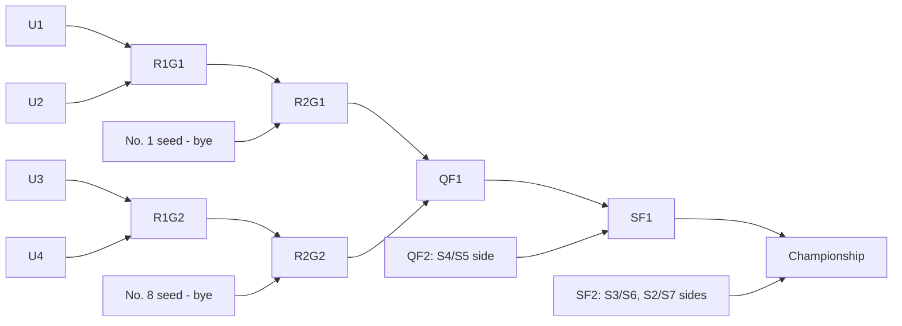
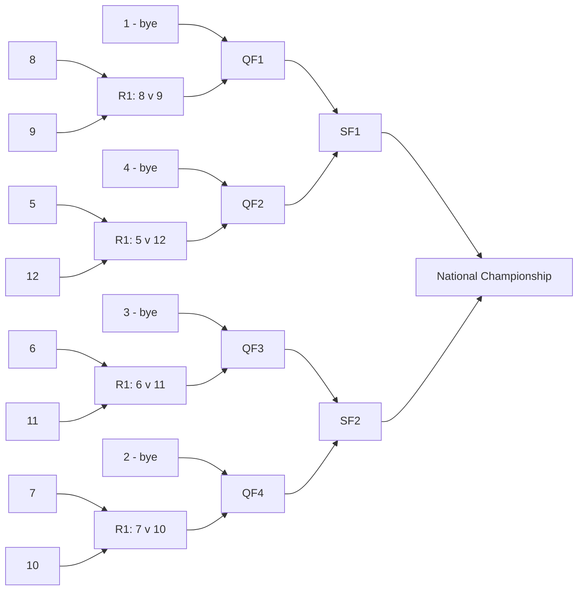

## Appendix A: Bracket templates

### A.1 FCS 24 (`fcs24`): 24 teams, 23 games, 8 byes

| Round | Games | Standard points | Round total |
|---|---|---|---|
| First round | 8 | 10 | 80 |
| Second round (seeds enter) | 8 | 20 | 160 |
| Quarterfinals | 4 | 40 | 160 |
| Semifinals | 2 | 80 | 160 |
| Championship | 1 | 160 | 160 |
| **Total** | **23** | | **720** |

### A.2 CFP 12 (`cfp12`): 12 teams, 11 games, 4 byes

| Round | Games | Balanced points | Round total |
|---|---|---|---|
| First round | 4 | 40 | 160 |
| Quarterfinals | 4 | 40 | 160 |
| Semifinals | 2 | 80 | 160 |
| Championship | 1 | 160 | 160 |
| **Total** | **11** | | **640** |

### A.3 D-II 28 (`d2_28`): 4 super regions × 7, 27 games, 4 byes

Per region: 4v5, 3v6, 2v7 in round 1; No. 1 plays the 4/5 winner and the 2/7 winner plays the 3/6 winner in round 2; regional final is the national quarterfinal.

| Round | Games | Standard points | Round total |
|---|---|---|---|
| First round | 12 | 10 | 120 |
| Second round | 8 | 20 | 160 |
| Quarterfinals (regional finals) | 4 | 40 | 160 |
| Semifinals | 2 | 80 | 160 |
| Championship | 1 | 160 | 160 |
| **Total** | **27** | | **760** |

### A.4 D-III 32 (`d3_32`): 32 teams, 31 games, no byes

| Round | Games | Standard points | Round total |
|---|---|---|---|
| First round | 16 | 10 | 160 |
| Second round | 8 | 20 | 160 |
| Quarterfinals | 4 | 40 | 160 |
| Semifinals | 2 | 80 | 160 |
| Stagg Bowl | 1 | 160 | 160 |
| **Total** | **31** | | **800** |

### A.5 NCAA basketball 68 (`ncaab68`): First Four + 64

| Round | Games | Suggested points | Round total |
|---|---|---|---|
| First Four (optional, default unscored) | 4 | 0 | 0 |
| Round of 64 | 32 | 10 | 320 |
| Round of 32 | 16 | 20 | 320 |
| Sweet 16 | 8 | 40 | 320 |
| Elite Eight | 4 | 80 | 320 |
| Final Four | 2 | 160 | 320 |
| Championship | 1 | 320 | 320 |
| **Total** | **67** | | **1,920** |

### A.6 Engine invariants (tested for every format)

1. `games.length === team_count - 1` (single elimination).
2. Every slot feeds exactly one game; every non-final game feeds exactly one later game.
3. Following `winnerOf` links from any game reaches `finalGame`.
4. Round numbers strictly increase along feeds.
5. Seeded byes appear only as `slot` sides in round 2 (FCS, CFP, D-II).
6. Max score equals the table above for its default scoring config.
